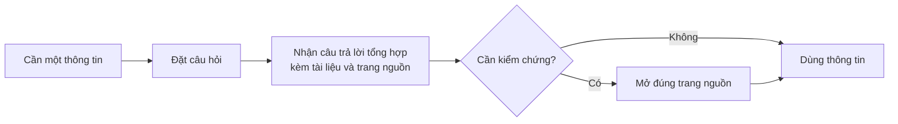

# Business Requirements Document — Chat với tài liệu (tên tạm)

> **TRẠNG THÁI: DRAFT v0.3, chưa được BA xác nhận, chưa đủ điều kiện phê duyệt**
>
> Tài liệu dựa trên bối cảnh giả định ở Mục 2.1 của prompt (SRC-001). Nội dung có hai loại nguồn:
> - **SRC-001**: lấy trực tiếp từ yêu cầu của quản lý.
> - **`[Đề xuất]`**: phương án agent đề xuất để BA chấp nhận hoặc bác bỏ. Không được coi là quyết định đã chốt.
>
> Số liệu chưa có thì ghi `[TBD: OQ-xxx]`.

### Các mục chặn việc phê duyệt

| ID | Nội dung cần có | Mục bị chặn |
|---|---|---|
| OQ-001 | Tên chính thức của dự án | 1, 14 |
| OQ-002 | Nhà tài trợ và đơn vị cấp ngân sách | 1, 6, 14 |
| OQ-003 | Người review và phê duyệt BRD | 1, 14 |
| OQ-004 | Số liệu hiện trạng về thời gian tìm thông tin | 3, 4 |
| OQ-008 | Mức độ bảo mật của tài liệu; có được phép cho dịch vụ AI xử lý không | 9, 10 |
| OQ-017 | Xác nhận các chỉ số và mục tiêu `[Đề xuất]` (M-001 → M-003) | 4 |
| OQ-018 | Xác nhận các yêu cầu `[Đề xuất]` (BR-004 → BR-014) và mức ưu tiên | 5, 7 |

---

## 1. Document control

| Trường | Giá trị |
|---|---|
| Tiêu đề | Business Requirements Document — Chat với tài liệu `[TBD: OQ-001]` |
| Số tài liệu | BRD-001 |
| Phiên bản | 0.3 |
| Trạng thái | Draft |
| Tác giả | AI Requirements Elicitation Agent |
| Người đóng góp | BA (người cung cấp SRC-001) |
| Người review | `[TBD: OQ-003]` |
| Người phê duyệt | `[TBD: OQ-003]` |
| Mức độ bảo mật | Nội bộ |
| Cơ sở | Bối cảnh giả định (SRC-001) |

**Lịch sử phiên bản**

| Phiên bản | Ngày | Tác giả | Thay đổi |
|---|---|---|---|
| 0.1 | 2026-10-19 | AI Elicitation Agent | Bản nháp đầu tiên, chỉ có nội dung SRC-001, các phần còn lại để `[TBD]` |
| 0.2 | 2026-10-19 | AI Elicitation Agent | Viết lại theo prompt đã cập nhật: thêm chỉ số, yêu cầu, quy tắc, rủi ro `[Đề xuất]`. Giữ nguyên các ID của v0.1 |
| 0.3 | 2026-10-19 | AI Elicitation Agent | Review theo BRD_IEEE_29148_Checklist.xlsx: thêm tuyên bố tầm nhìn, kịch bản sử dụng (UC-01 → UC-06), hồ sơ người dùng, BR-014 (tính sẵn sàng), phương án dự phòng rủi ro, OQ-020 → OQ-022; viết lại BR-012 cho rõ một đối tượng |

---

## 2. Executive summary

**Tuyên bố tầm nhìn** `[Đề xuất]`: *Mọi thành viên đội BD có được thông tin chính xác, có dẫn nguồn, từ toàn bộ tài liệu của dự án chỉ bằng một câu hỏi, để dành thời gian cho việc phát triển kinh doanh thay vì tìm tài liệu.*

**Vấn đề kinh doanh.** Đội phát triển kinh doanh (BD) làm việc với nhiều tài liệu PDF và khó nắm hết nội dung. Mỗi lần cần một thông tin, họ phải tự tìm và tổng hợp từ nhiều file, rất mất thời gian (SRC-001). Mức thời gian đang mất: `[TBD: OQ-004]`.

**Thay đổi đề xuất.** Xây một MVP "Chat với tài liệu" (SRC-001). Đội BD đưa tài liệu PDF vào, đặt câu hỏi bằng ngôn ngữ thường ngày, và nhận câu trả lời tổng hợp từ các tài liệu đó, có ghi rõ nguồn (BR-007, `[Đề xuất]`).

**Lợi ích kỳ vọng và cách đo** `[Đề xuất]`, chờ OQ-017:

| Mục tiêu | Chỉ số | Mục tiêu đề xuất |
|---|---|---|
| BO-001: giảm thời gian tìm thông tin | M-001 | Giảm ≥ 50% so với hiện trạng, đo 4 tuần sau khi đưa vào dùng |
| BO-002: thông tin tra được đáng tin cậy | M-002 | ≥ 80% câu trả lời đúng và có dẫn nguồn trên bộ câu hỏi kiểm thử |
| BO-003: đội BD thực sự dùng công cụ | M-003 | ≥ 60% thành viên BD dùng ít nhất 1 lần mỗi tuần sau 4 tuần |

**Đầu tư và thời gian.** `[TBD: OQ-012]`.

**Rủi ro chính.**
- Tài liệu mật bị đưa ra bên ngoài (R-001).
- AI trả lời sai hoặc bịa thông tin (R-004).
- Phạm vi MVP phình to (R-002).
- Chưa có số liệu hiện trạng để chứng minh lợi ích (R-003).

**Quyết định cần có.** BA xác nhận các nội dung `[Đề xuất]` (OQ-017, OQ-018) và chỉ định người phê duyệt (OQ-003). Sau đó tài liệu chuyển sang trạng thái *In review*.

---

## 3. Business context and problem statement

### 3.1 Quy trình hiện tại

Theo SRC-001. Chi tiết từng bước chờ BA xác nhận (Q-101).

### 3.2 Quy trình mong muốn `[Đề xuất]`

### 3.2a Kịch bản sử dụng chính `[Đề xuất]`

| ID | Kịch bản | Người thực hiện | Kết quả mong đợi | Yêu cầu liên quan |
|---|---|---|---|---|
| UC-01 | Đưa bộ tài liệu của một dự án vào để tra cứu | Thành viên BD | Tài liệu sẵn sàng tra cứu; được báo nếu file không đọc được | BR-001, BR-006 |
| UC-02 | Hỏi một thông tin nằm rải rác trong nhiều file, ví dụ "Các điều khoản thanh toán của khách hàng X trong các hợp đồng đã ký?" | Thành viên BD | Câu trả lời tổng hợp, ghi rõ tài liệu và trang nguồn | BR-002, BR-003, BR-007, BR-009 |
| UC-03 | Hỏi một thông tin không có trong tài liệu | Thành viên BD | Được báo rõ là không tìm thấy, không có câu trả lời bịa | BR-008 |
| UC-04 | Gỡ một tài liệu đã lỗi thời | Thành viên BD | Tài liệu không còn được dùng cho câu trả lời mới | BR-004, BR-005 |
| UC-05 | Chuẩn bị bộ câu hỏi kiểm thử và chấm kết quả để nghiệm thu | Trưởng nhóm BD | Có số liệu M-002 để quyết định nghiệm thu | DEP-003, AC-003, AC-007, AC-008 |
| UC-06 | Theo dõi mức sử dụng và lợi ích sau khi đưa vào dùng | Quản lý | Có số liệu M-001, M-003 để quyết định đầu tư tiếp | SN-002 |

### 3.3 Ai bị ảnh hưởng và như thế nào

| Nhóm | Ảnh hưởng | Nguồn |
|---|---|---|
| Đội BD (SH-001) | Mất thời gian tổng hợp thông tin từ nhiều PDF; khó nắm hết nội dung | SRC-001 |
| Quản lý (SH-002) | Năng suất đội BD bị giảm do thời gian tra cứu | `[Đề xuất]`, suy ra từ SRC-001 |

### 3.4 Chi phí nếu không làm gì

`[TBD: OQ-004]`. Cách tính đề xuất: *số giờ tra cứu mỗi tuần mỗi người × số người BD × 52 tuần × chi phí mỗi giờ*.

### 3.5 Nguyên nhân gốc và triệu chứng

| Loại | Nội dung | Nguồn |
|---|---|---|
| Triệu chứng | Tốn thời gian tìm một thông tin | SRC-001 |
| Triệu chứng | Khó nắm bắt đầy đủ nội dung tài liệu | SRC-001 |
| Nguyên nhân gốc | Thông tin cần cho một câu hỏi nằm rải rác ở nhiều file. Hiện không có cách tra cứu xuyên suốt các file đó | `[Đề xuất]` (ASM-001) |
| Nguyên nhân gốc | Khối lượng tài liệu vượt quá khả năng đọc và ghi nhớ của từng người | `[Đề xuất]` (ASM-001) |

### 3.6 Vì sao làm lúc này

`[TBD: Q-001]`. SRC-001 chỉ nêu đây là yêu cầu từ quản lý.

---

## 4. Business drivers and objectives

| BO ID | Động lực | Mục tiêu (kết quả) | Metric ID | Hiện trạng | Mục tiêu | Thời hạn | Nguồn |
|---|---|---|---|---|---|---|---|
| BO-001 | Năng suất đội BD | Giảm thời gian đội BD cần để có được một thông tin từ tài liệu | M-001 | `[TBD: OQ-004]` | Giảm ≥ 50% `[Đề xuất]` | 4 tuần sau khi đưa vào dùng `[Đề xuất]` | SRC-001; mục tiêu: `[Đề xuất]` |
| BO-002 | Chất lượng thông tin dùng trong công việc BD | Thông tin tra được là đúng và kiểm chứng được | M-002 | Không áp dụng (chưa có công cụ) | ≥ 80% `[Đề xuất]` | Khi nghiệm thu MVP `[Đề xuất]` | SRC-001 ("khó nắm bắt đầy đủ"); `[Đề xuất]` |
| BO-003 | Chứng minh giá trị của MVP | Đội BD thực sự dùng công cụ trong công việc hằng ngày | M-003 | 0% | ≥ 60% `[Đề xuất]` | 4 tuần sau khi đưa vào dùng `[Đề xuất]` | `[Đề xuất]` |

### 4.1 Định nghĩa chỉ số

| Metric ID | Tên | Công thức | Nguồn dữ liệu | Người sở hữu | Tần suất | Ngày đo hiện trạng |
|---|---|---|---|---|---|---|
| M-001 | Thời gian có được thông tin | Trung bình số phút từ lúc bắt đầu tìm đến lúc có câu trả lời dùng được, trên bộ 20 câu hỏi điển hình của đội BD | Đo thử có bấm giờ trước và sau MVP | Trưởng nhóm BD `[TBD: OQ-002]` | Trước khi đưa vào dùng và 4 tuần sau | `[TBD: OQ-004]` |
| M-002 | Tỉ lệ câu trả lời đúng có dẫn nguồn | Số câu trả lời được đánh giá đúng **và** có dẫn đúng nguồn ÷ tổng số câu trong bộ câu hỏi kiểm thử × 100% | Bộ câu hỏi kiểm thử (DEP-003), do người của đội BD chấm | Trưởng nhóm BD | Khi nghiệm thu và sau mỗi lần thay đổi lớn | Không áp dụng |
| M-003 | Tỉ lệ sử dụng hằng tuần | Số thành viên BD đặt ≥ 1 câu hỏi trong tuần ÷ tổng số thành viên BD × 100% | Thống kê sử dụng của công cụ | Quản lý (SH-002) | Hằng tuần | Ngày đưa vào dùng (0%) |

### 4.2 Những điều không phải mục tiêu `[Đề xuất]`

- Thay thế hệ thống lưu trữ tài liệu hiện có.
- Tự động tạo báo cáo hoặc tài liệu mới.
- Thay thế việc người dùng tự đánh giá và quyết định dựa trên thông tin.

---

## 5. Scope

### 5.1 Trong phạm vi MVP

| # | Hạng mục | Nguồn |
|---|---|---|
| S-01 | Đưa tài liệu PDF dạng văn bản vào để tra cứu | SRC-001 |
| S-02 | Hỏi đáp về nội dung tất cả tài liệu đã đưa vào | SRC-001 |
| S-03 | Câu trả lời có dẫn tài liệu và trang nguồn | `[Đề xuất]` |
| S-04 | Báo rõ khi tài liệu không có thông tin được hỏi | `[Đề xuất]` |
| S-05 | Xem danh sách và gỡ bỏ tài liệu | `[Đề xuất]` |
| S-06 | Chỉ thành viên đội BD được truy cập | `[Đề xuất]` |
| S-07 | Người dùng: đội BD. Truy cập qua trình duyệt web | SRC-001 |

### 5.2 Ngoài phạm vi `[Đề xuất]`

| Hạng mục | Lý do |
|---|---|
| Ứng dụng di động riêng | CON-001 quy định hình thức ứng dụng web |
| Chỉnh sửa nội dung tài liệu | Mục tiêu là tra cứu, không phải biên tập |
| Tự động tạo báo cáo hoặc tài liệu mới | Không gắn với BO-001 → BO-003 |
| Người dùng ngoài đội BD | MVP chỉ phục vụ đội BD (SRC-001) |

### 5.3 Để giai đoạn sau `[Đề xuất]`

| Hạng mục | Lý do để sau |
|---|---|
| Đọc PDF dạng ảnh scan | Cần xác nhận tỉ lệ file scan trước (ASM-003, OQ-019) |
| Định dạng khác: Word, Excel, PowerPoint | CON-002 giới hạn MVP ở PDF |
| Kết nối với kho tài liệu hiện có | Cần biết hệ thống hiện có (Q-305) |
| Phân quyền theo từng tài liệu (BR-013) | MVP chỉ giới hạn ở mức cả đội BD |
| Chỉ hỏi trong một nhóm tài liệu được chọn (BR-011) | Chưa cần khi số tài liệu còn ít |

### 5.4 Ranh giới

Dự án bắt đầu từ lúc người dùng đưa file PDF vào và kết thúc khi người dùng nhận được câu trả lời có dẫn nguồn. Việc thu thập, tạo mới hay lưu trữ chính thức các tài liệu gốc không thuộc dự án này.

---

## 6. Stakeholders and needs

### 6.1 Bên liên quan

| ID | Nhóm | Vai trò | Quan tâm | Ảnh hưởng | Nguồn |
|---|---|---|---|---|---|
| SH-001 | Đội phát triển kinh doanh (BD) | Người dùng chính | Có thông tin nhanh và đúng | Cao (quyết định có dùng hay không) | SRC-001 |
| SH-002 | Quản lý | Người yêu cầu, có thể là nhà tài trợ `[TBD: OQ-002]` | MVP chứng minh được giá trị | Cao | SRC-001 |
| SH-003 | Đội BA | Phân tích yêu cầu, đề xuất tính năng | Yêu cầu rõ ràng, có căn cứ | Trung bình | SRC-001 |
| SH-004 | Đội phát triển | Xây dựng MVP | Yêu cầu kiểm chứng được, phạm vi ổn định | Trung bình | SRC-001 |
| SH-005 | IT / Bảo mật thông tin | Có thể chặn nếu vi phạm quy định | Tài liệu nội bộ không bị lộ | Cao (có thể chặn dự án) | `[Đề xuất]`, chờ OQ-005 |

### 6.2 Nhu cầu

| SN ID | Bên liên quan | Nhu cầu | Khó khăn hiện tại | Bằng chứng | Ưu tiên |
|---|---|---|---|---|---|
| SN-001 | SH-001 | Có được thông tin cần thiết mà không phải tự tổng hợp từ nhiều PDF | Tốn thời gian, khó nắm hết | SRC-001 | Cao |
| SN-002 | SH-002 | Đo được giá trị của MVP trước khi quyết định đầu tư tiếp | Chưa có số liệu | `[Đề xuất]` | Cao |
| SN-003 | SH-003 | Mọi tính năng đề xuất đều gắn với mục tiêu kinh doanh | SRC-001 để ngỏ phần tính năng | SRC-001 | Trung bình |
| SN-004 | SH-004 | Mỗi yêu cầu có tiêu chí nghiệm thu đo được | Chưa có | `[Đề xuất]` | Trung bình |
| SN-005 | SH-001 | Kiểm chứng được câu trả lời đến từ tài liệu nào, trang nào | Phải đọc lại toàn bộ file | `[Đề xuất]` | Cao |
| SN-006 | SH-001 | Tự quản lý được tập tài liệu đang dùng để tra cứu | Chưa có | `[Đề xuất]` | Trung bình |
| SN-007 | SH-005 | Chỉ người được phép mới truy cập được tài liệu | Chưa có | `[Đề xuất]` | Cao |

### 6.3 Hồ sơ người dùng `[Đề xuất]`, chờ OQ-009

| Nhóm người dùng | Vai trò nghiệp vụ | Bối cảnh sử dụng | Mức chuyên môn | Tần suất dùng dự kiến |
|---|---|---|---|---|
| Thành viên BD | Tìm thông tin trong tài liệu để chuẩn bị đề xuất, trả lời khách hàng, đàm phán | Trên máy tính ở văn phòng, qua trình duyệt web (CON-001) | Hiểu sâu nghiệp vụ; không chuyên kỹ thuật, không cần đào tạo về AI | Nhiều lần mỗi ngày |
| Trưởng nhóm BD | Chuẩn bị bộ câu hỏi kiểm thử, nghiệm thu, hướng dẫn đội | Như trên | Hiểu sâu nghiệp vụ và nội dung tài liệu | Theo đợt nghiệm thu, hằng tuần |
| Quản lý | Theo dõi giá trị của MVP | Xem số liệu tổng hợp | Nghiệp vụ, quản lý | Hằng tuần |

SN-003 và SN-004 là nhu cầu về cách làm dự án, không sinh ra yêu cầu nghiệp vụ. Chúng được đáp ứng bằng chính cấu trúc của BRD này (truy vết ở Mục 11, tiêu chí nghiệm thu ở Mục 7). Việc không có BR cho hai nhu cầu này là có chủ đích.

---

## 7. Business requirements

**Quy ước:**
- Ưu tiên: Must (bắt buộc cho MVP), Should (nên có), Could (có thể có), Won't (không làm trong MVP).
- Trạng thái: *Proposed* (chờ BA xác nhận) hoặc *Blocked* (bị chặn bởi OQ ghi kèm).
- Các con số trong tiêu chí nghiệm thu đều là `[Đề xuất]` và chờ OQ-017 / OQ-018.

### 7.1 Năng lực A: Quản lý tài liệu

| ID | Yêu cầu (shall) | Lý do | Nguồn | Ưu tiên | Tiêu chí nghiệm thu | Kiểm chứng | Trạng thái |
|---|---|---|---|---|---|---|---|
| BR-001 | A BD team member shall be able to add a text-based PDF document of up to 50 MB to the set of documents available for querying. *(Thành viên BD đưa được file PDF dạng văn bản, tối đa 50 MB, vào tập tài liệu tra cứu.)* | Tài liệu phải được đưa vào thì mới hỏi được | SRC-001; SN-001 | Must | **AC-001:** một file PDF 50 MB, 300 trang có thể được tra cứu chậm nhất 5 phút sau khi đưa vào | Test | Proposed (OQ-009) |
| BR-004 | A BD team member shall be able to view the list of documents currently available for querying. *(Xem được danh sách tài liệu đang có.)* | Biết câu trả lời dựa trên những tài liệu nào | CAND-03; SN-006 | Should | **AC-004:** danh sách hiển thị đúng 100% tài liệu đã đưa vào, có tên file và ngày đưa vào | Demonstration | Proposed (OQ-018) |
| BR-005 | A BD team member shall be able to remove a document so that it is no longer used in any new answer. *(Gỡ được tài liệu; tài liệu đã gỡ không được dùng cho câu trả lời mới.)* | Loại bỏ tài liệu lỗi thời hoặc đưa nhầm | CAND-03; SN-006 | Should | **AC-005:** sau khi gỡ, 0/10 câu hỏi về nội dung chỉ có trong tài liệu đó nhận được câu trả lời trích từ nó | Test | Proposed (OQ-018) |
| BR-006 | The user shall be informed when an added PDF contains no readable text. *(Người dùng được báo khi file PDF không đọc được chữ, ví dụ file scan.)* | Tránh người dùng tưởng tài liệu đã được tra cứu | ASM-003; SN-001 | Should | **AC-006:** 10/10 file PDF dạng ảnh scan trong bộ kiểm thử đều có thông báo | Test | Proposed (OQ-019) |

### 7.2 Năng lực B: Hỏi đáp trên tài liệu

| ID | Yêu cầu (shall) | Lý do | Nguồn | Ưu tiên | Tiêu chí nghiệm thu | Kiểm chứng | Trạng thái |
|---|---|---|---|---|---|---|---|
| BR-002 | A BD team member shall be able to ask a question in natural language about the content of the added documents. *(Đặt được câu hỏi bằng ngôn ngữ thường ngày về nội dung tài liệu.)* | Thay việc tự đọc và tìm | SRC-001; SN-001; BO-001 | Must | **AC-002:** đặt và nhận được câu trả lời cho câu hỏi bằng tiếng Việt và bằng tiếng Anh | Demonstration | Blocked (OQ-014) |
| BR-003 | The answer to a question shall draw on the content of all added documents relevant to that question. *(Câu trả lời tổng hợp từ mọi tài liệu liên quan, không chỉ một file.)* | Vấn đề gốc là thông tin rải rác ở nhiều file | SRC-001; SN-001; BO-001, BO-002 | Must | **AC-003:** trên 15 câu hỏi kiểm thử cần thông tin từ ≥ 2 tài liệu, ≥ 80% câu trả lời được người của BD chấm là đúng và đủ | Test (bộ câu hỏi kiểm thử) | Proposed (OQ-017) |
| BR-007 | Each answer shall identify the document and page from which its information was taken. *(Mỗi câu trả lời ghi rõ tài liệu và trang nguồn.)* | Kiểm chứng mà không phải đọc lại cả file; giảm rủi ro R-004 | CAND-01; SN-005; BO-002 | Must | **AC-007:** 100% câu trả lời có thông tin đều dẫn ≥ 1 tài liệu và trang. Kiểm tra mẫu 30 trích dẫn: ≥ 90% trỏ đúng trang chứa thông tin | Test, Inspection | Proposed (OQ-018) |
| BR-008 | When the added documents do not contain the requested information, the answer shall state that the information was not found. *(Khi tài liệu không có thông tin, câu trả lời phải nói rõ là không tìm thấy.)* | Tránh câu trả lời bịa; giảm rủi ro R-004 | CAND-02; SN-005; BO-002 | Must | **AC-008:** trên 10 câu hỏi kiểm thử mà tài liệu không có câu trả lời, ≥ 9 câu nhận được thông báo "không tìm thấy" | Test | Proposed (OQ-018) |
| BR-009 | An answer shall be returned within 30 seconds of the question being asked for at least 95% of questions. *(Có câu trả lời trong vòng 30 giây cho ≥ 95% câu hỏi.)* | Đạt được BO-001; người dùng không bỏ dùng vì chờ lâu | BO-001, BO-003 | Should | **AC-009:** đo trên 100 câu hỏi: ≥ 95 câu có câu trả lời trong ≤ 30 giây | Test | Proposed (OQ-017) |
| BR-010 | A BD team member shall be able to review the questions and answers of their current conversation. *(Xem lại được các câu hỏi và câu trả lời trong cuộc hội thoại hiện tại.)* | Không phải hỏi lại | CAND-05; SN-001 | Could | **AC-010:** sau 10 lượt hỏi đáp, cả 10 cặp câu hỏi và câu trả lời đều xem lại được | Demonstration | Proposed (OQ-018) |
| BR-011 | A BD team member shall be able to restrict a question to a selected subset of the added documents. *(Giới hạn câu hỏi trong một nhóm tài liệu được chọn.)* | Thu hẹp phạm vi khi có nhiều dự án | CAND-04; SN-001 | Won't (MVP) | Không áp dụng trong MVP | — | Deferred |

### 7.3 Năng lực C: Kiểm soát truy cập

| ID | Yêu cầu (shall) | Lý do | Nguồn | Ưu tiên | Tiêu chí nghiệm thu | Kiểm chứng | Trạng thái |
|---|---|---|---|---|---|---|---|
| BR-012 | Access to the tool shall be limited to authorised BD team members. *(Chỉ thành viên BD được cấp quyền mới truy cập được công cụ, bao gồm tài liệu và hỏi đáp.)* | Bảo vệ tài liệu nội bộ (R-001) | CAND-06; SN-007; RUL-001 | Must | **AC-012:** 100% lần truy cập thử bằng tài khoản không được cấp quyền đều bị từ chối | Test | Blocked (OQ-008) |
| BR-013 | Access to each document shall be restrictable to named users. *(Phân quyền theo từng tài liệu.)* | Một số tài liệu chỉ dành cho một số người | CAND-06; SN-007 | Won't (MVP) | Không áp dụng trong MVP | — | Deferred |

### 7.4 Năng lực D: Tính sẵn sàng cho công việc

Đây là kỳ vọng ở mức kinh doanh. MVP nội bộ không có cam kết hợp đồng về thời gian hoạt động hay thời gian khôi phục (OQ-020). Mục tiêu kỹ thuật chi tiết thuộc PRD/SAD.

| ID | Yêu cầu (shall) | Lý do | Nguồn | Ưu tiên | Tiêu chí nghiệm thu | Kiểm chứng | Trạng thái |
|---|---|---|---|---|---|---|---|
| BR-014 | The tool shall be available to BD team members during business hours (08:00–18:00, Monday to Friday) on at least 95% of working days. *(Công cụ dùng được trong giờ làm việc ở ít nhất 95% số ngày làm việc.)* | Đội BD không dùng công cụ thường xuyên được nếu nó hay gián đoạn (BO-003) | BO-003; SN-001 | Should | **AC-014:** trong 4 tuần đầu sau khi đưa vào dùng, số ngày làm việc có gián đoạn trong giờ làm việc ≤ 5% | Analysis (thống kê vận hành) | Proposed (OQ-020) |

**Tổng hợp theo ưu tiên:** Must 6 (BR-001, 002, 003, 007, 008, 012) · Should 5 (BR-004, 005, 006, 009, 014) · Could 1 (BR-010) · Won't 2 (BR-011, 013).

---

## 8. Business rules

| ID | Quy tắc | Loại | Phạm vi | Người chịu trách nhiệm | Nguồn |
|---|---|---|---|---|---|
| RUL-001 | Chỉ thành viên đội BD được cấp quyền mới truy cập tài liệu đã đưa vào | Chính sách nội bộ | Toàn bộ MVP | Quản lý (SH-002) | `[Đề xuất]`, chờ OQ-008 |
| RUL-002 | Câu trả lời chỉ dựa trên nội dung các tài liệu đã đưa vào; không dùng nguồn bên ngoài để khẳng định thông tin | Chính sách nội bộ | Chức năng hỏi đáp | Quản lý (SH-002) | `[Đề xuất]` |
| RUL-003 | Tài liệu đã gỡ bỏ không được dùng cho bất kỳ câu trả lời mới nào | Chính sách nội bộ | Quản lý tài liệu | Quản lý (SH-002) | `[Đề xuất]` |
| RUL-004 | Thời gian lưu giữ tài liệu đã đưa vào: `[TBD: OQ-016]` | Chính sách nội bộ hoặc pháp lý `[TBD]` | Quản lý tài liệu | `[TBD: OQ-016]` | — |

---

## 9. Constraints

| ID | Ràng buộc | Loại | Do ai đặt ra | Tác động | Nguồn |
|---|---|---|---|---|---|
| CON-001 | Giải pháp là ứng dụng web | Giải pháp | Quản lý (SH-002) | Người dùng truy cập qua trình duyệt; không làm ứng dụng di động riêng | SRC-001 |
| CON-002 | Định dạng tài liệu đầu vào là PDF | Phạm vi dữ liệu | Quản lý (SH-002) | Các định dạng khác để giai đoạn sau | SRC-001 |
| CON-003 | Tra cứu bằng hình thức hội thoại với AI | Giải pháp | Quản lý (SH-002) | Cần dịch vụ AI (DEP-001); kéo theo rủi ro R-004 và R-006 | SRC-001 |
| CON-004 | Phạm vi ở mức MVP | Phạm vi | Quản lý (SH-002) | Chỉ làm các yêu cầu Must và Should; ngân sách và thời gian `[TBD: OQ-012]` | SRC-001 |
| CON-005 | Tài liệu đưa vào không được dùng để huấn luyện mô hình AI của bên thứ ba | Bảo mật | IT / Bảo mật (SH-005) | Hạn chế việc chọn nhà cung cấp dịch vụ AI | `[Đề xuất]`, chờ OQ-008 |

OQ-013 sẽ xác nhận CON-001 → CON-004 là ràng buộc thật hay chỉ là mong muốn.

---

## 10. Assumptions, dependencies, and risks

| ID | Hạng mục | Loại | Mô tả | Tác động nếu sai | Người chịu trách nhiệm | Kiểm chứng / giảm thiểu | Hạn |
|---|---|---|---|---|---|---|---|
| ASM-001 | Vấn đề chính | Giả định | Vấn đề chính là thời gian tổng hợp thông tin rải rác ở nhiều file | BO-001 đo sai thứ cần đo | BA | Phỏng vấn 3–5 thành viên BD (Q-101 → Q-105) | 2026-10-26 |
| ASM-002 | Bối cảnh | Giả định | Đây là bối cảnh giả định (SRC-001) | Số liệu phải lấy từ nguồn thật | BA | OQ-006 | 2026-10-26 |
| ASM-003 | Loại file | Giả định | Phần lớn PDF của đội BD là dạng văn bản, không phải ảnh scan | BR-001 không đáp ứng được SN-001 | BA | Lấy mẫu 20 file PDF thực tế (OQ-019) | 2026-11-02 |
| ASM-004 | Quy mô | Giả định | MVP phục vụ ≤ 30 người dùng và ≤ 500 tài liệu | Ảnh hưởng BR-009 và chi phí (R-006) | BA | OQ-009 | 2026-11-02 |
| ASM-005 | Ngôn ngữ | Giả định | Tài liệu và câu hỏi bằng tiếng Việt và tiếng Anh | Ảnh hưởng AC-002 | BA | OQ-014 | 2026-11-02 |
| DEP-001 | Dịch vụ AI | Phụ thuộc | Cần một dịch vụ AI xử lý được ngôn ngữ tự nhiên, đáp ứng CON-005 | Không có lõi hỏi đáp | Đội phát triển (SH-004) | Đánh giá ≥ 2 phương án so với CON-005 | `[TBD: OQ-012]` |
| DEP-002 | Tài khoản người dùng | Phụ thuộc | IT cấp cách xác thực thành viên BD | BR-012 không thực hiện được | IT (SH-005) | Thống nhất với IT trước khi phát triển | `[TBD: OQ-005]` |
| DEP-003 | Bộ kiểm thử | Phụ thuộc | Đội BD cung cấp bộ tài liệu mẫu và bộ câu hỏi kiểm thử có đáp án (gồm cả câu không có đáp án trong tài liệu) | Không đo được M-002 và các AC-003, 007, 008 | Trưởng nhóm BD | Yêu cầu bộ kiểm thử trước khi nghiệm thu | 2026-11-09 |
| R-001 | Bảo mật tài liệu | Rủi ro (cao) | Tài liệu nội bộ hoặc tài liệu theo hợp đồng bị đưa ra dịch vụ bên ngoài | Vi phạm quy định, có thể dừng dự án | IT / Bảo mật (SH-005) | Làm rõ OQ-008; áp dụng CON-005, BR-012 | 2026-11-02 |
| R-002 | Phạm vi phình to | Rủi ro (trung bình) | Tính năng do BA đề xuất làm MVP mất ranh giới | Trễ hạn, vượt ngân sách | BA | Chỉ làm Must và Should; mọi bổ sung phải qua OQ-018 | Liên tục |
| R-003 | Không chứng minh được lợi ích | Rủi ro (cao) | Chưa có số liệu hiện trạng cho M-001 | Không đánh giá được MVP | BA | Đo thử có bấm giờ trước khi đưa vào dùng (OQ-004) | 2026-10-26 |
| R-004 | AI trả lời sai hoặc bịa | Rủi ro (cao) | Người dùng ra quyết định dựa trên thông tin không đúng | Mất niềm tin, sai sót trong công việc BD | Đội phát triển (SH-004) | BR-007, BR-008, RUL-002; đo M-002 | Khi nghiệm thu |
| R-005 | Ít người dùng | Rủi ro (trung bình) | Đội BD không thay đổi thói quen | Không đạt BO-003 | Quản lý (SH-002) | Hướng dẫn sử dụng; theo dõi M-003 hằng tuần | 4 tuần sau khi đưa vào dùng |
| R-006 | Chi phí dịch vụ AI | Rủi ro (trung bình) | Chi phí theo lượng sử dụng vượt dự kiến | Vượt ngân sách | Quản lý (SH-002) | Ước tính chi phí theo ASM-004; theo dõi hằng tháng | `[TBD: OQ-012]` |

### 10.1 Phương án dự phòng cho rủi ro cao `[Đề xuất]`

| Rủi ro | Dấu hiệu cảnh báo sớm | Phương án dự phòng nếu rủi ro xảy ra |
|---|---|---|
| R-001 | IT / Bảo mật không cho phép đưa tài liệu ra dịch vụ AI bên ngoài (OQ-008) | Đánh giá dịch vụ AI chạy trong hạ tầng nội bộ; hoặc giới hạn MVP chỉ dùng tài liệu không mật |
| R-003 | Đến 2026-10-26 chưa đo được hiện trạng | Dùng ước tính do thành viên BD tự khai qua khảo sát ngắn, gắn nhãn `[Unverified]` và đo lại sau |
| R-004 | M-002 dưới 80% khi nghiệm thu | Không mở rộng; giữ ở mức thử nghiệm và bắt buộc người dùng mở trang nguồn (BR-007) trước khi dùng thông tin |

---

## 11. Traceability

| Mục tiêu | Nhu cầu | Yêu cầu | Tiêu chí nghiệm thu | ID ở PRD/SRS |
|---|---|---|---|---|
| BO-001 | SN-001 | BR-001 | AC-001 | `[TBD]` |
| BO-001 | SN-001 | BR-002 | AC-002 | `[TBD]` |
| BO-001, BO-002 | SN-001 | BR-003 | AC-003 | `[TBD]` |
| BO-001 | SN-006 | BR-004 | AC-004 | `[TBD]` |
| BO-002 | SN-006 | BR-005 | AC-005 | `[TBD]` |
| BO-001 | SN-001 | BR-006 | AC-006 | `[TBD]` |
| BO-002 | SN-005 | BR-007 | AC-007 | `[TBD]` |
| BO-002 | SN-005 | BR-008 | AC-008 | `[TBD]` |
| BO-001, BO-003 | SN-001 | BR-009 | AC-009 | `[TBD]` |
| BO-001 | SN-001 | BR-010 | AC-010 | `[TBD]` |
| BO-001 | SN-001 | BR-011 | Không áp dụng (Won't) | — |
| BO-003 | SN-007 | BR-012 | AC-012 | `[TBD]` |
| BO-003 | SN-007 | BR-013 | Không áp dụng (Won't) | — |
| BO-003 | SN-001 | BR-014 | AC-014 | `[TBD]` |
| BO-003 | SN-002 | (đo bằng M-003, không cần BR riêng) | — | — |

BR-012 được gắn với BO-003 vì nếu không được IT cho phép (R-001), công cụ sẽ không thể đưa vào dùng.

**Độ bao phủ**
- Yêu cầu mồ côi (không gắn mục tiêu): không có.
- Mục tiêu chưa có yêu cầu: không có.
- Nhu cầu chưa có yêu cầu: SN-002 (đáp ứng bằng M-003), SN-003 và SN-004 (nhu cầu về cách làm dự án). Cả ba đều có chủ đích.
- Yêu cầu Must/Should/Could chưa có tiêu chí nghiệm thu: không có.
- Yêu cầu chưa có phương pháp kiểm chứng: không có (BR-011, BR-013 là Won't).
- Yêu cầu có tiêu chí nghiệm thu chưa được xác nhận: tất cả (OQ-017, OQ-018).

---

## 12. Open questions and decisions

| ID | Câu hỏi / quyết định | Vì sao quan trọng | Người chịu trách nhiệm | Hạn | Trạng thái | Kết quả |
|---|---|---|---|---|---|---|
| OQ-001 | Tên chính thức của dự án? | Kiểm soát tài liệu | BA | 2026-10-26 | Open | Tạm dùng "Chat với tài liệu" |
| OQ-002 | Quản lý giữ vai trò gì, có phải nhà tài trợ hoặc người cấp ngân sách không? | Quyền quyết định | BA | 2026-10-26 | Open | — |
| OQ-003 | Ai review và ai phê duyệt BRD? | Mục 14 | BA | 2026-10-26 | Open | — |
| OQ-004 | Hiện đội BD mất bao lâu để có được một thông tin? | Hiện trạng của M-001 | BA | 2026-10-26 | Open | — |
| OQ-005 | Ngoài đội BD còn ai bị ảnh hưởng hoặc có quyền chặn (IT, bảo mật, pháp chế)? | SH-005, DEP-002 | BA | 2026-10-26 | Open | SH-005 đang là đề xuất |
| OQ-006 | Đây có phải bối cảnh giả định? BRD viết bằng tiếng Việt hay tiếng Anh? | Cách ghi nguồn, ngôn ngữ | BA | 2026-10-26 | Partially resolved | Prompt Mục 2.1 ghi rõ "Bối cảnh giả sử". Tạm viết tiếng Việt |
| OQ-007 | Chỉ số thành công, mục tiêu, thời hạn của BO-001? | Mục 4 | Quản lý (SH-002) | 2026-11-02 | Superseded | Thay bằng OQ-017 |
| OQ-008 | Tài liệu PDF thuộc mức bảo mật nào? Có được phép cho dịch vụ AI bên ngoài xử lý không? | R-001, CON-005, BR-012 | IT / Bảo mật (SH-005) | 2026-11-02 | Open | — |
| OQ-009 | Bao nhiêu tài liệu, dung lượng file lớn nhất, bao nhiêu người dùng? | BR-001, ASM-004 | BA | 2026-11-02 | Open | Đề xuất: 50 MB/file, ≤ 500 tài liệu, ≤ 30 người dùng |
| OQ-010 | Ngoài phạm vi và để giai đoạn sau gồm những gì? | Mục 5 | BA | 2026-11-02 | Proposed | Xem 5.2, 5.3 |
| OQ-011 | Tiêu chí nghiệm thu của BR-001 → BR-003? | Mục 7 | BA | 2026-11-02 | Superseded | Đã đề xuất AC-001 → AC-003, xác nhận qua OQ-018 |
| OQ-012 | Ngân sách và thời gian của MVP? | CON-004, DEP-001, R-006 | Quản lý (SH-002) | 2026-11-02 | Open | — |
| OQ-013 | CON-001 → CON-004 là ràng buộc thật hay chỉ là mong muốn? | Mục 9 | Quản lý (SH-002) | 2026-11-02 | Open | — |
| OQ-014 | Tài liệu và câu hỏi dùng ngôn ngữ nào? | BR-002, ASM-005 | BA | 2026-11-02 | Open | Đề xuất: tiếng Việt và tiếng Anh |
| OQ-015 | Ai nghiệm thu các yêu cầu Must, dựa trên bằng chứng gì? | Mục 11, 14 | BA | 2026-11-02 | Open | Đề xuất: Trưởng nhóm BD, dùng bộ kiểm thử DEP-003 |
| OQ-016 | Tài liệu đã đưa vào được lưu giữ trong bao lâu? | RUL-004 | IT / Bảo mật (SH-005) | 2026-11-09 | Open | — |
| OQ-017 | Xác nhận chỉ số và mục tiêu M-001 → M-003, cùng các con số trong AC-003 và AC-009 | Mục 4, 7 | Quản lý (SH-002) | 2026-11-02 | Open | — |
| OQ-018 | Chấp nhận hoặc bác bỏ BR-004 → BR-014 và mức ưu tiên của từng yêu cầu | Mục 5, 7 | BA | 2026-11-02 | Open | — |
| OQ-019 | Tỉ lệ file PDF dạng ảnh scan trong tài liệu của đội BD là bao nhiêu? | ASM-003, BR-006 | BA | 2026-11-02 | Open | — |
| OQ-020 | Kỳ vọng về giờ hoạt động, mức chấp nhận gián đoạn và thời gian khôi phục của MVP? | BR-014 | Quản lý (SH-002) | 2026-11-02 | Open | Đề xuất: giờ làm việc, ≥ 95% số ngày, không cam kết thời gian khôi phục |
| OQ-021 | Tài liệu có chứa dữ liệu cá nhân (ví dụ thông tin liên hệ của khách hàng) không? Nếu có, quy định bảo vệ dữ liệu cá nhân nào áp dụng, và có cần lưu vết ai đã truy cập hay hỏi gì không? | Mục 8, 9; R-001 | IT / Bảo mật (SH-005) | 2026-11-02 | Open | — |
| OQ-022 | Kỳ vọng ROI, hay ngưỡng lợi ích mà quản lý cần thấy để đầu tư tiếp sau MVP, là bao nhiêu? | Mục 2, 4 | Quản lý (SH-002) | 2026-11-09 | Open | — |

Chưa phát hiện mâu thuẫn (C-xxx) nào.

---

## 13. Glossary and references

### 13.1 Thuật ngữ

| Thuật ngữ | Định nghĩa |
|---|---|
| BRD | Business Requirements Document: tài liệu yêu cầu kinh doanh |
| MVP | Minimum Viable Product: phiên bản tối thiểu đủ để dùng thật và đánh giá giá trị |
| BD | Business Development: đội phát triển kinh doanh |
| BA | Business Analyst: chuyên viên phân tích nghiệp vụ |
| AI | Trí tuệ nhân tạo; ở đây là dịch vụ hiểu câu hỏi và soạn câu trả lời từ tài liệu |
| PDF dạng văn bản | File PDF có chữ chọn và sao chép được |
| PDF dạng ảnh scan | File PDF chỉ chứa hình chụp trang giấy, không có chữ đọc được trực tiếp |
| Ngôn ngữ tự nhiên | Câu hỏi viết như khi nói hoặc viết thông thường |
| Dẫn nguồn | Ghi rõ tài liệu và số trang chứa thông tin dùng trong câu trả lời |
| Trả lời bịa | Câu trả lời trông hợp lý nhưng không có trong tài liệu |
| Bộ câu hỏi kiểm thử | Bộ câu hỏi có đáp án đúng do đội BD chuẩn bị, dùng để chấm chất lượng câu trả lời |
| shall | Từ khóa đánh dấu yêu cầu bắt buộc (IEEE 29148) |
| Must / Should / Could / Won't | Mức ưu tiên: bắt buộc / nên có / có thể có / không làm trong MVP |
| `[Đề xuất]` | Nội dung agent đề xuất, chờ BA xác nhận |
| `[TBD: OQ-xxx]` | Nội dung chưa có, chờ câu hỏi mở tương ứng |

### 13.2 Tài liệu tham chiếu

| ID | Tên | Phiên bản | Vị trí | Ngày truy cập |
|---|---|---|---|---|
| SRC-001 | Bối cảnh và yêu cầu MVP "Chat với tài liệu" | — | [docx/BRD_Elicitation_Prompt_IEEE_standard.md](../../docx/BRD_Elicitation_Prompt_IEEE_standard.md), Mục 2.1 | 2026-10-19 |
| REF-001 | IEEE 29148-2018, Systems and software engineering — Requirements engineering | 2018 | — | — |
| REF-002 | IEEE 29148-2018 BRD Elicitation Agent prompt | 1.0 | [docx/BRD_Elicitation_Prompt_IEEE_standard.md](../../docx/BRD_Elicitation_Prompt_IEEE_standard.md) | 2026-10-19 |

---

## 14. Approval

Phiên bản 0.3 ở trạng thái Draft, chưa đủ điều kiện phê duyệt.

**Điều kiện để chuyển sang In review:**
1. OQ-001 → OQ-004, OQ-008, OQ-017 và OQ-018 đã được giải quyết.
2. Mọi nhãn `[Đề xuất]` đã được xác nhận hoặc gỡ bỏ.

| Vai trò | Tên | Quyết định | Chữ ký / ngày |
|---|---|---|---|
| Nhà tài trợ | `[TBD: OQ-002]` | — | — |
| Người phê duyệt BRD | `[TBD: OQ-003]` | — | — |
| Đại diện đội BD (nghiệm thu) | `[TBD: OQ-015]` | — | — |
| IT / Bảo mật | `[TBD: OQ-005]` | — | — |

---

## 15. Appendix

### 15.1 Nội dung gốc SRC-001

> Bối cảnh giả sử: trong một dự án kinh doanh, có nhiều tài liệu PDF mà đội phát triển kinh doanh khó lòng nắm bắt đầy đủ, mỗi khi cần tìm một thông tin thường tốn thời gian tổng hợp từ nhiều file pdf.
> Bạn nhận được yêu cầu từ quản lý, phát triển một MVP cho một công cụ "Chat với tài liệu".
> Mục tiêu: một ứng dụng web cho phép người dùng upload pdf file và chat với AI để truy vấn về nội dung cả các tài liệu đã được upload.
> Có thể có thêm tính năng theo gợi ý từ đội BA.

### 15.2 Từ tính năng ứng viên (v0.1) sang yêu cầu (v0.2)

| Ứng viên (v0.1) | Yêu cầu (v0.2) | Ưu tiên đề xuất |
|---|---|---|
| CAND-01: dẫn tài liệu và trang | BR-007 | Must |
| CAND-02: báo khi không tìm thấy | BR-008 | Must |
| CAND-03: xem danh sách và xóa tài liệu | BR-004 (xem), BR-005 (gỡ), tách vì là hai nghĩa vụ | Should |
| CAND-04: giới hạn trong nhóm tài liệu | BR-011 | Won't (MVP) |
| CAND-05: lịch sử hội thoại | BR-010 | Could |
| CAND-06: phân quyền | BR-012 (cả đội BD), BR-013 (từng tài liệu) | Must / Won't (MVP) |

### 15.3 Kết quả Coverage Gate (Mục 9 của prompt)

| # | Tiêu chí | Kết quả | Ghi chú |
|---|---|---|---|
| G1 | Vấn đề | Fail | Chưa định lượng (OQ-004); nguyên nhân gốc mới là giả định (ASM-001) |
| G2 | Động lực | Pass | BO-001 → BO-003 đều nêu kết quả, không phải hoạt động |
| G3 | Mục tiêu | Fail | Có chỉ số và mục tiêu đề xuất; thiếu hiện trạng của M-001 và chưa được xác nhận (OQ-004, OQ-017) |
| G4 | Phạm vi | Pass có điều kiện | Đủ phần trong phạm vi, ngoài phạm vi, để sau và ranh giới; chờ OQ-010 |
| G5 | Bên liên quan | Pass có điều kiện | Mọi nhóm đều có nhu cầu; SH-005 chờ OQ-005 |
| G6 | Yêu cầu | Pass có điều kiện | Mỗi yêu cầu một nghĩa vụ, có định lượng, không chỉ định công nghệ; chờ OQ-018 |
| G7 | Nghiệm thu | Pass có điều kiện | Mọi yêu cầu trong MVP đều có AC và phương pháp kiểm chứng; con số chờ OQ-017 |
| G8 | Truy vết | Pass | Không có yêu cầu mồ côi; các nhu cầu không có BR đều có chủ đích |
| G9 | Quy tắc | Pass có điều kiện | RUL-004 chờ OQ-016 |
| G10 | Ràng buộc | Fail | CON-001 → CON-004 chờ OQ-013; CON-005 chờ OQ-008 |
| G11 | Rủi ro | Pass | Mọi giả định có cách kiểm chứng; mọi rủi ro có người chịu trách nhiệm |
| G12 | Nghĩa vụ | Fail | Chưa có nguồn cho nghĩa vụ bảo mật, lưu giữ, dữ liệu cá nhân và tính sẵn sàng (OQ-008, OQ-016, OQ-020, OQ-021) |
| G13 | Câu hỏi mở | Pass | Mọi OQ đều có người chịu trách nhiệm, hạn và mục bị chặn |
| G14 | Phê duyệt | Fail | OQ-003 |
