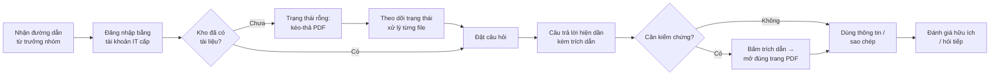

# Product Requirements Document — Chat với tài liệu (MVP)

> **TRẠNG THÁI: DRAFT v0.2**, viết từ [BRD v0.3](BRD.md) (Draft, chưa phê duyệt).
>
> Mọi nội dung `[Đề xuất]` trong BRD vẫn giữ nguyên tính chất "chờ xác nhận" khi chuyển sang PRD. Những quyết định sản phẩm mới chỉ có ở PRD (không có trong BRD) được gắn nhãn **`[PRD-new]`**; cần BA xác nhận và bổ sung vào BRD để giữ truy vết.

---

## 0. Document control & product foundation

| Trường | Giá trị |
|---|---|
| Số tài liệu | PRD-001 |
| Phiên bản | 0.2 |
| Trạng thái | Draft |
| Lịch sử | v0.1 (2026-10-19): bản đầu tiên. v0.2 (2026-10-19): review theo PRD_IEEE_29148_Checklist.xlsx; thêm Mục 6 (NFR, môi trường, giao diện, phân quyền), tiêu chí nghiệm thu cho P1/P2 (3.6), tách US-306 → US-310 và US-308 → US-311, PQ-006 → PQ-007 |
| Tài liệu gốc | BRD-001 v0.3 ([BRD.md](BRD.md)) |
| Người đọc | Engineering, Design, QA, đội BD, quản lý, IT / Bảo mật |
| Người phê duyệt | `[TBD: OQ-003]` |

### 0.1 Product foundation

| Mục | Nội dung | Nguồn |
|---|---|---|
| **Tên sản phẩm** | Chat với tài liệu (tên tạm) | SRC-001; `[TBD: OQ-001]` |
| **Người dùng mục tiêu** | Đội phát triển kinh doanh (BD): làm việc với nhiều tài liệu PDF của dự án, cần thông tin chính xác để chuẩn bị đề xuất, trả lời khách hàng, đàm phán | BRD 6.1, 6.3 |
| **Vấn đề** | Thông tin cần cho một câu hỏi nằm rải rác ở nhiều file PDF. Mỗi lần tra cứu, người dùng phải tự mở, đọc và tổng hợp từng file: tốn thời gian và dễ bỏ sót | BRD 3.1, 3.5 |
| **Giải pháp cốt lõi** | Người dùng đưa PDF vào một lần, sau đó hỏi bằng ngôn ngữ thường ngày và nhận câu trả lời tổng hợp từ **tất cả** tài liệu liên quan. Mỗi ý trong câu trả lời đều chỉ rõ tài liệu và trang nguồn; khi tài liệu không có thông tin, sản phẩm nói rõ là không tìm thấy thay vì đoán | BRD BR-002, 003, 007, 008 |
| **Trụ cột UX** | (1) Kiểm chứng được, (2) Trung thực khi không biết, (3) Không cần học cách dùng, (4) Web trên máy tính văn phòng, (5) Riêng tư mặc định. Xem 0.2 | Mục 0.2 |

### 0.2 Thẩm định các trụ cột sản phẩm

| # | Trụ cột | Căn cứ trong BRD | Thẩm định | Hệ quả cho thiết kế |
|---|---|---|---|---|
| UX-1 | **Kiểm chứng được (trust by citation)** | BR-007, SN-005, BO-002, R-004 | ✅ Hợp lệ. Đây là yếu tố khác biệt chính so với việc chỉ "chat với AI": không có dẫn nguồn, người dùng BD vẫn phải mở lại file, và BO-001 không đạt | Mỗi câu trả lời có trích dẫn bấm được; bấm vào mở đúng trang |
| UX-2 | **Trung thực khi không biết** | BR-008, RUL-002 | ✅ Hợp lệ. Một câu trả lời bịa gây hại nhiều hơn một câu "không tìm thấy" trong công việc BD (đàm phán, báo giá) | Trạng thái "không tìm thấy" là một kết quả hợp lệ, có thiết kế riêng, không bị coi là lỗi |
| UX-3 | **Không cần học cách dùng** | Hồ sơ người dùng BRD 6.3 ("không chuyên kỹ thuật") | ✅ Hợp lệ. Không có cấu hình, không có cú pháp truy vấn | Một ô hỏi; tải lên bằng kéo-thả; trạng thái rỗng hướng dẫn bước tiếp theo |
| UX-4 | **Web trên máy tính văn phòng** | CON-001, BRD 6.3 (bối cảnh: máy tính văn phòng) | ⚠️ Hợp lệ, nhưng **không** phải "mobile-first". Đọc đối chiếu trích dẫn với trang PDF cần màn hình rộng | Tối ưu cho màn hình ≥ 1280 px; hỗ trợ tối thiểu 1024 px; dưới mức đó hiển thị thông báo |
| UX-5 | **Riêng tư mặc định** | BR-012, CON-005, RUL-001, R-001 | ⚠️ Hợp lệ, nhưng đang **bị chặn** bởi OQ-008 (mức bảo mật tài liệu) và OQ-021 (dữ liệu cá nhân) | Không có trang công khai; nội dung câu hỏi không đưa vào dữ liệu phân tích (Mục 5.2) |

**Xung đột cần cân bằng:** UX-1/UX-2 (độ chính xác, dẫn nguồn) và KR1.2 (trả lời trong 30 giây) có thể kéo ngược nhau. Quy tắc ưu tiên của MVP: **độ chính xác và dẫn nguồn thắng tốc độ**. Nếu không đạt cả hai, chấp nhận trả lời chậm hơn trong giới hạn 30 giây ở p95 nhưng không bỏ trích dẫn.

**Lưu ý về đầu vào:** prompt PRD yêu cầu dựa trên SRS, nhưng dự án hiện mới có BRD. PRD này được viết trực tiếp từ BRD; các ngưỡng kỹ thuật chi tiết sẽ được chuẩn hóa ở SRS.

---

## 1. Executive Summary & Strategy

### 1.1 Product Vision

> *Mọi thành viên đội BD có được thông tin chính xác, có dẫn nguồn, từ toàn bộ tài liệu của dự án chỉ bằng một câu hỏi, để dành thời gian cho việc phát triển kinh doanh thay vì tìm tài liệu.* (BRD Mục 2, `[Đề xuất]`)

Trong MVP, tầm nhìn này được thu hẹp thành một lời hứa kiểm chứng được: **"Hỏi một câu, nhận câu trả lời có trang nguồn, trong vòng 30 giây."**

### 1.2 Objectives & Key Results (OKRs)

Đo trong 4 tuần đầu sau khi đưa vào dùng. Mọi con số kế thừa từ BRD và còn chờ OQ-017.

| Objective | Key Result | Đích | Nguồn đo | Truy vết BRD |
|---|---|---|---|---|
| **O1. Cắt giảm thời gian tìm thông tin của đội BD** | KR1.1: thời gian trung bình để có được một thông tin trên bộ 20 câu hỏi điển hình giảm so với hiện trạng | ≥ 50% | Đo bấm giờ trước và sau (M-001) | BO-001 |
| | KR1.2: thời gian từ lúc gửi câu hỏi đến khi câu trả lời hoàn chỉnh, ở p95 | ≤ 30 giây | Sự kiện `answer_completed.latency_ms` | BR-009 |
| **O2. Câu trả lời đủ tin cậy để dùng trong công việc** | KR2.1: tỉ lệ câu trả lời đúng **và** có dẫn đúng nguồn trên bộ câu hỏi kiểm thử | ≥ 80% | Bộ câu hỏi kiểm thử, BD chấm (M-002) | BO-002 |
| | KR2.2: tỉ lệ câu hỏi "không có đáp án trong tài liệu" được trả lời là "không tìm thấy" | ≥ 90% | Bộ câu hỏi kiểm thử | BR-008 |
| | KR2.3: tỉ lệ trích dẫn trỏ đúng trang chứa thông tin (mẫu 30 trích dẫn) | ≥ 90% | Kiểm tra thủ công | BR-007 |
| **O3. Đội BD dùng sản phẩm hằng tuần** | KR3.1: tỉ lệ thành viên BD đặt ≥ 1 câu hỏi mỗi tuần | ≥ 60% | Sự kiện `question_submitted` (M-003) | BO-003 |
| | KR3.2: tỉ lệ phản hồi "hữu ích" trên tổng phản hồi | ≥ 70% `[PRD-new]` | Sự kiện `answer_feedback_submitted` | BO-002, BO-003 |

### 1.3 Phạm vi MVP và không phải mục tiêu

- **Trong phạm vi:** đăng nhập giới hạn cho đội BD; tải lên, xem, gỡ PDF dạng văn bản; hỏi đáp tiếng Việt và tiếng Anh trên toàn bộ tài liệu; trích dẫn tài liệu và trang; trả lời "không tìm thấy"; đo lường sử dụng. (BRD 5.1)
- **Ngoài phạm vi / để sau:** ứng dụng di động, đọc PDF dạng ảnh scan (OCR), định dạng Word/Excel/PowerPoint, kết nối kho tài liệu hiện có, phân quyền theo từng tài liệu (BR-013), giới hạn câu hỏi trong nhóm tài liệu (BR-011), tạo báo cáo tự động. (BRD 5.2, 5.3)

### 1.4 Quyết định sản phẩm chỉ có ở PRD

| ID | Quyết định | Lý do | Cần làm |
|---|---|---|---|
| PD-01 | **Một kho tài liệu chung cho cả đội BD** (mọi thành viên thấy và hỏi trên cùng tập tài liệu) `[PRD-new]` | BR-013 (phân quyền từng tài liệu) đã để sau, nên MVP không có ranh giới tài liệu theo người | Xác nhận qua PQ-001 |
| PD-02 | **Chỉ người tải lên và trưởng nhóm BD được gỡ tài liệu** `[PRD-new]` | Kho chung → một người gỡ nhầm ảnh hưởng cả đội | Xác nhận qua PQ-002 |
| PD-03 | **Nút phản hồi hữu ích / không hữu ích** trên mỗi câu trả lời `[PRD-new]` | Cần tín hiệu chất lượng liên tục sau khi đưa vào dùng (KR3.2), bổ sung cho đo bằng bộ kiểm thử | Bổ sung BR mới vào BRD |
| PD-04 | **Hội thoại không lưu sau khi đăng xuất** trong MVP | BR-010 chỉ yêu cầu xem lại trong cuộc hội thoại hiện tại; lưu lâu dài liên quan OQ-016, OQ-021 | — |

---

## 2. User Personas & User Journeys

### 2.1 Target Personas

| | **P-1. Chuyên viên BD** (chính) | **P-2. Trưởng nhóm BD** (phụ) | **P-3. Quản lý** (phụ) |
|---|---|---|---|
| **Mục tiêu công việc** | Có câu trả lời chính xác để chuẩn bị đề xuất, trả lời khách hàng, đàm phán | Đảm bảo đội dùng thông tin đúng; nghiệm thu công cụ | Biết MVP có mang lại giá trị để quyết định đầu tư tiếp |
| **Nỗi đau hiện tại** | Mở và đọc lần lượt nhiều PDF; sợ bỏ sót điều khoản nằm ở file khác | Không kiểm soát được thành viên đã đọc đủ tài liệu hay chưa | Không có số liệu về thời gian tra cứu của đội (OQ-004) |
| **Bối cảnh** | Máy tính văn phòng, trình duyệt; thường làm dưới áp lực thời gian (trước cuộc họp với khách hàng) | Như P-1 | Xem số liệu tổng hợp hằng tuần |
| **Mức kỹ thuật** | Nghiệp vụ sâu, không chuyên kỹ thuật | Nghiệp vụ sâu, nắm rõ nội dung tài liệu | Quản lý |
| **Tần suất** | Nhiều lần mỗi ngày | Hằng tuần, theo đợt nghiệm thu | Hằng tuần |
| **Thành công nghĩa là** | "Tôi có câu trả lời kèm trang nguồn trước khi cuộc họp bắt đầu" | "Bộ câu hỏi kiểm thử đạt ≥ 80%" | "Có số liệu M-001, M-003 sau 4 tuần" |
| **Truy vết** | SH-001, SN-001, SN-005, SN-006 | SH-001, UC-05, DEP-003 | SH-002, SN-002, UC-06 |

**Bên liên quan không phải người dùng hằng ngày:** IT / Bảo mật (SH-005) cấp tài khoản (DEP-002) và phê duyệt việc xử lý tài liệu (OQ-008). Không có giao diện riêng cho nhóm này trong MVP.

### 2.2 High-Level User Journey (P-1, lần dùng đầu tiên)



| Giai đoạn | Người dùng làm gì | Sản phẩm phải đảm bảo | Rủi ro bỏ cuộc | Sự kiện đo |
|---|---|---|---|---|
| 1. Tiếp cận | Mở đường dẫn, đăng nhập | Đăng nhập một bước bằng tài khoản công ty | Không đăng nhập được | `session_started` |
| 2. Chuẩn bị | Tải PDF lên (nếu kho rỗng) | Hiển thị tiến độ; báo rõ file lỗi, file scan | Chờ xử lý lâu, không biết đã xong chưa | `document_upload_*`, `document_processing_completed` |
| 3. Hỏi | Gõ câu hỏi tiếng Việt hoặc tiếng Anh | Không cần cú pháp; có câu hỏi gợi ý ở trạng thái rỗng | Không biết hỏi gì | `question_submitted` |
| 4. Nhận câu trả lời | Đọc câu trả lời | Hiện dần trong ≤ 30 giây (p95); mỗi ý có trích dẫn | Chờ lâu; câu trả lời không có nguồn | `answer_completed`, `answer_failed` |
| 5. Kiểm chứng | Bấm trích dẫn | Mở đúng tài liệu, đúng trang, bên cạnh khung chat | Trích dẫn sai trang → mất niềm tin | `citation_clicked` |
| 6. Dùng và quay lại | Sao chép, đánh giá, hỏi tiếp | Sao chép kèm nguồn; phản hồi một chạm | Không thấy giá trị → không quay lại | `answer_copied`, `answer_feedback_submitted` |

---

## 3. Functional Requirements & User Stories

**Quy ước ưu tiên:** P0 = Must trong BRD (bắt buộc để ra mắt) · P1 = Should · P2 = Could. Các mục Won't trong BRD (BR-011, BR-013) không xuất hiện trong PRD này.

### 3.1 Ma trận Epic / Feature

| Epic | Mô tả | User stories | BRD | P0 | P1 | P2 |
|---|---|---|---|---|---|---|
| **E1. Truy cập** | Chỉ thành viên BD được cấp quyền mới vào được sản phẩm | US-101 → US-103 | BR-012 | 2 | 1 | 0 |
| **E2. Kho tài liệu** | Đưa vào, theo dõi, xem, gỡ tài liệu PDF | US-201 → US-206 | BR-001, 004, 005, 006 | 2 | 3 | 1 |
| **E3. Hỏi đáp có dẫn nguồn** | Hỏi bằng ngôn ngữ tự nhiên, nhận câu trả lời tổng hợp có trích dẫn | US-301 → US-311 | BR-002, 003, 007, 008, 009, 010 | 4 | 5 | 2 |
| **E4. Đo lường giá trị** | Số liệu cho trưởng nhóm và quản lý | US-401 → US-402 | SN-002, UC-05, UC-06 | 0 | 1 | 1 |
| **Tổng** | | **22** | | **8** | **10** | **4** |

### 3.2 E1 — Truy cập

| ID | User story | Ưu tiên | BRD |
|---|---|---|---|
| US-101 | Là **chuyên viên BD**, tôi muốn đăng nhập bằng tài khoản công ty do IT cấp, để không phải nhớ thêm mật khẩu riêng | **P0** | BR-012, DEP-002 |
| US-102 | Là **quản lý**, tôi muốn người không thuộc đội BD bị từ chối truy cập, để tài liệu nội bộ không bị lộ | **P0** | BR-012, RUL-001 |
| US-103 | Là **chuyên viên BD**, tôi muốn phiên làm việc tự kết thúc sau 8 giờ không hoạt động `[PRD-new]`, để máy để quên không mở sẵn tài liệu cho người khác | P1 | SN-007 |

**AC — US-101**
- **Given** tôi là thành viên BD đã được IT cấp quyền, **When** tôi mở đường dẫn sản phẩm và đăng nhập bằng tài khoản công ty, **Then** tôi vào màn hình chính trong ≤ 5 giây và thấy tên của mình ở góc trên.
- **Given** tôi đã đăng nhập, **When** tôi đóng tab rồi mở lại trong vòng phiên còn hiệu lực, **Then** tôi không phải đăng nhập lại.

**AC — US-102**
- **Given** một tài khoản công ty **không** thuộc nhóm BD được cấp quyền, **When** người đó đăng nhập, **Then** họ thấy thông báo "Bạn chưa được cấp quyền dùng công cụ này. Liên hệ trưởng nhóm BD." và **không** thấy bất kỳ tên tài liệu hay nội dung nào.
- **Given** một người chưa đăng nhập, **When** họ truy cập trực tiếp đường dẫn tới tài liệu hoặc API của sản phẩm, **Then** yêu cầu bị từ chối và được chuyển về trang đăng nhập.
- **Given** bộ kiểm thử truy cập trái phép (tối thiểu 20 trường hợp), **When** QA thực hiện, **Then** 100% bị từ chối (AC-012).

### 3.3 E2 — Kho tài liệu

| ID | User story | Ưu tiên | BRD |
|---|---|---|---|
| US-201 | Là **chuyên viên BD**, tôi muốn kéo-thả một hoặc nhiều file PDF vào sản phẩm, để các file đó trở thành nguồn cho câu trả lời | **P0** | BR-001 |
| US-202 | Là **chuyên viên BD**, tôi muốn thấy trạng thái xử lý của từng file (đang tải, đang xử lý, sẵn sàng, lỗi), để biết khi nào có thể hỏi về file đó | **P0** | BR-001 (AC-001) |
| US-203 | Là **chuyên viên BD**, tôi muốn xem danh sách tài liệu trong kho (tên, số trang, người tải, ngày tải), để biết câu trả lời dựa trên những tài liệu nào | P1 | BR-004 |
| US-204 | Là **chuyên viên BD**, tôi muốn gỡ một tài liệu tôi đã tải lên, để tài liệu lỗi thời không còn được dùng trong câu trả lời mới | P1 | BR-005, RUL-003, PD-02 |
| US-205 | Là **chuyên viên BD**, tôi muốn được báo khi một file PDF không có chữ đọc được (file scan), để không tưởng rằng file đó đã được tra cứu | P1 | BR-006 |
| US-206 | Là **chuyên viên BD**, tôi muốn được cảnh báo khi tải lên một file trùng với file đã có `[PRD-new]`, để kho không có bản trùng làm câu trả lời bị lặp | P2 | SN-006 |

**AC — US-201**
- **Given** tôi đang ở màn hình chính, **When** tôi kéo-thả 1 file PDF dạng văn bản ≤ 50 MB vào khu vực tải lên (hoặc bấm "Tải tài liệu" và chọn file), **Then** file xuất hiện trong danh sách với trạng thái "Đang tải lên" kèm phần trăm tiến độ.
- **Given** tôi chọn đồng thời 10 file PDF hợp lệ, **When** tôi thả vào khu vực tải lên, **Then** cả 10 file được đưa vào hàng đợi và có trạng thái riêng từng file.
- **Given** tôi chọn một file không phải PDF hoặc lớn hơn 50 MB, **When** tôi thả vào, **Then** file đó bị từ chối ngay trước khi tải với thông báo nêu đúng lý do (sai định dạng / vượt 50 MB); các file hợp lệ khác trong cùng lượt vẫn được tải.

**AC — US-202**
- **Given** một file PDF 50 MB, 300 trang đã tải lên xong, **When** quá trình xử lý kết thúc, **Then** trạng thái chuyển sang "Sẵn sàng" chậm nhất 5 phút sau khi tải lên (AC-001), và file được dùng ngay cho câu hỏi tiếp theo.
- **Given** một file đang ở trạng thái "Đang xử lý", **When** tôi đặt câu hỏi, **Then** câu trả lời chỉ dùng các file "Sẵn sàng" và có dòng ghi chú "1 tài liệu đang được xử lý, chưa được dùng cho câu trả lời này".
- **Given** xử lý một file thất bại, **When** trạng thái chuyển sang "Lỗi", **Then** tôi thấy lý do bằng ngôn ngữ thường ngày và nút "Thử lại".

### 3.4 E3 — Hỏi đáp có dẫn nguồn

| ID | User story | Ưu tiên | BRD |
|---|---|---|---|
| US-301 | Là **chuyên viên BD**, tôi muốn gõ câu hỏi bằng tiếng Việt hoặc tiếng Anh như khi hỏi đồng nghiệp, để không phải học cú pháp tìm kiếm | **P0** | BR-002 |
| US-302 | Là **chuyên viên BD**, tôi muốn câu trả lời tổng hợp thông tin từ tất cả tài liệu liên quan, để không bỏ sót thông tin nằm ở file khác | **P0** | BR-003 |
| US-303 | Là **chuyên viên BD**, tôi muốn mỗi ý trong câu trả lời có trích dẫn tên tài liệu và số trang, để kiểm chứng trước khi dùng với khách hàng | **P0** | BR-007 |
| US-304 | Là **chuyên viên BD**, tôi muốn được báo rõ "không tìm thấy" khi tài liệu không có thông tin, để không dùng nhầm thông tin bịa | **P0** | BR-008, RUL-002 |
| US-305 | Là **chuyên viên BD**, tôi muốn bấm vào trích dẫn để mở đúng trang PDF cạnh khung chat, để kiểm chứng mà không rời khỏi cuộc hội thoại | P1 | BR-007, SN-005 |
| US-306 | Là **chuyên viên BD**, tôi muốn thấy câu trả lời hiện dần trong lúc được soạn, để không phải nhìn màn hình trống khi chờ | P1 | BR-009 |
| US-310 | Là **chuyên viên BD**, tôi muốn dừng một câu trả lời đang soạn, để hỏi lại ngay khi nhận ra mình hỏi sai | P1 | BR-009 |
| US-307 | Là **chuyên viên BD**, tôi muốn sao chép câu trả lời kèm danh sách nguồn, để dán vào email hoặc tài liệu đề xuất | P1 | SN-001 |
| US-308 | Là **chuyên viên BD**, tôi muốn xem lại các câu hỏi và câu trả lời trong cuộc hội thoại hiện tại, để không phải hỏi lại | P2 | BR-010 |
| US-311 | Là **chuyên viên BD**, tôi muốn hỏi tiếp một câu ngắn dựa trên câu trả lời trước (ví dụ "còn hợp đồng năm 2024 thì sao?") `[PRD-new]`, để không phải nhắc lại toàn bộ ngữ cảnh | P2 | BR-010, SN-001 |
| US-309 | Là **trưởng nhóm BD**, tôi muốn thành viên đánh giá hữu ích / không hữu ích cho từng câu trả lời, để phát hiện sớm loại câu hỏi sản phẩm trả lời kém `[PRD-new]` | P1 | PD-03, KR3.2 |

**AC — US-301**
- **Given** kho có ít nhất 1 tài liệu "Sẵn sàng", **When** tôi gõ câu hỏi tiếng Việt và nhấn Enter, **Then** câu hỏi được gửi và câu trả lời bằng tiếng Việt bắt đầu hiện.
- **Given** như trên, **When** tôi gõ câu hỏi tiếng Anh, **Then** câu trả lời bằng tiếng Anh.
- **Given** ô câu hỏi đang trống hoặc chỉ có khoảng trắng, **When** tôi nhấn Enter, **Then** không có gì được gửi và nút Gửi vẫn ở trạng thái vô hiệu.
- **Given** câu hỏi dài quá 2.000 ký tự `[PRD-new]`, **When** tôi gõ tiếp, **Then** bộ đếm ký tự chuyển màu cảnh báo và nút Gửi bị vô hiệu cho đến khi rút gọn.

**AC — US-302**
- **Given** thông tin cho một câu hỏi nằm ở 2 tài liệu khác nhau trong kho, **When** tôi hỏi câu đó, **Then** câu trả lời chứa thông tin từ cả 2 tài liệu và có trích dẫn tới cả 2.
- **Given** bộ 15 câu hỏi kiểm thử cần thông tin từ ≥ 2 tài liệu, **When** trưởng nhóm BD chấm kết quả, **Then** ≥ 80% câu trả lời được chấm là đúng và đủ (AC-003).
- **Given** một tài liệu đã bị gỡ, **When** tôi hỏi về nội dung chỉ có trong tài liệu đó, **Then** câu trả lời không trích từ tài liệu đó (AC-005, RUL-003).

**AC — US-303**
- **Given** câu trả lời có chứa thông tin, **When** câu trả lời hiển thị xong, **Then** mỗi đoạn có ít nhất 1 trích dẫn dạng `[n]`, và cuối câu trả lời liệt kê nguồn dạng "Tên tài liệu — trang X".
- **Given** một mẫu 30 trích dẫn ngẫu nhiên, **When** QA mở từng trang được trích, **Then** ≥ 90% trang chứa đúng thông tin được nêu (AC-007).
- **Given** câu trả lời không có trích dẫn nào, **When** nó sắp được hiển thị, **Then** sản phẩm hiển thị trạng thái "không tìm thấy" (US-304) thay vì câu trả lời không có nguồn.

**AC — US-304**
- **Given** thông tin được hỏi không có trong bất kỳ tài liệu "Sẵn sàng" nào, **When** tôi hỏi, **Then** tôi nhận thông báo "Không tìm thấy thông tin này trong N tài liệu hiện có" kèm gợi ý: diễn đạt lại câu hỏi hoặc tải thêm tài liệu.
- **Given** bộ 10 câu hỏi kiểm thử không có đáp án trong tài liệu, **When** QA chạy, **Then** ≥ 9 câu nhận trạng thái "không tìm thấy" (AC-008).
- **Given** trạng thái "không tìm thấy", **When** hiển thị, **Then** nó dùng giao diện trung tính (không phải màu lỗi) và không chứa thông tin lấy từ ngoài tài liệu (RUL-002).

### 3.5 E4 — Đo lường giá trị

| ID | User story | Ưu tiên | BRD |
|---|---|---|---|
| US-401 | Là **quản lý**, tôi muốn xem trang số liệu hằng tuần (người dùng hoạt động, số câu hỏi, tỉ lệ "không tìm thấy", tỉ lệ hữu ích, thời gian trả lời p95), để đánh giá MVP sau 4 tuần | P1 | SN-002, M-003, UC-06 |
| US-402 | Là **trưởng nhóm BD**, tôi muốn chạy bộ câu hỏi kiểm thử và xuất kết quả ra bảng tính để chấm, để có số liệu M-002 khi nghiệm thu | P2 | UC-05, DEP-003 |

### 3.6 Tiêu chí nghiệm thu cho các story P1 / P2

Prompt chỉ yêu cầu Given-When-Then cho P0. Để mọi story đều kiểm chứng được, các story P1/P2 có tiêu chí rút gọn dưới đây.

| Story | Tiêu chí nghiệm thu | Kiểm chứng |
|---|---|---|
| US-103 | Sau 8 giờ không thao tác, thao tác tiếp theo chuyển về trang đăng nhập; câu hỏi đang gõ dở được giữ lại (EC-17) | Test |
| US-203 | Danh sách hiển thị 100% tài liệu trong kho với tên file, số trang, người tải, ngày tải (AC-004); lọc theo tên trả kết quả khi gõ ≥ 2 ký tự | Test |
| US-204 | Nút "Gỡ" chỉ hiện với người tải lên và trưởng nhóm BD (PD-02); sau khi gỡ, 0/10 câu hỏi kiểm thử về nội dung riêng của tài liệu đó trích từ nó (AC-005) | Test |
| US-205 | 10/10 file PDF dạng ảnh scan trong bộ kiểm thử có trạng thái "Không đọc được chữ" và không xuất hiện trong trích dẫn (AC-006) | Test |
| US-206 | Tải lại một file có nội dung trùng 100% với file đã có → hiện hộp xác nhận trong 100% lần thử | Test |
| US-305 | Bấm một trích dẫn → vùng nguồn hiển thị đúng tài liệu, đúng trang trong ≤ 2 giây ở p95 (file ≤ 50 MB) | Test |
| US-306 | Phần đầu tiên của câu trả lời hiển thị trong ≤ 5 giây ở p95 `[PRD-new]` | Test |
| US-307 | Nội dung sao chép gồm câu trả lời và danh sách "Tên tài liệu — trang X"; dán vào trình soạn email giữ nguyên các dòng | Demonstration |
| US-308 | Sau 10 lượt hỏi đáp trong cùng phiên, cả 10 cặp câu hỏi và câu trả lời đều xem lại được (AC-010) | Demonstration |
| US-309 | Mỗi câu trả lời hoàn chỉnh có 👍/👎; bấm 👎 mở danh sách lý do; mỗi lần bấm sinh đúng 1 sự kiện `answer_feedback_submitted` | Test |
| US-310 | Bấm Dừng → câu trả lời ngừng hiển thị trong ≤ 1 giây, ô câu hỏi dùng được ngay; sinh sự kiện `answer_stopped` | Test |
| US-311 | Trên 10 cặp câu hỏi nối tiếp kiểm thử, ≥ 8 câu hỏi nối tiếp được trả lời đúng ngữ cảnh của câu trước | Test (bộ câu hỏi kiểm thử) |
| US-401 | Trang số liệu hiển thị 5 chỉ số của Mục 5.2 cho từng tuần; chỉ quản lý và trưởng nhóm BD xem được (Mục 6.3) | Test |
| US-402 | Chạy bộ câu hỏi kiểm thử → xuất file bảng tính gồm câu hỏi, câu trả lời, trích dẫn, cột để chấm | Demonstration |

---

## 4. UX & UI Requirements

### 4.1 Core Wireframe / Flow Logic

**Bố cục màn hình chính (≥ 1280 px):** ba vùng, vùng nguồn chỉ mở khi cần.

> Wireframe và kích thước dưới đây **chỉ để minh họa**. Đội Design được thay đổi bố cục và hình thức, miễn là giữ đúng các *hành vi bắt buộc* trong bảng sau và các trụ cột UX ở Mục 0.2.

```text
┌──────────────────────────────────────────────────────────────────────────────┐
│ [Logo] Chat với tài liệu                                   Nguyễn A ▾        │
├───────────────────┬──────────────────────────────────┬───────────────────────┤
│ KHO TÀI LIỆU (12) │  Hội thoại                       │  NGUỒN (mở khi bấm    │
│ [+ Tải tài liệu]  │                                  │  trích dẫn)           │
│ 🔍 Lọc theo tên    │  🧑 Điều khoản thanh toán của     │                       │
│ ───────────────── │     khách hàng X là gì?          │  Hop_dong_X_2025.pdf  │
│ ✅ Hop_dong_X.pdf  │                                  │  Trang 4 / 32         │
│ ✅ Bao_gia_Q3.pdf  │  🤖 Thanh toán 30% khi ký [1],    │  ┌─────────────────┐  │
│ ⏳ Bien_ban.pdf    │     70% sau nghiệm thu [2]...    │  │ …đoạn văn được  │  │
│    Đang xử lý 60% │     Nguồn:                       │  │ tô sáng…        │  │
│ ⚠️ Scan_01.pdf     │     [1] Hop_dong_X.pdf — tr. 4   │  └─────────────────┘  │
│    Không đọc được │     [2] Phu_luc_02.pdf — tr. 2   │  [‹ Trang trước] [›]  │
│                   │     👍 👎   ⧉ Sao chép            │  [Mở toàn bộ file]    │
│                   │ ──────────────────────────────── │                       │
│                   │ [ Hỏi về tài liệu của bạn…   ][➤]│                       │
└───────────────────┴──────────────────────────────────┴───────────────────────┘
```

| Thành phần | Hành vi bắt buộc |
|---|---|
| **Kho tài liệu** (gợi ý: bên trái) | Nút tải lên luôn hiện; cả vùng nhận kéo-thả. Mỗi file có biểu tượng trạng thái (đang tải / đang xử lý / sẵn sàng / không đọc được / lỗi). Menu "⋯" trên từng file: xem, gỡ (chỉ hiện với người được phép, PD-02). Thu gọn được |
| **Khung hội thoại** (gợi ý: ở giữa) | Ô câu hỏi cố định ở dưới. Enter = gửi, Shift+Enter = xuống dòng. Câu trả lời hiện dần; trong lúc chờ, nút Gửi thành nút Dừng. Trích dẫn `[n]` là liên kết bấm được |
| **Vùng nguồn** (gợi ý: bên phải) | Hiển thị cùng lúc với khung hội thoại, không mở cửa sổ mới. Mở khi bấm trích dẫn; hiển thị đúng trang và tô sáng đoạn liên quan nếu xác định được. Có điều hướng trang và "Mở toàn bộ file". Đóng bằng Esc hoặc nút ✕ |
| **1024–1279 px** | Kho tài liệu thu gọn thành biểu tượng; vùng nguồn mở chồng lên khung hội thoại |
| **< 1024 px** | Thông báo "Vui lòng dùng màn hình rộng hơn để xem nguồn" (UX-4); vẫn đọc được câu trả lời |
| **Ngôn ngữ giao diện** | Tiếng Việt (OQ-014) |
| **Khả năng tiếp cận** `[PRD-new]` | Điều khiển được hoàn toàn bằng bàn phím; độ tương phản đạt WCAG 2.1 mức AA; trích dẫn có nhãn đọc được bằng trình đọc màn hình |

**Luồng tương tác then chốt**
1. **Tải lên:** thả file → kiểm tra định dạng và dung lượng ngay ở trình duyệt → tải lên kèm tiến độ → xử lý → "Sẵn sàng" (thông báo nhỏ: "Bao_gia_Q3.pdf đã sẵn sàng để hỏi").
2. **Hỏi:** gửi → chỉ báo "Đang tìm trong 12 tài liệu…" → câu trả lời hiện dần → danh sách nguồn hiện khi xong → nút phản hồi và sao chép.
3. **Kiểm chứng:** bấm `[n]` → vùng nguồn mở đúng trang → bấm `[m]` khác → vùng nguồn chuyển trang, không mở thêm cửa sổ.
4. **Gỡ tài liệu:** "⋯" → "Gỡ" → hộp xác nhận nêu rõ "Tài liệu sẽ không còn được dùng cho câu trả lời mới của cả đội" → gỡ.

### 4.2 Edge Cases & Error States

| # | Tình huống | Hành vi của sản phẩm | Truy vết |
|---|---|---|---|
| EC-01 | **Kho rỗng** (lần đầu dùng) | Khung giữa hiện vùng kéo-thả lớn + "Tải tài liệu PDF đầu tiên để bắt đầu hỏi". Ô câu hỏi vô hiệu, có chú thích lý do | UX-3 |
| EC-02 | **Kho có tài liệu nhưng chưa có câu hỏi** | Hiện 3 câu hỏi mẫu dạng thẻ bấm được (ví dụ "Tóm tắt các điều khoản thanh toán") | UX-3 |
| EC-03 | **Mọi tài liệu đang xử lý** | Ô câu hỏi vô hiệu với chú thích "Đang xử lý 3 tài liệu, bạn có thể hỏi khi có ít nhất 1 tài liệu sẵn sàng" | US-202 |
| EC-04 | **Mất mạng khi đang tải file** | File chuyển sang "Tạm dừng — mất kết nối"; tự thử lại khi có mạng (tối đa 3 lần); sau đó hiện nút "Thử lại". Không mất các file khác trong hàng đợi | US-201 |
| EC-05 | **Mất mạng khi đang nhận câu trả lời** | Giữ phần đã hiện, gắn nhãn "Câu trả lời chưa hoàn chỉnh do mất kết nối" + nút "Hỏi lại". Phần chưa hoàn chỉnh không được sao chép kèm nguồn như câu trả lời đầy đủ | US-306 |
| EC-06 | **Mất mạng khi đang ở trang** | Thanh thông báo trên cùng "Mất kết nối, đang thử lại…"; vô hiệu nút Gửi và Tải lên cho đến khi có mạng | — |
| EC-07 | **File không phải PDF** (kể cả file đổi đuôi thành .pdf) | Từ chối với thông báo "Chỉ hỗ trợ file PDF". File đổi đuôi bị phát hiện ở bước xử lý và chuyển "Lỗi" | CON-002 |
| EC-08 | **File > 50 MB** | Từ chối trước khi tải: "File vượt 50 MB. Hãy tách file hoặc liên hệ trưởng nhóm" | BR-001 |
| EC-09 | **PDF có mật khẩu** | Trạng thái "Lỗi — file có mật khẩu. Hãy bỏ mật khẩu rồi tải lại" | — |
| EC-10 | **PDF dạng ảnh scan / không có chữ** | Trạng thái "⚠️ Không đọc được chữ" và giải thích; file **không** được tính là nguồn | BR-006 |
| EC-11 | **PDF hỏng** | Trạng thái "Lỗi — không mở được file" + nút "Gỡ" | — |
| EC-12 | **File trùng** | Hỏi "File này đã có trong kho (tải lên ngày …). Vẫn tải?" | US-206 |
| EC-13 | **Dịch vụ AI quá 30 giây hoặc báo lỗi** | Sau 30 giây: "Câu hỏi đang mất nhiều thời gian hơn bình thường" + nút Dừng / Chờ tiếp. Lỗi: "Chưa trả lời được lúc này, vui lòng thử lại" + "Thử lại"; không hiện mã lỗi kỹ thuật | BR-009 |
| EC-14 | **Câu trả lời không có trích dẫn hợp lệ** | Không hiển thị câu trả lời đó; chuyển sang trạng thái "không tìm thấy" | US-303, RUL-002 |
| EC-15 | **Trích dẫn tới tài liệu đã bị gỡ** (trong hội thoại hiện tại) | Trích dẫn vẫn hiện nhưng gạch ngang, chú thích "Tài liệu đã được gỡ"; không mở được vùng nguồn | RUL-003 |
| EC-16 | **Người khác gỡ tài liệu khi tôi đang xem nó trong vùng nguồn** | Vùng nguồn hiện "Tài liệu này vừa được gỡ khỏi kho" | PD-01 |
| EC-17 | **Phiên hết hạn** | Khi thao tác tiếp: chuyển về đăng nhập; sau khi đăng nhập quay lại đúng màn hình. Câu hỏi đang gõ dở được giữ lại | US-103 |
| EC-18 | **Người không được cấp quyền** | Màn hình từ chối, không lộ tên hay số lượng tài liệu | US-102 |
| EC-19 | **Câu hỏi ngoài phạm vi tài liệu** (ví dụ "Thời tiết hôm nay?") | Xử lý như EC-14 / US-304: "Tôi chỉ trả lời dựa trên tài liệu trong kho" | RUL-002 |

---

## 5. Release Criteria & Post-Launch Metrics

### 5.1 Launch Gate Criteria

Ra mắt cho toàn đội BD chỉ khi **mọi** tiêu chí dưới đây đạt. Bất kỳ tiêu chí nào không đạt → giữ ở nhóm thử nghiệm (theo phương án dự phòng R-004, BRD 10.1).

| Nhóm | # | Tiêu chí | Ngưỡng | Người xác nhận |
|---|---|---|---|---|
| **Chức năng** | LG-01 | Mọi AC của 8 user story P0 đạt | 100% | QA |
| | LG-02 | Không còn lỗi mức nghiêm trọng Critical / High đang mở | 0 | QA |
| **Chất lượng câu trả lời** | LG-03 | Độ đúng và đủ trên bộ câu hỏi kiểm thử (KR2.1, AC-003) | ≥ 80% | Trưởng nhóm BD |
| | LG-04 | Tỉ lệ "không tìm thấy" đúng (KR2.2, AC-008) | ≥ 9/10 | Trưởng nhóm BD |
| | LG-05 | Trích dẫn đúng trang (KR2.3, AC-007) | ≥ 90% trên mẫu 30 | QA |
| **Hiệu năng** | LG-06 | Thời gian trả lời p95 trên 100 câu hỏi (AC-009) | ≤ 30 giây | QA |
| | LG-07 | Thời gian xử lý file 50 MB / 300 trang (AC-001) | ≤ 5 phút | QA |
| | LG-08 | Thời gian mở màn hình chính trên mạng văn phòng `[PRD-new]` | ≤ 3 giây | QA |
| **Bảo mật** | LG-09 | IT / Bảo mật phê duyệt bằng văn bản việc xử lý tài liệu bằng dịch vụ AI đã chọn (OQ-008, CON-005) | Có phê duyệt | IT / Bảo mật |
| | LG-10 | Kiểm thử truy cập trái phép (AC-012) | 100% bị từ chối | QA |
| | LG-11 | Toàn bộ kết nối được mã hóa; không có lỗ hổng mức Critical / High trong lần quét bảo mật | 0 | IT / Bảo mật |
| | LG-12 | Điều khoản với nhà cung cấp dịch vụ AI xác nhận tài liệu không bị dùng để huấn luyện (CON-005) | Có văn bản | IT / Bảo mật |
| **QA coverage** | LG-13 | Mọi AC P0 và P1 có test case; test case P0 đã chạy | 100% | QA |
| | LG-14 | Kiểm thử hồi quy trên trình duyệt chuẩn của công ty `[TBD: PQ-004]` | Đạt | QA |
| **Vận hành & đo lường** | LG-15 | Mọi sự kiện ở Mục 5.2 ghi nhận được trên môi trường thật | 100% | Engineering |
| | LG-16 | Đã đo hiện trạng M-001 trước khi ra mắt (R-003) | Có số liệu | Trưởng nhóm BD |
| | LG-17 | Đã có cảnh báo khi sản phẩm gián đoạn trong giờ làm việc (BR-014) | Có | Engineering |

### 5.2 Analytics & Tracking

**Nguyên tắc riêng tư (UX-5):** sự kiện chỉ chứa siêu dữ liệu. **Không** ghi nội dung câu hỏi, nội dung câu trả lời hay nội dung tài liệu vào hệ thống phân tích. ID người dùng được ẩn danh hóa. Thời gian lưu giữ dữ liệu sự kiện theo OQ-016.

**Thuộc tính chung của mọi sự kiện:** `event_name`, `timestamp`, `user_id_hash`, `session_id`, `app_version`.

| Sự kiện | Kích hoạt khi | Thuộc tính riêng | Phục vụ |
|---|---|---|---|
| `session_started` | Đăng nhập thành công hoặc mở lại phiên | `is_first_session` | M-003, phễu kích hoạt |
| `access_denied` | Người không có quyền bị từ chối | `reason` | LG-10, giám sát bảo mật |
| `document_upload_started` | Bắt đầu tải một file | `file_size_mb`, `batch_size` | Phễu tải lên |
| `document_upload_failed` | Tải lên hoặc kiểm tra thất bại | `reason` (`not_pdf`, `too_large`, `network`, `password`, `corrupt`) | EC-04 → EC-11 |
| `document_processing_completed` | File chuyển "Sẵn sàng" hoặc "Không đọc được" | `page_count`, `duration_ms`, `status` (`ready`, `no_text`, `error`) | AC-001, BR-006, ASM-003 |
| `document_removed` | Gỡ tài liệu | `role` (`uploader`, `lead`), `doc_age_days` | BR-005 |
| `question_submitted` | Gửi câu hỏi | `language`, `question_length`, `ready_doc_count`, `is_suggested`, `turn_index` | M-003, KR3.1 |
| `answer_completed` | Câu trả lời hiển thị xong | `latency_ms`, `citation_count`, `distinct_docs_cited`, `is_not_found` | KR1.2, BR-003, BR-008 |
| `answer_failed` | Không trả lời được | `error_type` (`timeout`, `service_error`, `network`) | EC-05, EC-13, BR-014 |
| `answer_stopped` | Người dùng bấm Dừng | `elapsed_ms` | US-310 |
| `citation_clicked` | Bấm một trích dẫn | `citation_index`, `doc_removed` | UX-1, mức độ kiểm chứng |
| `answer_copied` | Sao chép câu trả lời | `with_sources` | Giá trị thực tế (US-307) |
| `answer_feedback_submitted` | Bấm 👍 / 👎 | `value` (`helpful`, `not_helpful`), `reason` (`wrong`, `incomplete`, `wrong_source`, `other`) | KR3.2 |

**Phễu và chỉ số phải dựng được từ dữ liệu trên**

| Chỉ số | Định nghĩa | Đích |
|---|---|---|
| **Phễu kích hoạt** | `session_started` (lần đầu) → `document_upload_started` hoặc kho đã có tài liệu → `question_submitted` → `answer_completed` → `citation_clicked` | Theo dõi bước rơi lớn nhất |
| **Người dùng hoạt động hằng tuần** (M-003) | Số `user_id_hash` có ≥ 1 `question_submitted` trong tuần ÷ tổng thành viên BD | ≥ 60% sau 4 tuần |
| **Thời gian trả lời p95** | p95 của `answer_completed.latency_ms` | ≤ 30 giây |
| **Tỉ lệ "không tìm thấy"** | `answer_completed` có `is_not_found = true` ÷ tổng `answer_completed` | Theo dõi; tăng đột biến → thiếu tài liệu hoặc lỗi tìm kiếm |
| **Tỉ lệ kiểm chứng** | Câu trả lời có ≥ 1 `citation_clicked` ÷ tổng câu trả lời | Theo dõi (đo niềm tin) |
| **Tỉ lệ hữu ích** (KR3.2) | `helpful` ÷ tổng `answer_feedback_submitted` | ≥ 70% |
| **Tỉ lệ lỗi** | `answer_failed` ÷ (`answer_completed` + `answer_failed`) | ≤ 2% `[PRD-new]` |
| **Tỉ lệ file không đọc được** | `status = no_text` ÷ tổng `document_processing_completed` | Kiểm chứng ASM-003; > 20% → ưu tiên OCR cho giai đoạn sau |

**Lịch đánh giá sau ra mắt:** tuần 0 (đo hiện trạng M-001, LG-16) → hằng tuần (trang số liệu US-401) → **tuần 4: buổi đánh giá MVP** với quản lý, dùng M-001, M-002, M-003 và KR3.2 để quyết định mở rộng, điều chỉnh hay dừng (OQ-022).

---

## 6. Non-Functional Requirements, môi trường và giao diện

Các ngưỡng dưới đây là yêu cầu ở mức sản phẩm. SRS sẽ chuẩn hóa chi tiết kỹ thuật. Ngưỡng nào chưa có trong BRD được gắn `[PRD-new]`.

### 6.1 Môi trường vận hành

| ID | Thành phần | Yêu cầu | Nguồn |
|---|---|---|---|
| ENV-01 | Thiết bị người dùng | Máy tính văn phòng (desktop / laptop), màn hình ≥ 1024 px; tối ưu ≥ 1280 px | CON-001, UX-4 |
| ENV-02 | Trình duyệt | 2 phiên bản mới nhất của trình duyệt chuẩn công ty `[TBD: PQ-004]` | LG-14 |
| ENV-03 | Mạng | Mạng văn phòng của công ty; truy cập từ bên ngoài văn phòng `[TBD: PQ-007]` | — |
| ENV-04 | Nơi vận hành hệ thống và nơi xử lý tài liệu | Hạ tầng đám mây hay hạ tầng nội bộ: `[TBD: OQ-008]`. Nếu IT không cho phép đưa tài liệu ra dịch vụ bên ngoài, áp dụng phương án dự phòng R-001 của BRD (dịch vụ AI chạy trong hạ tầng nội bộ) | R-001, CON-005 |

### 6.2 Hiệu năng và dung lượng

| ID | Yêu cầu | Ngưỡng | Nguồn |
|---|---|---|---|
| NFR-01 | Thời gian từ lúc gửi câu hỏi đến khi câu trả lời hoàn chỉnh | ≤ 30 giây ở p95 | BR-009, AC-009 |
| NFR-02 | Thời gian đến khi phần đầu tiên của câu trả lời hiển thị | ≤ 5 giây ở p95 | `[PRD-new]` |
| NFR-03 | Thời gian xử lý một file 50 MB / 300 trang đến khi "Sẵn sàng" | ≤ 5 phút | BR-001, AC-001 |
| NFR-04 | Thời gian mở màn hình chính trên mạng văn phòng | ≤ 3 giây | `[PRD-new]` |
| NFR-05 | Thời gian mở trang nguồn khi bấm trích dẫn | ≤ 2 giây ở p95 | `[PRD-new]` |
| NFR-06 | Dung lượng kho | 500 tài liệu, tối đa 50 MB mỗi tài liệu | ASM-004, BR-001 |
| NFR-07 | Số người dùng | 30 tài khoản được cấp quyền | ASM-004 |
| NFR-08 | Số câu hỏi xử lý đồng thời mà vẫn đạt NFR-01 | 10 | `[PRD-new]`, ước tính từ NFR-07 |

### 6.3 Bảo mật và riêng tư

**Phân quyền theo vai trò** `[PRD-new]`, chờ PQ-001, PQ-002:

| Quyền | Thành viên BD | Trưởng nhóm BD | Quản lý | Người không được cấp quyền |
|---|---|---|---|---|
| Hỏi đáp, xem tài liệu, mở trang nguồn | ✅ | ✅ | ✅ | ❌ |
| Tải tài liệu lên | ✅ | ✅ | ✅ | ❌ |
| Gỡ tài liệu do chính mình tải lên | ✅ | ✅ | ✅ | ❌ |
| Gỡ mọi tài liệu | ❌ | ✅ | ❌ | ❌ |
| Xem trang số liệu (US-401) | ❌ | ✅ | ✅ | ❌ |
| Cấp và thu hồi quyền truy cập | Do IT thực hiện theo DEP-002 | | | |

| ID | Yêu cầu | Nguồn |
|---|---|---|
| SEC-01 | Mọi truy cập phải qua đăng nhập bằng tài khoản công ty; 100% truy cập trái phép bị từ chối | BR-012, AC-012 |
| SEC-02 | Mọi kết nối giữa trình duyệt, hệ thống và dịch vụ AI được mã hóa (HTTPS, TLS 1.2 trở lên) | LG-11 |
| SEC-03 | Tài liệu và dữ liệu trích xuất từ tài liệu được mã hóa khi lưu trữ | `[PRD-new]` |
| SEC-04 | Nhà cung cấp dịch vụ AI cam kết bằng văn bản: không dùng tài liệu và câu hỏi để huấn luyện mô hình, không lưu giữ sau khi xử lý quá thời hạn IT cho phép | CON-005, LG-12 |
| SEC-05 | Ghi nhật ký truy cập (ai, lúc nào, tải lên hoặc gỡ tài liệu nào), không ghi nội dung câu hỏi. Thời gian lưu nhật ký theo OQ-016 | `[PRD-new]`, OQ-021 |
| SEC-06 | Tài liệu đã gỡ bị xóa khỏi kho và khỏi dữ liệu trích xuất trong ≤ 24 giờ | RUL-003, `[PRD-new]` |
| SEC-07 | Tiêu chuẩn bảo mật nội bộ phải tuân theo: `[TBD: OQ-008]` | OQ-008 |

### 6.4 Độ tin cậy và tính sẵn sàng

| ID | Yêu cầu | Ngưỡng | Nguồn |
|---|---|---|---|
| REL-01 | Dùng được trong giờ làm việc (08:00–18:00, thứ Hai đến thứ Sáu) | ≥ 95% số ngày làm việc | BR-014, AC-014 |
| REL-02 | Thời gian khôi phục sau sự cố (RTO) | ≤ 1 ngày làm việc `[PRD-new]`, chờ OQ-020 | OQ-020 |
| REL-03 | Lượng dữ liệu tối đa có thể mất (RPO): tài liệu đã "Sẵn sàng" | ≤ 24 giờ (sao lưu hằng ngày) `[PRD-new]` | OQ-020 |
| REL-04 | Khi dịch vụ AI gián đoạn: kho tài liệu và vùng nguồn vẫn dùng được; thanh thông báo "Hỏi đáp tạm gián đoạn" hiển thị; ô câu hỏi bị vô hiệu | Bắt buộc | EC-13 |
| REL-05 | File đang tải lên khi mất mạng được tự thử lại tối đa 3 lần | Bắt buộc | EC-04 |

### 6.5 Khả năng mở rộng

- MVP phải đạt NFR-01 → NFR-05 ở mức tải NFR-06 → NFR-08. Hiện chưa yêu cầu mở rộng vượt mức này (CON-004).
- Nếu sau buổi đánh giá tuần 4 quyết định mở rộng, mức tải mục tiêu cho giai đoạn sau sẽ được xác định theo OQ-009 và OQ-022. Kiến trúc không được có giới hạn cứng ở mức NFR-06 → NFR-08 `[PRD-new]`.

### 6.6 Giao diện ngoài

**Giao diện phần cứng:** không áp dụng. Sản phẩm chạy trên trình duyệt, không kết nối thiết bị phần cứng nào.

**Giao diện phần mềm** (mô tả ở mức logic; việc chọn nhà cung cấp thuộc SAD):

| ID | Hệ thống bên ngoài | Mục đích | Dữ liệu trao đổi | Phụ thuộc |
|---|---|---|---|---|
| IF-01 | Hệ thống tài khoản của công ty | Đăng nhập, xác định thành viên BD | Danh tính người dùng, nhóm | DEP-002 |
| IF-02 | Dịch vụ AI | Hiểu câu hỏi, soạn câu trả lời từ các đoạn tài liệu | Câu hỏi, các đoạn tài liệu liên quan → câu trả lời kèm vị trí nguồn | DEP-001, SEC-04 |
| IF-03 | Kho lưu trữ tài liệu | Lưu file PDF và dữ liệu trích xuất | File PDF, văn bản, số trang | SEC-03 |
| IF-04 | Công cụ phân tích sản phẩm | Ghi các sự kiện ở Mục 5.2 | Chỉ siêu dữ liệu, không có nội dung | Mục 5.2 |
| IF-05 | Giám sát và cảnh báo | Phát hiện gián đoạn trong giờ làm việc | Trạng thái hoạt động | LG-17, REL-01 |

**Giao diện truyền thông:**
- Toàn bộ trao đổi qua HTTPS với TLS 1.2 trở lên (SEC-02).
- Câu trả lời được truyền theo từng phần để hiển thị dần (US-306); cơ chế cụ thể do SAD quyết định.
- Ngoài IF-01 → IF-05, hệ thống không được gửi dữ liệu tới bất kỳ địa chỉ bên ngoài nào.

### 6.7 Ràng buộc thiết kế và tuân thủ

| ID | Ràng buộc | Ảnh hưởng tới PRD |
|---|---|---|
| CON-001 | Ứng dụng web | ENV-01, UX-4; không có ứng dụng di động |
| CON-002 | Chỉ PDF | EC-07; định dạng khác để sau |
| CON-003 | Hỏi đáp bằng hội thoại với AI | IF-02, R-004 |
| CON-004 | Phạm vi MVP | Chỉ P0 là điều kiện ra mắt; P1 có thể dời nếu thiếu thời gian |
| CON-005 | Tài liệu không được dùng để huấn luyện AI của bên thứ ba | SEC-04, LG-12 |
| Tuân thủ | Quy định bảo vệ dữ liệu cá nhân nếu tài liệu chứa dữ liệu cá nhân: `[TBD: OQ-021]` | SEC-05; có thể phát sinh yêu cầu mới |
| Tiếp cận | WCAG 2.1 mức AA `[PRD-new]` | Mục 4.1 |

---

## 7. Truy vết, phụ thuộc và câu hỏi mở

### 7.1 Truy vết BRD → PRD

| BRD | Ưu tiên BRD | User story | Ưu tiên PRD |
|---|---|---|---|
| BR-001 | Must | US-201, US-202 | P0 |
| BR-002 | Must | US-301 | P0 |
| BR-003 | Must | US-302 | P0 |
| BR-004 | Should | US-203 | P1 |
| BR-005 | Should | US-204 | P1 |
| BR-006 | Should | US-205 | P1 |
| BR-007 | Must | US-303 (P0), US-305 (P1) | P0 / P1 |
| BR-008 | Must | US-304 | P0 |
| BR-009 | Should | US-306, US-310, NFR-01, LG-06 | P1 (mâu thuẫn với LG-06, xem PQ-006) |
| BR-010 | Could | US-308, US-311 | P2 |
| BR-011 | Won't | — | Ngoài MVP |
| BR-012 | Must | US-101, US-102 | P0 |
| BR-013 | Won't | — | Ngoài MVP |
| BR-014 | Should | REL-01, LG-17, sự kiện `answer_failed` | Tiêu chí vận hành |
| SN-002, UC-05, UC-06 | — | US-401, US-402 | P1 / P2 |
| *(không có trong BRD)* | — | US-103, US-206, US-307, US-309, US-311, PD-01 → PD-04, các mục `[PRD-new]` ở Mục 6 | `[PRD-new]` → cần bổ sung BR |

### 7.2 Phụ thuộc kế thừa từ BRD

- **DEP-001** dịch vụ AI đáp ứng CON-005: chặn LG-09, LG-12.
- **DEP-002** IT cấp cách xác thực: chặn US-101.
- **DEP-003** bộ tài liệu mẫu và bộ câu hỏi kiểm thử từ đội BD: chặn LG-03 → LG-05.

### 7.3 Câu hỏi mở của PRD

| ID | Câu hỏi | Ảnh hưởng | Người quyết định | Hạn |
|---|---|---|---|---|
| PQ-001 | Kho tài liệu dùng chung cho cả đội BD (PD-01), hay mỗi người một kho riêng? | Toàn bộ E2, EC-15, EC-16 | Quản lý (SH-002) | 2026-11-02 |
| PQ-002 | Ai được gỡ tài liệu: người tải lên và trưởng nhóm (PD-02), hay mọi thành viên? | US-204 | Trưởng nhóm BD | 2026-11-02 |
| PQ-003 | Có cần lưu lịch sử hội thoại qua các phiên không (PD-04)? | US-308, OQ-016, OQ-021 | Quản lý + IT / Bảo mật | 2026-11-09 |
| PQ-004 | Trình duyệt chuẩn của công ty là gì? | LG-14 | IT (SH-005) | 2026-11-02 |
| PQ-005 | Xác nhận các ngưỡng `[PRD-new]`: phiên 8 giờ, câu hỏi 2.000 ký tự, mở màn hình ≤ 3 giây, tỉ lệ lỗi ≤ 2%, tỉ lệ hữu ích ≥ 70%, NFR-02, NFR-05, NFR-08, REL-02, REL-03, SEC-03, SEC-06 | US-103, US-301, LG-08, Mục 5.2, Mục 6 | BA + Engineering | 2026-11-02 |
| PQ-006 | **Mâu thuẫn:** BR-009 (trả lời ≤ 30 giây) là *Should* trong BRD, nhưng LG-06 lại là điều kiện bắt buộc để ra mắt. Nâng BR-009 lên *Must*, hay chuyển LG-06 thành chỉ số theo dõi? Đề xuất: nâng lên Must, vì chờ lâu là nguyên nhân chính khiến người dùng bỏ (BO-003) | BR-009, US-306, LG-06 | Quản lý (SH-002) | 2026-11-02 |
| PQ-007 | Có cho phép truy cập từ ngoài mạng văn phòng không? | ENV-03, SEC-01 | IT / Bảo mật (SH-005) | 2026-11-02 |

Các câu hỏi mở của BRD vẫn có hiệu lực, đặc biệt **OQ-008** (bảo mật), **OQ-014** (ngôn ngữ), **OQ-017** (chỉ số), **OQ-018** (yêu cầu đề xuất).

---

## 8. Thuật ngữ bổ sung

Xem thêm BRD Mục 13.

| Thuật ngữ | Định nghĩa |
|---|---|
| PRD | Product Requirements Document: tài liệu yêu cầu sản phẩm |
| OKR | Objectives & Key Results: mục tiêu và kết quả then chốt đo được |
| P0 / P1 / P2 | Bắt buộc khi ra mắt / nên có / có thể có |
| Given-When-Then | Cách viết tiêu chí nghiệm thu: bối cảnh cho trước, hành động, kết quả mong đợi |
| p95 | Giá trị mà 95% lần đo nằm dưới mức đó |
| Phễu kích hoạt | Chuỗi các bước từ lần đầu đăng nhập đến lần đầu nhận được câu trả lời có giá trị |
| Trích dẫn `[n]` | Liên kết trong câu trả lời trỏ tới tài liệu và trang nguồn |
| `[PRD-new]` | Quyết định chỉ có ở PRD, chưa có trong BRD |
