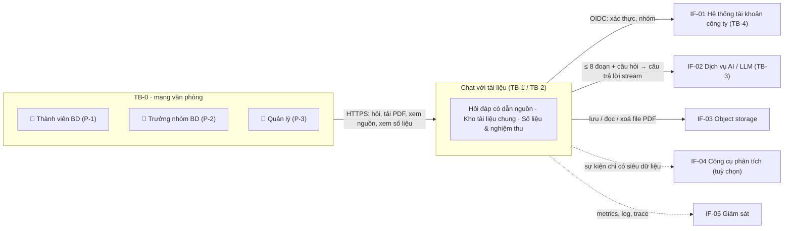
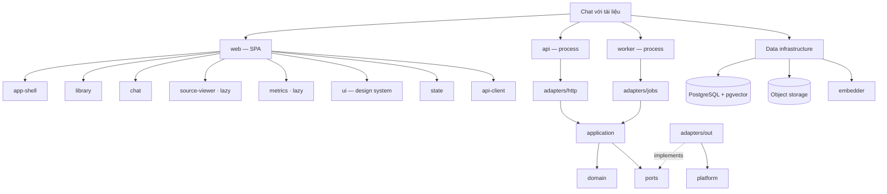
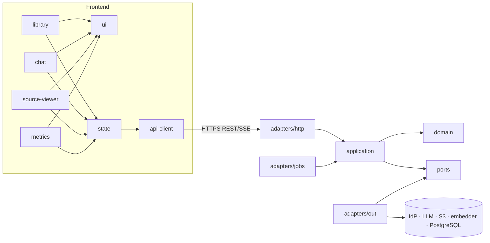
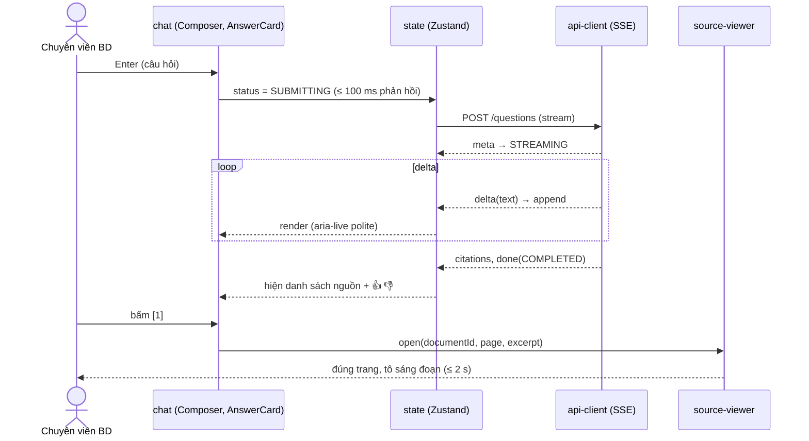
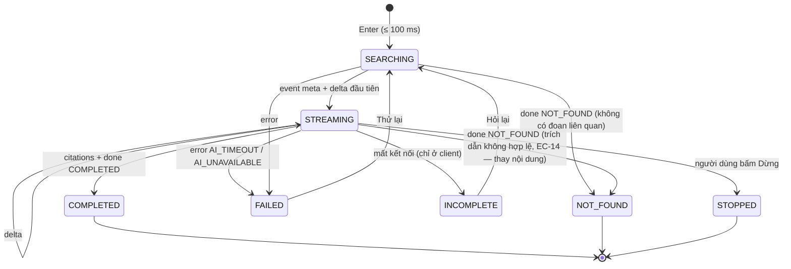
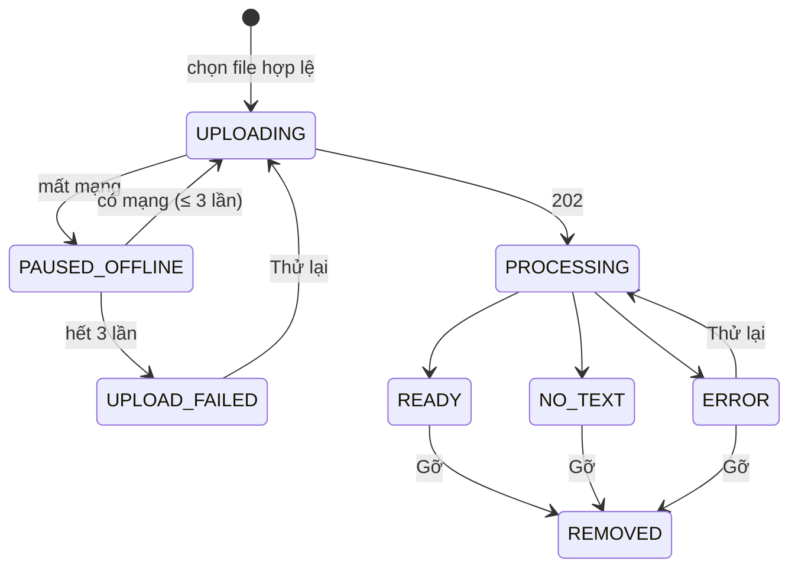

# Software Design Description (Blueprint) — Chat với tài liệu (MVP)

> **Chuẩn:** IEEE 1016-2009 · **Trạng thái:** Draft v1.0
>
> **Đầu vào:**
> - [BRD v0.3](../02-requirements/BRD.md), [PRD v0.2](../02-requirements/PRD.md), [SAD v0.1](../03-design/SAD.md)
> - Sơ đồ [Use case](../02-requirements/UseCase_ChatVoiTaiLieu.drawio) · [Activity](../02-requirements/ActivityDiagram_ChatVoiTaiLieu.drawio) · [Class](../02-requirements/ClassDiagram_ChatVoiTaiLieu.drawio) · [Sequence](../02-requirements/SequenceDiagram_ChatVoiTaiLieu.drawio)
>
> **Đầu ra kế tiếp:** [UI/UX design (HTML)](UI_UX_design/index.html)
>
> Blueprint này **không lặp lại** chi tiết đã có trong SAD. Nó tổ chức thiết kế theo các góc nhìn của IEEE 1016, bổ sung phần thiết kế giao diện người dùng (UX/UI), và **truy vết** từng mối quan tâm của bên liên quan tới phần tử thiết kế. Các mục `[Đề xuất]` kế thừa từ PRD và SAD, vẫn đang chờ xác nhận.

---

## 1. Context & Subject

### 1.1 System Identification

| Attribute | Value |
|---|---|
| **System Name** | Chat với tài liệu (MVP), tên chính thức `[TBD: OQ-001]` |
| **SDD Version** | v1.0 (Draft) |
| **Document Date** | 2026-10-19 |
| **Document Owner** | Kiến trúc sư phần mềm và nhóm thiết kế UX/UI |
| **Revision History** | v1.0, 2026-10-19, AI Architect Agent: bản đầu tiên, dựng từ SAD v0.1, PRD v0.2, BRD v0.3 · v1.1, 2026-10-19: review theo BluePrint_Design_IEEE_1016_2009_Checklist.xlsx; thêm context view (1.2) và Algorithm View (3.9) |

**Mô tả hệ thống.**
- **Mục đích:** ứng dụng web nội bộ cho đội phát triển kinh doanh (BD). Người dùng tải tài liệu PDF dạng văn bản vào **một kho chung** (PD-01), hỏi bằng tiếng Việt hoặc tiếng Anh, và nhận câu trả lời tổng hợp từ nhiều tài liệu.
- **Trích dẫn:** mỗi ý trong câu trả lời có trích dẫn tới **tài liệu và trang**. Bấm vào trích dẫn sẽ mở đúng trang nguồn cạnh khung chat.
- **Không đoán:** khi tài liệu không có thông tin, hệ thống nói rõ "không tìm thấy" thay vì đoán (BR-007, BR-008, RUL-002).
- **Kiến trúc:** modular monolith theo Clean Architecture, gồm SPA React, API FastAPI, worker, PostgreSQL + pgvector, object storage chuẩn S3, embedder nội bộ và LLM sau port `AnswerGenerator` (SAD ADR-01 → ADR-12).

### 1.2 System Scope and External Boundaries

| Boundary Type | Description |
|---|---|
| **System Purpose** | Giảm thời gian đội BD tìm thông tin rải rác trong nhiều PDF (BO-001, giảm ≥ 50%) bằng câu trả lời **kiểm chứng được** (BO-002, ≥ 80% đúng và có nguồn), đủ hữu ích để dùng hằng tuần (BO-003, ≥ 60% người dùng) |
| **External Systems** | **IF-01** hệ thống tài khoản công ty (OIDC IdP) · **IF-02** dịch vụ AI / LLM (đám mây hoặc nội bộ) · **IF-03** object storage (S3 / MinIO, có thể là dịch vụ được quản lý) · **IF-04** công cụ phân tích (mặc định là bảng sự kiện nội bộ; chuyển tiếp ra ngoài là tuỳ chọn, TQ-04) · **IF-05** giám sát (Prometheus / Grafana / Loki / Tempo) |
| **User Types** | Thành viên BD (P-1), Trưởng nhóm BD (P-2), Quản lý (P-3). IT / Bảo mật chỉ cấp quyền trên IdP, không dùng giao diện của hệ thống |
| **External Interfaces** | HTTPS REST/JSON + SSE (trình duyệt ↔ API) · OIDC Authorization Code + PKCE (API ↔ IdP) · HTTPS (API ↔ LLM) · S3 API (API / worker ↔ storage) · HTTP nội bộ (↔ embedder) · OTLP / Prometheus scrape (↔ giám sát) |
| **Trust Boundaries** | **TB-0** mạng văn phòng ↔ LB (TLS 1.3) · **TB-1** vùng ứng dụng riêng (api, worker, embedder; không nhận kết nối trực tiếp từ ngoài) · **TB-2** vùng dữ liệu (PostgreSQL, storage; chỉ nhận kết nối từ TB-1) · **TB-3** miền của bên thứ ba: LLM đám mây, chỉ nhận ≤ 8 đoạn tài liệu và câu hỏi (SEC-04) · **TB-4** miền IdP công ty |
| **Deployment Environment** | Một vùng, hai zone. **Phương án A (đám mây):** dịch vụ container được quản lý + PostgreSQL được quản lý + S3. **Phương án B (nội bộ):** Docker Compose trên 2 máy chủ + MinIO + Patroni. Lựa chọn chờ **OQ-008** (SAD ADR-12) |

**Context view** (chi tiết hơn: SAD 2.0, [use case diagram](../02-requirements/UseCase_ChatVoiTaiLieu.drawio)):



| Hệ thống **cung cấp** cho môi trường | Hệ thống **cần** từ môi trường |
|---|---|
| Hỏi đáp có trích dẫn tài liệu và trang; kho tài liệu chung; số liệu sử dụng; chạy nghiệm thu | Xác thực và nhóm người dùng (IF-01); sinh câu trả lời (IF-02); lưu trữ file (IF-03); hạ tầng giám sát (IF-05) |

### 1.3 Assumptions and Constraints

| Type | Description |
|---|---|
| **Technical Constraints** | Ứng dụng web, máy tính văn phòng, màn hình ≥ 1024 px (CON-001, ENV-01) · chỉ PDF dạng văn bản ≤ 50 MB (CON-002) · trả lời ≤ 30 s p95, phần đầu ≤ 5 s p95 (NFR-01, NFR-02) · TLS 1.2+ khi truyền, mã hoá khi lưu (SEC-02, SEC-03) · tài liệu không được dùng để huấn luyện AI của bên thứ ba (CON-005) · triển khai được cả đám mây lẫn nội bộ (OQ-008) |
| **Business Constraints** | Phạm vi MVP (CON-004); ngân sách và thời gian `[TBD: OQ-012]`; buổi đánh giá MVP sau 4 tuần sử dụng (PRD 5.2); phê duyệt bảo mật bằng văn bản là điều kiện ra mắt (LG-09, LG-12) |
| **Environmental Assumptions** | Mạng văn phòng ổn định, độ trễ tới LB < 50 ms; trình duyệt chuẩn của công ty ở 2 phiên bản mới nhất (PQ-004); IdP công ty hoạt động trong giờ làm việc; LLM đám mây có p95 thời gian ra token đầu ≤ 4,5 s (SAD 3.2.3, cần đo, TQ-02) |
| **Data Assumptions** | ≤ 500 tài liệu, ≤ 50 MB mỗi tài liệu (≤ 25 GB file gốc); ước tính ≤ 300.000 đoạn × 1.024 chiều ≈ 1,2 GB vector; ~600 câu hỏi/ngày; ≥ 80% PDF là dạng văn bản (ASM-003); giữ dữ liệu theo SAD 2.3 (hội thoại xoá khi kết thúc phiên; sự kiện 13 tháng `[Đề xuất]`) |

---

## 2. Stakeholders & Concerns

### 2.1 Stakeholder Identification

| Stakeholder | Role/Title | Primary Interest |
|---|---|---|
| **Thành viên BD (P-1)** | Người dùng cuối chính | Có câu trả lời đúng, có nguồn, nhanh; không phải học cách dùng |
| **Trưởng nhóm BD (P-2)** | Người dùng, người nghiệm thu | Chất lượng câu trả lời đo được (M-002); kiểm soát kho tài liệu (gỡ mọi tài liệu) |
| **Quản lý (P-3)** | Nhà tài trợ / chủ sản phẩm `[TBD: OQ-002]` | Chứng minh giá trị sau 4 tuần (M-001, M-003); chi phí AI (R-006) |
| **IT / Bảo mật (SH-005)** | Người phê duyệt bảo mật | Bảo vệ dữ liệu, phân quyền, nhật ký kiểm toán, cam kết của nhà cung cấp AI |
| **Đội phát triển** | Engineering | Dễ bảo trì, dễ kiểm thử, ranh giới module rõ |
| **DevOps / vận hành** | Platform | Dễ triển khai, dễ giám sát, khôi phục được (REL-01 → REL-03) |
| **Kỹ sư AI / chất lượng tìm kiếm** | Engineering (vai trò AI) | Chất lượng truy xuất và trích dẫn, ngưỡng "không tìm thấy" (TQ-07), bộ câu hỏi kiểm thử |
| **QA** | Kiểm thử | Mọi tiêu chí nghiệm thu và điều kiện ra mắt đều kiểm chứng được (LG-01 → LG-17) |
| **Đội Design** | UX/UI | Tuân thủ trụ cột UX-1 → UX-5, design system thống nhất |

**Persona người dùng** (đầu vào cho UI/UX; nguồn: PRD 2.1, BRD 6.3)

| Persona | Role | Goals | Pain Points | Tech Proficiency | Usage Frequency | Key Tasks |
|---|---|---|---|---|---|---|
| **P-1 Chuyên viên BD** | Thành viên BD | Có câu trả lời kèm trang nguồn trước cuộc họp với khách hàng | Mở và đọc lần lượt nhiều PDF; sợ bỏ sót điều khoản nằm ở file khác | Trung bình: dùng thành thạo email và văn phòng, không chuyên kỹ thuật | Nhiều lần mỗi ngày | Tải PDF, hỏi, kiểm chứng trích dẫn, sao chép câu trả lời, gỡ tài liệu của mình |
| **P-2 Trưởng nhóm BD** | Trưởng nhóm | Đội dùng thông tin đúng; nghiệm thu đạt ≥ 80% | Không kiểm soát được việc thành viên đã đọc đủ tài liệu chưa | Trung bình–khá | Hằng tuần, theo đợt nghiệm thu | Như P-1; gỡ mọi tài liệu; xem số liệu; chạy bộ câu hỏi kiểm thử |
| **P-3 Quản lý** | Quản lý / nhà tài trợ | Có số liệu để quyết định đầu tư tiếp | Không có số liệu về thời gian tra cứu | Trung bình | Hằng tuần | Xem trang số liệu; thỉnh thoảng hỏi đáp |

### 2.2 Stakeholder Concerns (IEEE 1016-2009)

| ID | Stakeholder | Concern | Priority | Acceptance Criteria |
|---|---|---|---|---|
| CN-01 | P-1, P-2 | Câu trả lời đúng và kiểm chứng được | High | ≥ 80% đúng và có dẫn đúng nguồn trên bộ câu hỏi kiểm thử (KR2.1); ≥ 90% trích dẫn đúng trang (KR2.3) |
| CN-02 | P-1 | Không bị đưa thông tin bịa | High | ≥ 9/10 câu không có đáp án trả về "không tìm thấy" (KR2.2); 0 câu trả lời COMPLETED mà không có trích dẫn (EC-14) |
| CN-03 | P-1 | Độ trễ thấp | High | Phần đầu ≤ 5 s, hoàn chỉnh ≤ 30 s ở p95 (NFR-01, NFR-02) |
| CN-04 | P-1 | Dùng được ngay, không cần đào tạo | High | ≥ 4/5 người dùng thử tự tải file và nhận câu trả lời có nguồn đầu tiên trong ≤ 3 phút (UX-S01) |
| CN-05 | P-1 | Biết rõ trạng thái tài liệu | Med | Trạng thái từng file cập nhật ≤ 3 s sau thay đổi; file "Sẵn sàng" ≤ 5 phút (NFR-03) |
| CN-06 | P-2 | Kiểm soát kho chung | Med | Chỉ người tải lên và trưởng nhóm gỡ được; 100% trường hợp sai quyền bị chặn (PD-02) |
| CN-07 | P-3 | Đo được giá trị | High | Trang số liệu hiển thị M-003, tỉ lệ hữu ích, p95 theo tuần (US-401) |
| CN-08 | P-3 | Kiểm soát chi phí AI | Med | Số token mỗi ngày được theo dõi; cảnh báo khi vượt 150% trung bình 7 ngày (SAD 4.3) |
| CN-09 | IT / Bảo mật | Bảo vệ dữ liệu và giới hạn truy cập | High | 100% truy cập trái phép bị từ chối (AC-012); TLS 1.2+; mã hoá khi lưu; không có nội dung trong log và sự kiện |
| CN-10 | IT / Bảo mật | Truy vết được ai làm gì | Med | Nhật ký kiểm toán ghi 100% hành động đăng nhập, upload, gỡ, từ chối truy cập (SEC-05) |
| CN-11 | IT / Bảo mật | Không khoá vào một nhà cung cấp AI | High | Đổi adapter LLM hoặc storage mà không sửa tầng domain/application (0 file thay đổi ngoài thư mục `adapters/`) |
| CN-12 | Engineering | Dễ bảo trì | Med | Một thay đổi trong một module ảnh hưởng ≤ 2 module khác; quy tắc import được kiểm tra trong CI |
| CN-13 | Engineering, QA | Dễ kiểm thử | Med | Coverage unit test ≥ 80% ở domain và application; bộ integration test ≤ 5 phút |
| CN-14 | DevOps | Dễ triển khai, khôi phục được | Med | Rolling update không gián đoạn; RTO ≤ 1 ngày, RPO ≤ 24 h (REL-02, REL-03) |
| CN-15 | DevOps | Dễ giám sát | Med | Mọi câu hỏi có trace đầu-cuối; 9 cảnh báo theo SAD 4.3 |
| CN-16 | Kỹ sư AI | Hiệu chỉnh được chất lượng | Med | Ngưỡng `τ`, top-k, prompt nằm trong cấu hình; chạy lại bộ kiểm thử ≤ 60 phút (US-402) |
| CN-17 | Design | Giao diện nhất quán, tiếp cận được | High | WCAG 2.1 AA; 100% màu, chữ, khoảng cách dùng token (2.5) |

### 2.3 Quality Attribute Scenarios

Định dạng 6 phần: Source · Stimulus · Artifact · Environment · Response · Response Measure.

| ID | Quality Attribute | Source | Stimulus | Artifact | Environment | Response | Response Measure |
|---|---|---|---|---|---|---|---|
| QAS-01 | **Performance** | Thành viên BD | Gửi một câu hỏi | api + LLM | Giờ cao điểm, 10 câu hỏi đồng thời, kho 500 tài liệu | Câu trả lời được stream, có trích dẫn | Phần đầu ≤ 5 s và hoàn chỉnh ≤ 30 s ở p95 trên 100 câu |
| QAS-02 | **Scalability** | Quản lý | Mở rộng sau MVP lên 3 lần số người dùng | api, embedder, PostgreSQL | Sau buổi đánh giá tuần 4 | Thêm bản sao api / embedder, nâng cấp CSDL; không sửa mã | Thông lượng tăng ≥ 2,5 lần khi tăng gấp 3 tài nguyên; không có giới hạn cứng trong mã (PRD 6.5) |
| QAS-03 | **Availability** | Hạ tầng | Một bản sao api hoặc zone gặp sự cố | LB, api, PostgreSQL | Giờ làm việc | LB rút bản sao lỗi; CSDL chuyển sang standby | Người dùng thấy gián đoạn ≤ 2 phút; ≥ 95% số ngày làm việc không gián đoạn (REL-01) |
| QAS-04 | **Availability (AI)** | Dịch vụ AI | Lỗi liên tục hoặc quá thời gian | Circuit breaker | Giờ làm việc | Ngắt mạch trong ≤ 60 s; kho tài liệu và vùng nguồn vẫn dùng được; giao diện hiện banner | 0 lỗi lan sang chức năng khác; tự thử lại sau 30 s (REL-04) |
| QAS-05 | **Security** | Người không thuộc đội BD | Truy cập giao diện hoặc API | access, PermissionPolicy | Bình thường | Từ chối, không lộ tên hay số lượng tài liệu | 100% của ≥ 20 ca thử bị từ chối (AC-012); TLS 1.3 / AES-256 |
| QAS-06 | **Security (riêng tư)** | Hệ thống | Ghi log, sự kiện, trace | Log và analytics pipeline | Bình thường | Lọc nội dung trước khi ghi | 0 trường `text`, `content`, `excerpt` trong log, sự kiện, span (kiểm thử tự động) |
| QAS-07 | **Answer Integrity** | LLM | Trả lời có trích dẫn không tồn tại hoặc không có trích dẫn | CitationPolicy | Bình thường | Chuyển thành NOT_FOUND | 100% câu trả lời COMPLETED có ≥ 1 trích dẫn hợp lệ |
| QAS-08 | **Maintainability** | Engineering | Đổi nhà cung cấp LLM | `adapters/llm` | Phát triển | Viết adapter mới thực hiện `AnswerGenerator` | 0 thay đổi ngoài `adapters/` và cấu hình; ≤ 3 ngày công |
| QAS-09 | **Testability** | CI | Mỗi pull request | Toàn bộ mã | CI | Chạy unit, integration, contract SSE, kiểm tra import | Coverage ≥ 80% (domain, application); integration ≤ 5 phút; LLM được giả lập bằng fake adapter |
| QAS-10 | **Deployability** | DevOps | Phát hành phiên bản mới | api, worker, SPA | Giờ làm việc | Rolling update, migration expand / contract | 0 câu hỏi đang chạy bị cắt (graceful 35 s); tự rollback nếu tỉ lệ 5xx > 2% trong 10 phút |
| QAS-11 | **Observability** | DevOps | Một câu trả lời chậm | OTel, Prometheus, Loki | Bình thường | Tìm ra bước chậm qua trace | Xác định nguyên nhân ≤ 10 phút; trace có đủ 8 span (SAD 4.3) |

### 2.4 UX/UI Quality Attribute Scenarios

| ID | Quality Attribute | UX/UI Scenario |
|---|---|---|
| UX-S01 | **Usability** | Người dùng lần đầu (P-1) tự tải 1 PDF và nhận câu trả lời có trích dẫn đầu tiên trong ≤ 3 phút, không cần hướng dẫn; ≥ 4/5 người dùng thử đạt, 0 lỗi nghiêm trọng |
| UX-S02 | **Accessibility** | Mọi phần tử tương tác dùng được bằng bàn phím (Tab, Enter, Esc) và trình đọc màn hình; câu trả lời đang stream được đọc qua vùng `aria-live="polite"`; đạt WCAG 2.1 AA (0 lỗi axe mức serious / critical) |
| UX-S03 | **Performance** | Trên mạng văn phòng: FCP ≤ 1,5 s, LCP ≤ 2,5 s, mở màn hình chính ≤ 3 s (NFR-04); phản hồi thị giác sau khi gửi câu hỏi ≤ 100 ms; mở trang nguồn ≤ 2 s (NFR-05) |
| UX-S04 | **Responsiveness** | Bố cục dùng được từ 1024 đến 2560 px, không cuộn ngang. 1024–1279 px: kho tài liệu thu gọn thành cột biểu tượng, vùng nguồn nổi đè lên khung chat. < 1024 px: thông báo "dùng màn hình rộng hơn để xem nguồn" (ENV-01) |
| UX-S05 | **Visual Consistency** | 100% màu, cỡ chữ, khoảng cách, bo góc, đổ bóng lấy từ token (3.6.3); lint CSS chặn mã màu viết trực tiếp ngoài file token |
| UX-S06 | **Error Recovery** | Mọi lỗi đều có thông điệp bằng ngôn ngữ thường ngày và **một hành động khắc phục** (Thử lại, Diễn đạt lại, Tải lại file), không cần tải lại trang; câu hỏi đang gõ không bị mất (EC-17) |
| UX-S07 | **Feedback & Affordance** | Mọi nút có trạng thái hover / active / focus / disabled; chỉ báo tải xuất hiện ≤ 300 ms; trạng thái "Không tìm thấy" dùng giao diện trung tính, không dùng màu lỗi (US-304) |
| UX-S08 | **Information Architecture** | Mọi chức năng đến được trong ≤ 2 lần bấm từ màn hình làm việc; kiểm chứng một trích dẫn mất đúng 1 lần bấm |
| UX-S09 | **Internationalization** | Giao diện tiếng Việt (OQ-014); hiển thị đúng dấu tiếng Việt (Unicode NFC); bố cục chịu được chữ dài thêm 30% khi có bản tiếng Anh; ngày `dd/MM/yyyy`, số theo định dạng `vi-VN` |
| UX-S10 | **Mobile Experience** | Không áp dụng cho MVP (CON-001, ENV-01). Vùng bấm tối thiểu 32 × 32 px trên desktop (vượt mức 24 px của WCAG 2.2 SC 2.5.8) |

### 2.5 UX/UI Constraints Matrix

| UX/UI Constraint | Requirement | Tool/Standard | Verification Method |
|---|---|---|---|
| **Color Contrast** | Chữ thường ≥ 4,5:1; chữ lớn và biểu tượng ≥ 3:1; viền focus ≥ 3:1 | WCAG 2.1 AA (1.4.3, 1.4.11) | axe-core trong CI + kiểm tra thủ công |
| **Typography** | Chữ nội dung 16 px; nhãn phụ ≥ 12 px; line-height 1,5; phóng to 200% không vỡ bố cục | Design system (3.6.3) | Design audit |
| **Touch Targets** | ≥ 32 × 32 px (desktop); cách nhau ≥ 8 px | WCAG 2.2 SC 2.5.8 | Kiểm thử giao diện |
| **Loading States** | Skeleton hoặc spinner ≤ 300 ms; câu trả lời có chỉ báo "Đang tìm trong N tài liệu…" | Thực hành UX | Theo dõi hiệu năng (sự kiện `answer_completed.latency_ms`) |
| **Error Messaging** | Rõ ràng, có hành động, không có mã kỹ thuật; dùng ngôi "bạn" | Hướng dẫn UX writing (PRD 4.2) | Rà soát nội dung |
| **Empty States** | Mọi trạng thái rỗng (kho rỗng, chưa có câu hỏi, danh sách lọc rỗng) đều hướng dẫn bước tiếp theo | Thực hành UX (EC-01, EC-02) | Kiểm kê giao diện |
| **Notifications** | Toast không chặn thao tác, tự ẩn sau 5 s, có `role="status"`; banner cố định cho mất mạng / AI gián đoạn | Thực hành UX | Thử nghiệm người dùng |
| **Help & Onboarding** | 3 câu hỏi mẫu ở trạng thái rỗng; tooltip giải thích trích dẫn `[n]` ở lần đầu | Thực hành UX | Đo UX-S01 |
| **Motion** | Hiệu ứng ≤ 320 ms; tắt khi người dùng bật `prefers-reduced-motion` | WCAG 2.1 (2.3.3) | Kiểm thử thủ công |

---

## 3. Design Views (IEEE 1016-2009 Core)

Mỗi view ghi rõ các concern (CN-xx) nó giải quyết.

### 3.1 Composition View

**Concern:** CN-11, CN-12, CN-13, CN-17.

| Element | Type | Parent | Responsibility | Dependencies |
|---|---|---|---|---|
| `web` | Subsystem (SPA) | System | Giao diện người dùng | `api` (REST + SSE) |
| `web/app-shell` | Module | web | Header, định tuyến, banner toàn cục, phiên | `web/state`, `web/ui` |
| `web/library` | Feature module | web | Kho tài liệu: tải lên, trạng thái, lọc, gỡ | `web/state`, `web/ui`, `web/api-client` |
| `web/chat` | Feature module | web | Ô câu hỏi, luồng hội thoại, thẻ câu trả lời, phản hồi | `web/state`, `web/ui`, `web/api-client` |
| `web/source-viewer` | Feature module (lazy) | web | Vùng nguồn, PDF.js, tô sáng đoạn | `web/api-client` |
| `web/metrics` | Feature module (lazy) | web | Trang số liệu, nghiệm thu | `web/api-client`, `web/ui` |
| `web/ui` | Package | web | Design system: token, component dùng chung | — |
| `web/state` | Package | web | TanStack Query (dữ liệu máy chủ), Zustand (trạng thái UI) | `web/api-client` |
| `web/api-client` | Package | web | Client REST có kiểu, trình đọc SSE, CSRF | — |
| `api` | Subsystem (process) | System | HTTP adapter, use case | `domain`, `ports` |
| `worker` | Subsystem (process) | System | Xử lý tài liệu, purge, nghiệm thu, dọn dẹp | `domain`, `ports` |
| `domain` | Package | backend | Thực thể, chính sách (Upload, Citation, Permission) | — |
| `application` | Package | backend | AccessService, DocumentService, DocumentProcessingService, QuestionAnsweringService, EvaluationService, MetricsService | `domain`, `ports` |
| `ports` | Package | backend | IdentityProvider, DocumentStorage, AnswerGenerator, EmbeddingProvider, ChunkIndex, AnalyticsSink, Repositories | `domain` |
| `adapters` | Package | backend | OIDC, S3/MinIO, LLM (cloud / on-prem), embedder HTTP, pgvector + FTS, SQLAlchemy, sự kiện Postgres | `ports`, SDK bên ngoài |
| `platform` | Package | backend | Cấu hình, logging có lọc nội dung, OTel, job runner, circuit breaker, rate limiter | — |



### 3.2 Logical View

**Concern:** CN-01, CN-02, CN-06, CN-12. Mô hình chi tiết ở [class diagram](../02-requirements/ClassDiagram_ChatVoiTaiLieu.drawio) (trang 1: miền, trang 2: dịch vụ).

| Thực thể / lớp | Trách nhiệm chính | Bất biến (invariant) |
|---|---|---|
| `User` (abstract) → `BDMember`, `BDLead`, `Manager` | Quyền theo vai trò | `canRemove(doc)`: BDLead luôn true; vai trò khác chỉ true với tài liệu do mình tải lên |
| `Session` | Phiên làm việc | Hết hạn sau 8 giờ không hoạt động; xoá kéo theo hội thoại |
| `DocumentLibrary` | Kho chung (PD-01) | Không có 2 tài liệu chưa gỡ trùng `contentHash` (trừ khi force) |
| `Document` | Vòng đời tài liệu | `isQueryable() ⇔ status = READY ∧ removedAt = null` |
| `TextChunk` | Đơn vị truy xuất | Luôn có `pageNumber`; không vượt ranh giới trang |
| `Answer` | Kết quả hỏi đáp | `status = COMPLETED ⇒ citations.size ≥ 1 ∧ mọi citation trỏ tới đoạn đã gửi cho LLM` |
| `Citation` (value object) | Vị trí nguồn | `(documentId, pageNumber, excerpt)` lấy từ `TextChunk`, không lấy từ chữ do LLM viết ra |
| `AnalyticsEvent` (abstract) | Sự kiện đo lường | Không có trường nội dung (danh sách thuộc tính cho phép) |

**Mô hình hiển thị (view model) ở giao diện:**

| View model | Trường | Nguồn |
|---|---|---|
| `DocumentVM` | `id, fileName, pageCount, status, uploadedByName, uploadedAt, canRemove, progress?` | `GET /documents` + tiến độ upload ở client |
| `TurnVM` | `questionId, text, answer: AnswerVM` | SSE + `GET …/questions` |
| `AnswerVM` | `answerId, text, status (STREAMING / COMPLETED / NOT_FOUND / FAILED / STOPPED / INCOMPLETE), citations[], latencyMs, feedback?` | SSE events |
| `CitationVM` | `index, documentId, fileName, page, excerpt, removed:boolean` | `event: citations` |
| `WeeklyMetricVM` | `week, wauRate, questions, notFoundRate, helpfulRate, p95LatencyMs` | `GET /metrics/weekly` |

### 3.3 Dependency View

**Concern:** CN-11, CN-12, CN-13.

| Quy tắc | Được phép | Bị cấm | Kiểm tra |
|---|---|---|---|
| DR-1 | `adapters → ports → domain`; `application → domain, ports` | `domain → *` (domain không phụ thuộc gì) | import-linter (CI) |
| DR-2 | Module `qa` đọc `TextChunk` qua port `ChunkIndex` | `qa` truy vấn trực tiếp bảng của `documents` | import-linter + review |
| DR-3 | `web/<feature>` → `web/ui`, `web/state`, `web/api-client` | Feature này import feature kia | eslint `boundaries` |
| DR-4 | `web/source-viewer` và `web/metrics` được tải lazy | Import tĩnh PDF.js ở bundle ban đầu | Kiểm tra kích thước bundle (3.8) |
| DR-5 | Chỉ `adapters/llm` được import SDK của nhà cung cấp AI | SDK AI xuất hiện ở nơi khác | import-linter |



### 3.4 Interaction View

**Concern:** CN-01 → CN-05, CN-07. Luồng hệ thống chi tiết: [sequence diagram](../02-requirements/SequenceDiagram_ChatVoiTaiLieu.drawio), [activity diagram](../02-requirements/ActivityDiagram_ChatVoiTaiLieu.drawio), SAD 3.2.

**Luồng tương tác của người dùng**

| ID | Flow Name | User Journey Steps | Decision Points | Error Paths | Success Criteria |
|---|---|---|---|---|---|
| F1 | Đăng nhập lần đầu | Mở đường dẫn → "Đăng nhập bằng tài khoản công ty" → IdP → quay về màn hình làm việc | Thuộc nhóm BD? | Không thuộc nhóm → màn hình từ chối (EC-18); IdP lỗi → "Thử lại" | Vào màn hình chính ≤ 5 s sau khi IdP xác thực (US-101) |
| F2 | Tải tài liệu | Bấm "Tải tài liệu" hoặc kéo-thả → kiểm tra ở client → tiến độ % → "Đang xử lý" → "Sẵn sàng" + toast | Định dạng / dung lượng hợp lệ? Trùng? Có chữ? | Sai định dạng / > 50 MB (EC-07, 08); mất mạng → tự thử lại (EC-04); có mật khẩu / hỏng (EC-09, 11); file scan (EC-10); trùng → hộp xác nhận (EC-12) | File 50 MB "Sẵn sàng" ≤ 5 phút; mỗi lỗi có hành động khắc phục |
| F3 | Hỏi và kiểm chứng | Gõ câu hỏi → Enter → "Đang tìm trong N tài liệu…" → câu trả lời hiện dần → danh sách nguồn → bấm `[n]` → vùng nguồn mở đúng trang → 👍 / 👎 hoặc Sao chép | Tìm thấy đoạn liên quan? Trích dẫn hợp lệ? Cần kiểm chứng? | Không tìm thấy (US-304); trích dẫn không hợp lệ → thay bằng "không tìm thấy" (EC-14); quá 30 s / AI lỗi (EC-13); mất mạng giữa chừng (EC-05); người dùng bấm Dừng (US-310) | Phần đầu ≤ 5 s; kiểm chứng bằng 1 lần bấm; KR2.1 ≥ 80% |
| F4 | Gỡ tài liệu | Menu "⋯" của tài liệu → "Gỡ" → hộp xác nhận nêu ảnh hưởng tới cả đội → Gỡ → toast | Có quyền gỡ (PD-02)? | Không có quyền → mục "Gỡ" không hiện; máy chủ trả `403` → toast lỗi | Tài liệu biến khỏi danh sách ≤ 1 s; không còn trong câu trả lời mới (AC-005) |
| F5 | Xem số liệu | Header → "Số liệu" → chọn số tuần → bảng và ô chỉ số | Vai trò là trưởng nhóm hoặc quản lý? | Không đủ quyền → mục menu không hiện; không có dữ liệu → trạng thái rỗng | Có đủ 5 chỉ số theo tuần (US-401) |
| F6 | Nghiệm thu chất lượng | Số liệu → tab "Nghiệm thu" → tải bộ câu hỏi (.xlsx) → chạy → theo dõi tiến độ → tải kết quả | File đúng mẫu? | Sai mẫu → lỗi nêu đúng dòng và cột | Có file kết quả để chấm M-002 (US-402) |



### 3.5 Information View

**Concern:** CN-02, CN-05, CN-09, CN-10. Lược đồ CSDL, index và thời gian giữ dữ liệu: SAD 2.3 và 3.1.

**Kho dữ liệu**

| Kho | Nội dung | Phân loại dữ liệu | Giữ trong bao lâu |
|---|---|---|---|
| PostgreSQL `documents.*` | Metadata tài liệu, trang, đoạn văn bản, vector | Mật nội bộ (`[TBD: OQ-008]`) | Đến khi gỡ + ≤ 24 h |
| PostgreSQL `qa.*` | Hội thoại, câu hỏi, câu trả lời, trích dẫn, phản hồi | Mật nội bộ | Đến khi phiên kết thúc |
| PostgreSQL `analytics.*` | Sự kiện chỉ có siêu dữ liệu | Nội bộ | 13 tháng `[Đề xuất]` |
| PostgreSQL `platform.audit_log` | Hành động, chủ thể, đối tượng, IP | Nội bộ, nhạy cảm | 12 tháng `[Đề xuất]` |
| Object storage | File PDF gốc | Mật nội bộ | Đến khi gỡ + ≤ 24 h; phiên bản cũ 7 ngày |

**Mô hình trạng thái giao diện (UI State Model)**

| UI State Name | Type | Description | Persistence | Scope |
|---|---|---|---|---|
| `session.me` | Global (server state) | Người dùng hiện tại, vai trò, quyền | Cache TanStack Query, làm mới khi focus lại cửa sổ | App |
| `library.documents` | Global (server state) | Danh sách `DocumentVM` | Cache TanStack; hỏi lại mỗi 3 s khi còn file đang xử lý | App |
| `library.uploads` | Global (client) | Hàng đợi upload: `{tempId, file, progress, attempt, status}` | Bộ nhớ (Zustand) | App |
| `library.filter` | Page | Chuỗi lọc theo tên | Bộ nhớ | Route `/` |
| `ui.libraryCollapsed` | Global (client) | Thu gọn kho tài liệu | `localStorage` | App |
| `chat.conversationId` | Global (client) | Hội thoại của phiên | Bộ nhớ (mất khi đăng xuất, PD-04) | App |
| `chat.turns` | Global (client) | Danh sách `TurnVM` | Bộ nhớ + `GET …/questions` khi tải lại trang | App |
| `chat.stream` | Component | `{answerId, status, abortController}` của câu trả lời đang chạy | Bộ nhớ | AnswerCard |
| `chat.draft` | Component | Câu hỏi đang gõ | `sessionStorage` (giữ khi phiên hết hạn, EC-17) | Composer |
| `source.panel` | Global (client) | `{open, documentId, page, excerpt}` | Bộ nhớ; có trong URL hash `#src=doc:page` để chia sẻ trong phiên | App |
| `net.online` | Global (client) | Trạng thái mạng | Sự kiện `online` / `offline` của trình duyệt | App |
| `ai.available` | Global (client) | Banner "Hỏi đáp tạm gián đoạn" | Lấy từ lỗi `AI_UNAVAILABLE`; tự xoá sau 30 s | App |
| `metrics.weeks` | Page | Số tuần đang xem (4 / 8 / 12) | URL query | Route `/metrics` |

**Lược đồ biểu mẫu (form schema)**

| Form | Trường | Kiểu | Kiểm tra (client = server) | Thông điệp lỗi |
|---|---|---|---|---|
| Upload | `file` | File[] | `type = application/pdf` hoặc đuôi `.pdf`; `size ≤ 50 MB`; tối đa 20 file mỗi lượt | "Chỉ hỗ trợ file PDF" · "File vượt 50 MB. Hãy tách file hoặc liên hệ trưởng nhóm" |
| Câu hỏi | `text` | string | `1 ≤ trim(len) ≤ 2000` | Bộ đếm `n/2000` chuyển màu cảnh báo khi > 1.800; nút Gửi bị vô hiệu khi > 2.000 |
| Phản hồi | `value`, `reason?` | enum `HELPFUL \| NOT_HELPFUL`; enum `wrong \| incomplete \| wrong_source \| other` | `reason` chỉ hiện khi 👎 | — |
| Xác nhận gỡ | — | — | Nút "Gỡ tài liệu" dùng màu nguy hiểm; focus mặc định đặt vào "Huỷ" | — |
| Bộ câu hỏi kiểm thử | `file` | .xlsx | Có các cột `question`, `expected_answer`, `expects_not_found`; ≤ 200 dòng | "Dòng 12: thiếu cột expected_answer" |

### 3.6 Interface View

**Concern:** CN-09, CN-11, CN-17.

#### 3.6.1 Giao diện hệ thống

Toàn bộ endpoint REST, hợp đồng SSE, mã lỗi RFC 9457 và giới hạn tần suất ở **SAD 2.4**. Các port backend ở **SAD 1.2** và class diagram trang 2.

#### 3.6.2 UI Component Interface Definition

| Component Name | Purpose | Props/Inputs | Events | States | Used In Pages |
|---|---|---|---|---|---|
| `AppHeader` | Tên sản phẩm, điều hướng, tài khoản | `user`, `activeRoute`, `canViewMetrics` | `onNavigate`, `onLogout` | default | workspace, metrics |
| `GlobalBanner` | Thông báo toàn cục | `kind: offline \| ai-unavailable \| session-expired`, `message` | `onRetry?` | visible, hidden | workspace |
| `LibraryPanel` | Kho tài liệu | `documents`, `uploads`, `filter`, `collapsed` | `onUpload(files)`, `onFilter(q)`, `onRemove(id)`, `onRetry(id)`, `onToggle` | empty, list, filtered-empty, collapsed | workspace |
| `UploadDropzone` | Nhận file kéo-thả hoặc chọn | `accept=".pdf"`, `maxSizeMb=50`, `variant: inline \| hero` | `onFiles(files)`, `onReject(file, reason)` | idle, drag-over, disabled | workspace |
| `DocumentItem` | Một tài liệu | `doc: DocumentVM`, `canRemove` | `onRemove`, `onRetry`, `onOpen` | uploading(%), paused-offline, processing, ready, no-text, error, removed | workspace |
| `StatusBadge` | Nhãn trạng thái | `status`, `label` | — | ready, processing, warning, error, neutral | workspace, design-system |
| `ChatThread` | Danh sách lượt hỏi đáp | `turns`, `readyCount` | — | empty-library, no-questions, list | workspace |
| `SuggestedQuestion` | Câu hỏi mẫu | `text` | `onPick(text)` | default, hover, focus | workspace |
| `QuestionComposer` | Ô câu hỏi | `disabled`, `disabledReason`, `maxLength=2000`, `streaming` | `onSubmit(text)`, `onStop()` | disabled, idle, typing, near-limit, over-limit, streaming | workspace |
| `AnswerCard` | Một câu trả lời | `answer: AnswerVM` | `onCitation(i)`, `onCopy`, `onFeedback(v, r)`, `onRetry` | searching, streaming, completed, not-found, failed, stopped, incomplete | workspace |
| `CitationChip` | Trích dẫn `[n]` bấm được | `index`, `fileName`, `page`, `removed`, `active` | `onClick` | default, hover, active, removed | workspace |
| `SourceList` | Danh sách nguồn cuối câu trả lời | `citations` | `onOpen(i)` | — | workspace |
| `SourcePanel` | Vùng nguồn (PDF.js) | `documentId`, `page`, `excerpt` | `onClose`, `onPage(n)`, `onOpenFull` | loading, page, removed, error | workspace |
| `FeedbackControl` | 👍 / 👎 + lý do | `value?` | `onSubmit(value, reason?)` | idle, helpful, not-helpful (mở lý do), sent | workspace |
| `ConfirmDialog` | Hộp xác nhận | `title`, `body`, `confirmLabel`, `danger` | `onConfirm`, `onCancel` | open, closed | workspace |
| `Toast` | Thông báo ngắn | `kind`, `message`, `durationMs=5000` | `onDismiss` | info, success, error | workspace, metrics |
| `EmptyState` | Hướng dẫn bước tiếp theo | `icon`, `title`, `body`, `action?` | `onAction` | — | workspace, metrics |
| `MetricTile` | Ô chỉ số | `label`, `value`, `target`, `trend` | — | on-target, off-target, no-data | metrics |
| `WeeklyTable` | Bảng số liệu theo tuần | `rows: WeeklyMetricVM[]` | — | data, empty | metrics |
| `AccessDenied` | Màn hình từ chối | `contact` | `onLogout` | — | login |

#### 3.6.3 Design System Token Interface

| Token Category | Token Name | Value | Usage |
|---|---|---|---|
| **Color** | `--color-primary` | `#1F5FBF` (6,1:1 trên nền trắng) | Nút chính, liên kết, focus, trích dẫn đang chọn |
| | `--color-primary-strong` | `#174A96` | Hover nút chính, chữ trên nền chip trích dẫn |
| | `--color-primary-soft` | `#EAF1FB` | Nền chip trích dẫn, nền câu hỏi của người dùng |
| | `--color-text` | `#111827` | Chữ chính |
| | `--color-text-muted` | `#5B6472` (5,9:1) | Chữ phụ, meta |
| | `--color-border` | `#D7DCE3` | Viền phân vùng |
| | `--color-surface` / `--color-canvas` | `#FFFFFF` / `#F6F7F9` | Nền thẻ / nền trang |
| | `--color-success` | `#157F3B` (5,1:1) | Trạng thái "Sẵn sàng" |
| | `--color-warning` | `#A15C07` (5,2:1) | "Không đọc được chữ", câu hỏi gần giới hạn |
| | `--color-danger` | `#B42318` (6,6:1) | Lỗi, nút "Gỡ tài liệu" |
| | `--color-neutral-state` | `#EEF0F3` | Nền thẻ "Không tìm thấy" (trung tính, UX-S07) |
| | `--color-highlight` | `#FFF3BF` | Tô sáng đoạn trích trong vùng nguồn |
| **Typography** | `--font-sans` | `"Segoe UI", system-ui, -apple-system, Roboto, "Helvetica Neue", Arial, sans-serif` | Toàn bộ giao diện (hiển thị tốt dấu tiếng Việt) |
| | `--text-xs / sm / base / lg / xl / 2xl` | 12 / 14 / 16 / 18 / 20 / 24 px | Meta / nhãn / nội dung / tiêu đề thẻ / tiêu đề vùng / tiêu đề trang |
| | `--leading` | 1,5 (nội dung), 1,25 (tiêu đề) | — |
| | `--weight-regular / semibold` | 400 / 600 | — |
| **Spacing** | `--space-1 … --space-12` | 4, 8, 12, 16, 20, 24, 32, 40, 48 px (bước 4 px) | Padding, gap |
| **Layout** | `--header-h`, `--library-w`, `--source-w` | 56 px, 288 px, 440 px | Bố cục 3 vùng |
| **Border Radius** | `--radius-sm / md / lg / full` | 4 / 8 / 12 / 999 px | Chip / nút, ô nhập / thẻ, dialog / badge |
| **Shadow** | `--shadow-sm / md / lg` | `0 1px 2px rgb(16 24 40 / .06)` / `0 4px 12px rgb(16 24 40 / .08)` / `0 16px 40px rgb(16 24 40 / .16)` | Thẻ / dropdown, toast / dialog |
| | `--focus-ring` | `0 0 0 3px rgb(31 95 191 / .45)` | Mọi phần tử có thể focus |
| **Animation** | `--motion-fast / base / slow` | 120 / 200 / 320 ms, `cubic-bezier(.2,0,0,1)` | Hover / mở panel / dialog; con trỏ nhấp nháy khi streaming 1 s |

### 3.7 State Dynamics View

**Concern:** CN-02, CN-03, CN-05.

**AnswerCard** (khớp `AnswerStatus` ở class diagram, thêm hai trạng thái chỉ có ở client):



**DocumentItem** (vòng đời ở máy chủ: SAD 3.1):



**QuestionComposer:** `DISABLED` (kho không có tài liệu "Sẵn sàng" / mất mạng / AI gián đoạn) ↔ `IDLE` → `TYPING` → (`NEAR_LIMIT` > 1.800 ký tự) → (`OVER_LIMIT` > 2.000, khoá nút Gửi) → `STREAMING` (nút Gửi thành nút Dừng) → `IDLE`.

### 3.8 Resource View

**Concern:** CN-03, CN-08, CN-14.

| Tài nguyên | Ngân sách | Ghi chú |
|---|---|---|
| Bundle JS ban đầu (gzip) | ≤ 200 KB | React + router + TanStack + Zustand + màn hình làm việc; PDF.js (~400 KB) và trang số liệu tải lazy (DR-4) |
| CSS (gzip) | ≤ 30 KB | Token + component |
| Bộ nhớ tab trình duyệt | ≤ 300 MB khi mở file 50 MB | PDF.js chỉ render trang hiện tại ± 1; huỷ tài liệu PDF khi đóng vùng nguồn |
| DOM | ≤ 3.000 node với 100 lượt hỏi đáp | Virtualize danh sách lượt khi > 50 lượt |
| Yêu cầu mạng định kỳ | 1 lần / 3 s chỉ khi còn file đang xử lý | Dừng khi tab bị ẩn (`visibilitychange`) |
| `api` | 2 × (2 vCPU, 2 GB) | Mỗi bản sao giữ ≤ 10 luồng SSE |
| `worker` | 1 × (2 vCPU, 4 GB) | 2 job xử lý tài liệu song song |
| `embedder` | 1 × (8 vCPU, 16 GB) | ~10 đoạn/s khi lập chỉ mục; truy vấn ≤ 200 ms (TQ-02) |
| PostgreSQL | 4 vCPU, 16 GB, SSD 100 GB | Index HNSW nằm vừa trong RAM (~1,2 GB) |
| LLM | ≤ 10 lời gọi đồng thời; ≤ 6.000 token vào, ≤ 800 token ra mỗi câu | Theo dõi `llm_tokens_total` (CN-08) |

### 3.9 Algorithm View

**Concern:** CN-01, CN-02, CN-03, CN-16. Các tham số (`τ`, top-k, kích thước đoạn) nằm trong cấu hình và được hiệu chỉnh bằng bộ câu hỏi kiểm thử (TQ-07).

**ALG-1 — Chia đoạn tài liệu** (`DocumentProcessingService`, SAD 2.2):

```text
for page in pdf.pages:                       # không bao giờ vượt ranh giới trang
    text = nfc_normalize(page.text); text = strip_repeated_header_footer(text)
    if total_chars(pdf) < 20 * page_count: return NO_TEXT
    for window in sliding_window(tokens(text), size=500, overlap=80, prefer_break="paragraph"):
        emit TextChunk(page_number=page.no, char_start, char_end, content=window)
embed in batches of 32 → upsert ChunkIndex
```

**ALG-2 — Truy xuất lai + Reciprocal Rank Fusion** (`ChunkIndex.search`, SAD 3.2.1 bước 6):

```text
q_vec   = embed(query)                                     # cache LRU 1.000
V       = top 30 by cosine(q_vec, chunk.embedding)  where doc ∈ readyDocs
F       = top 30 by ts_rank_cd(tsv, websearch_to_tsquery('simple', unaccent(query)))
score(c)= Σ_{list L ∈ {V,F}, c ∈ L} 1 / (60 + rank_L(c))   # RRF, k = 60
R       = sort by score desc; keep ≤ 3 per document; take top 8
if max_cosine(V) < τ (0,35) and F = ∅: return NOT_FOUND    # không gọi LLM
```

Độ phức tạp: HNSW cho truy vấn vector khoảng O(log N); GIN cho toàn văn. Mục tiêu ≤ 250 ms ở p95 với N ≤ 300.000 đoạn.

**ALG-3 — Kiểm tra trích dẫn** (`CitationPolicy`, QAS-07):

```text
if answer.text.strip() == "NOT_FOUND": return NOT_FOUND
refs = regex_findall(r"\[(\d+)\]", answer.text)
if refs = ∅ or any(n ∉ 1..len(R) for n in refs): return NOT_FOUND
for paragraph in split_paragraphs(answer.text):
    if no "[n]" in paragraph: return NOT_FOUND
citations = [Citation(n, R[n].document_id, R[n].page_number, R[n].content[:200]) for n in unique(refs)]
return COMPLETED(citations)                # vị trí nguồn lấy từ R, không lấy từ chữ do LLM viết
```

**ALG-4 — Ngân sách thời gian khi gọi LLM** (SAD 3.2.3, 4.2): kết nối 3 s; chưa có token đầu sau 10 s thì huỷ; tổng thời gian 28 s tính từ lúc nhận yêu cầu. Chỉ thử lại **1 lần**, và chỉ trước khi có token đầu tiên, với lỗi kết nối / 429 / 503. Circuit breaker mở khi ≥ 50% lỗi trong 60 s (tối thiểu 10 lời gọi) hoặc 5 lỗi liên tiếp; mở trong 30 s.

---

## 4. Design Elements & Resources

| Phần tử | Loại | Trách nhiệm | Tài nguyên | Chủ sở hữu | Concern |
|---|---|---|---|---|---|
| SPA `web` | Ứng dụng client | Mọi tương tác của người dùng | Trình duyệt (3.8) | Frontend | CN-04, CN-17 |
| `QuestionAnsweringService` | Use case | Truy xuất, gọi LLM, kiểm tra trích dẫn | CPU api; LLM | Backend | CN-01 → CN-03 |
| `CitationPolicy` | Chính sách domain | Kiểm tra trích dẫn hợp lệ | Không đáng kể | Backend | CN-01, CN-02 |
| `PermissionPolicy` | Chính sách domain | RBAC (PRD 6.3) | Không đáng kể | Backend | CN-06, CN-09 |
| `DocumentProcessingService` | Use case (worker) | Trích xuất, chia đoạn, embedding | worker + embedder | Backend | CN-05 |
| `ChunkIndex` (pgvector + FTS) | Adapter | Truy xuất lai, RRF | PostgreSQL | Backend / AI | CN-01, CN-16 |
| `AnswerGenerator` adapter | Adapter | Gọi LLM, streaming, circuit breaker | Mạng ra TB-3 | Backend | CN-03, CN-11 |
| `AnalyticsSink` + `MetricsService` | Adapter + use case | Sự kiện, số liệu tuần | PostgreSQL | Backend | CN-07, CN-08 |
| `audit_log` | Kho | Nhật ký kiểm toán | PostgreSQL (phân vùng theo tháng) | Backend / IT | CN-10 |
| Logging có lọc nội dung, OTel | Platform | Quan sát, bảo vệ riêng tư | Collector, Loki, Tempo | DevOps | CN-09, CN-15 |
| IaC + pipeline CI/CD | Hạ tầng | Triển khai, rollback | — | DevOps | CN-14 |

---

## 5. Design Rationale

| ID | Quyết định | Phương án đã cân nhắc | Đánh đổi | Concern |
|---|---|---|---|---|
| RAT-01 | Modular monolith + ports & adapters (SAD ADR-01) | Microservices; serverless | Ít tách biệt khi chạy, đổi lại vận hành đơn giản và chạy được cả hai môi trường | CN-11, CN-12, CN-14 |
| RAT-02 | Một PostgreSQL cho quan hệ + vector + FTS + hàng đợi (ADR-04, 05) | CSDL vector riêng; Redis / Celery | Phải tự tinh chỉnh pgvector; đổi lại ít thành phần và có giao dịch nhất quán | CN-12, CN-14 |
| RAT-03 | Máy chủ kiểm tra trích dẫn trước khi xác nhận COMPLETED | Tin trích dẫn do LLM tự ghi | Thêm khoảng 100 ms; đổi lại loại bỏ trích dẫn bịa | CN-01, CN-02 |
| RAT-04 | Stream câu trả lời, nhưng thay bằng "không tìm thấy" nếu kiểm tra thất bại | Chờ đủ rồi mới hiện (mất NFR-02); kiểm tra từng đoạn văn khi stream | Người dùng có thể thấy nội dung bị rút lại. **Chờ TQ-01** | CN-02, CN-03 |
| RAT-05 | Bố cục 3 vùng, vùng nguồn mở cạnh khung chat (UX-1) | Mở PDF ở tab mới; xem nguồn dạng popup | Cần màn hình ≥ 1280 px để tối ưu; kiểm chứng bằng 1 lần bấm (UX-S08) | CN-01, CN-04 |
| RAT-06 | "Không tìm thấy" dùng giao diện trung tính, kèm gợi ý hành động | Hiển thị như lỗi màu đỏ | Người dùng không coi đó là sự cố, nên tin hệ thống hơn (UX-2) | CN-02, CN-04 |
| RAT-07 | Ưu tiên desktop, không thiết kế cho di động (CON-001) | Mobile-first | Không dùng được trên điện thoại; phù hợp bối cảnh làm việc ở văn phòng | CN-04 |
| RAT-08 | Hội thoại chỉ sống trong phiên (PD-04) | Lưu lâu dài | Mất lịch sử khi đăng xuất; giảm rủi ro dữ liệu (OQ-016, OQ-021) | CN-09 |
| RAT-09 | Embedding chạy nội bộ (ADR-08) | API embedding của nhà cung cấp | Cần 8 vCPU; đổi lại toàn bộ tài liệu không phải gửi ra ngoài | CN-09, CN-11 |
| RAT-10 | Design token + component dùng chung, ép bằng lint | CSS viết riêng từng màn hình | Tốn công thiết lập ban đầu; nhất quán 100% (UX-S05) | CN-17 |
| RAT-11 | Phiên do BFF giữ, cookie HttpOnly (ADR-10) | SPA giữ JWT | Phải chống CSRF; không lộ token khi có lỗi XSS | CN-09 |

---

## 6. Traceability

### 6.1 Concern → View → Design Element

| Concern | Views | Design elements |
|---|---|---|
| CN-01 Đúng và kiểm chứng được | 3.2, 3.4, 3.7 | `CitationPolicy`, `ChunkIndex`, `AnswerCard`, `CitationChip`, `SourcePanel` |
| CN-02 Không bịa | 3.2, 3.7 | Kiểm tra trích dẫn, ngưỡng `τ`, trạng thái NOT_FOUND, RAT-03, RAT-06 |
| CN-03 Độ trễ | 3.4, 3.8 | SSE, ngân sách độ trễ (SAD 3.2.3), semaphore, AnswerCard SEARCHING / STREAMING |
| CN-04 Dùng được ngay | 2.4, 3.6.2 | `EmptyState`, `SuggestedQuestion`, `UploadDropzone`, bố cục 3 vùng |
| CN-05 Trạng thái tài liệu | 3.5, 3.7 | `DocumentItem`, `StatusBadge`, polling 3 s, toast "Sẵn sàng" |
| CN-06 Kiểm soát kho chung | 3.2, 3.4 (F4) | `PermissionPolicy`, `canRemove`, `ConfirmDialog` |
| CN-07, CN-08 Đo lường, chi phí | 3.4 (F5), 3.8 | `MetricsService`, `MetricTile`, `WeeklyTable`, `llm_tokens_total` |
| CN-09, CN-10 Bảo mật, kiểm toán | 1.2 (trust boundaries), 3.5 | BFF, RBAC, mã hoá, lọc log, `audit_log` |
| CN-11, CN-12 Không khoá nhà cung cấp, dễ bảo trì | 3.1, 3.3 | Ports & adapters, DR-1 → DR-5 |
| CN-13 Dễ kiểm thử | 3.3 | Fake adapter, contract test SSE |
| CN-14, CN-15 Triển khai, giám sát | 3.8, 4 | IaC, rolling update, OTel, cảnh báo |
| CN-16 Hiệu chỉnh chất lượng | 3.4 (F6) | `EvaluationService`, cấu hình `τ` và top-k |
| CN-17 Nhất quán, tiếp cận được | 2.5, 3.6.3 | Design token, WCAG 2.1 AA |

### 6.2 Requirement → Design → Verification

| Yêu cầu | Phần tử thiết kế | Xác minh |
|---|---|---|
| BR-001 / US-201, US-202 | `UploadDropzone`, `DocumentItem`, `DocumentService`, `process_document` | LG-07; test E2E tải file 50 MB |
| BR-002, BR-003 / US-301, US-302 | `QuestionComposer`, `QuestionAnsweringService`, truy xuất lai | LG-03 (bộ câu hỏi kiểm thử) |
| BR-007 / US-303, US-305 | `CitationPolicy`, `CitationChip`, `SourcePanel` | LG-05 (mẫu 30 trích dẫn); NFR-05 |
| BR-008 / US-304, EC-14 | Trạng thái NOT_FOUND, ngưỡng `τ` | LG-04 |
| BR-009 / NFR-01, NFR-02 / US-306 | SSE, ngân sách độ trễ | LG-06; đo p95 |
| BR-012 / US-101, US-102 | BFF OIDC, `PermissionPolicy`, `AccessDenied` | LG-10 |
| BR-014 / REL-01 → REL-05 | Hai bản sao, circuit breaker, `GlobalBanner` | LG-17; diễn tập khôi phục |
| US-204 / PD-02 | `canRemove`, `ConfirmDialog`, `purge_document` | AC-005; SEC-06 (≤ 24 h) |
| US-309 / KR3.2 | `FeedbackControl`, sự kiện `answer_feedback_submitted` | LG-15 |
| US-401, US-402 | `metrics` page, `EvaluationService` | Demonstration |
| SEC-05, PRD 5.2 | Lọc log, danh sách thuộc tính sự kiện cho phép | QAS-06 (kiểm thử tự động) |
| ENV-01, UX-4 | Bố cục ≥ 1024 px, thông báo khi < 1024 px | UX-S04 |

### 6.3 Mục còn mở ảnh hưởng tới thiết kế

| ID | Mục | Phần bị ảnh hưởng |
|---|---|---|
| TQ-01 | Stream rồi thay bằng "không tìm thấy" | RAT-04, `AnswerCard` |
| OQ-008 / AR-01 | Đám mây hay nội bộ | 1.2 Deployment, RAT-09, adapter LLM |
| PQ-001, PQ-002 | Kho chung; quyền gỡ | `PermissionPolicy`, F4 |
| PQ-004 | Trình duyệt chuẩn của công ty | 1.3, kiểm thử hồi quy |
| OQ-014 | Ngôn ngữ giao diện | UX-S09 |
