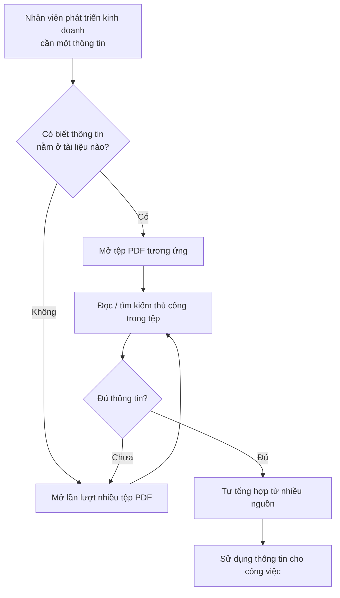
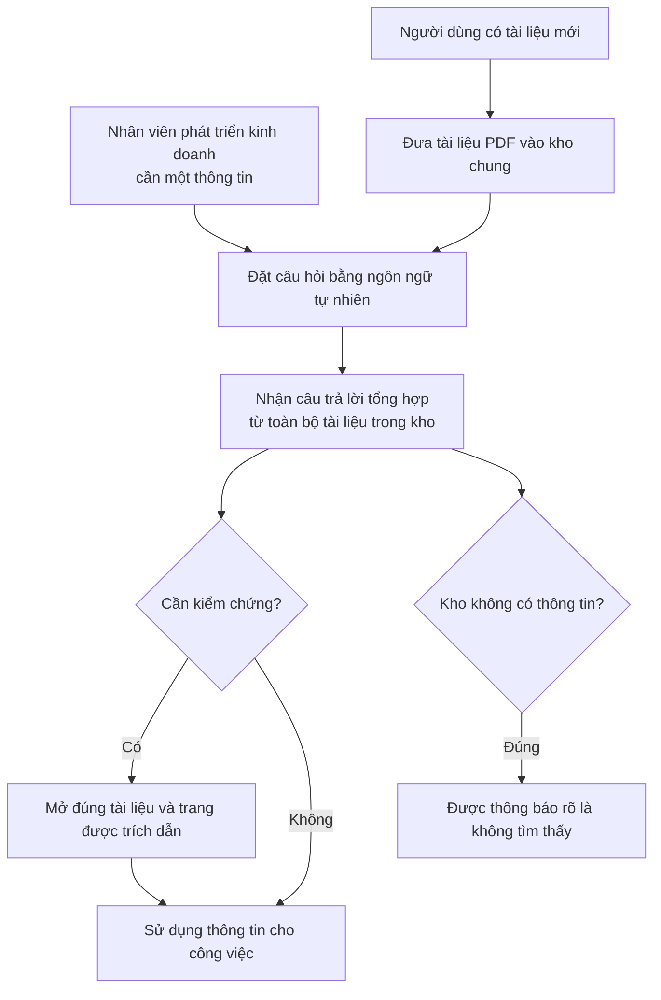

# Tài liệu Yêu cầu Nghiệp vụ (BRD) — Công cụ "Chat với tài liệu" (MVP)

> **Chuẩn áp dụng:** IEEE 29148-2018 · **Prompt nguồn:** `BRD_Prompt_IEEE_standard.md` v1.0
> **Quy ước từ chuẩn tắc:** **PHẢI** = *shall* (bắt buộc) · **NÊN** = *should* (mong muốn) · **CÓ THỂ** = *may* (được phép). Không dùng "sẽ", "cần", "có khả năng" làm động từ chuẩn tắc.

---

## 0. Tóm tắt đánh giá đầu vào

**Đầu vào đã nhận**

| Source ID | Nguồn | Loại | Chủ sở hữu | Ngày / phiên bản | Chứng minh điều gì |
|---|---|---|---|---|---|
| SRC-001 | Đề bài dự án, slide 2 "Dự án" trong `Day_4-Practice-Agentic-in-Analysis-Design.pptx` (cũng có trong §2.1 của prompt) | Sponsor brief | Quản lý giao yêu cầu (tên: [TBD: OQ-001]) | 2026-10-19 | Vấn đề nghiệp vụ, mục tiêu MVP, kênh web, định dạng PDF, quyền đề xuất tính năng của BA |
| SRC-002 | Slide 5–7 "Nhiệm vụ của hôm nay" / "Yêu cầu cho tài liệu của dự án" (cùng tệp) | Chỉ thị tổ chức | Quản lý / người hướng dẫn | 2026-10-19 | Ràng buộc về tài liệu: thư mục `./docs`, định dạng `.md`/`.drawio`, bản PDF cho người phê duyệt, đạt ít nhất 3 lớp thấp nhất của tháp chất lượng |
| SRC-003 | `BRD_Prompt_IEEE_standard.md` | Chuẩn / hướng dẫn | Đội BA | v1.0 | Cấu trúc và quy tắc chất lượng của BRD |
| SRC-004 | Phân tích và đề xuất của đội BA (tài liệu này) | Phân tích BA | Đội BA | 2026-10-19 | Các tính năng bổ sung được đề xuất theo quyền ghi trong SRC-001. **Mọi nội dung dựa trên SRC-004 phải được sponsor xác nhận (OQ-014).** |

**Đầu vào còn thiếu:** tên sponsor, business owner và người phê duyệt. Chưa có số liệu baseline (thời gian tìm thông tin hiện nay, số lượng và kích thước tài liệu, số người dùng). Ngoài ra còn thiếu: ngân sách và mốc thời gian, mức phân loại bảo mật của tài liệu, chính sách sử dụng dịch vụ AI, phỏng vấn người dùng cuối (đội phát triển kinh doanh) và mô tả quy trình hiện tại.

**Ba rủi ro lớn nhất đối với chất lượng yêu cầu**

1. **Không có baseline định lượng.** Không chứng minh được mục tiêu "giảm thời gian tìm thông tin" (BO-001). Các ngưỡng của BR-011 và BR-012 vẫn còn `[TBD]`.
2. **Chưa rõ ràng buộc bảo mật dữ liệu.** Nếu tài liệu kinh doanh không được phép gửi tới dịch vụ AI bên ngoài, phạm vi khả thi của toàn bộ giải pháp sẽ thay đổi (OQ-008, RSK-002).
3. **Chỉ có một nguồn là brief ngắn của quản lý, chưa có tiếng nói của người dùng cuối.** Các nhu cầu SN-xxx hiện là suy luận của BA, cần phỏng vấn đội phát triển kinh doanh để xác nhận (OQ-016).

---

## 4.1 Kiểm soát tài liệu

| Thuộc tính | Giá trị |
|---|---|
| Tiêu đề | Tài liệu Yêu cầu Nghiệp vụ — Công cụ "Chat với tài liệu" (MVP) |
| Mã tài liệu | BRD-CWD-001 |
| Phiên bản | 0.1 |
| Trạng thái | Draft |
| Tác giả | Đội BA |
| Người đóng góp | [TBD: OQ-001] |
| Người review | Đại diện đội phát triển kinh doanh, trưởng nhóm kỹ thuật, bộ phận bảo mật thông tin. Tên cụ thể: [TBD: OQ-001] |
| Người phê duyệt | Quản lý giao yêu cầu (SRC-001). Tên cụ thể: [TBD: OQ-001] |
| Phân loại bảo mật | Nội bộ (Internal) |
| Danh sách phân phối | Sponsor, đội phát triển kinh doanh, đội BA, đội phát triển, bộ phận bảo mật thông tin |

**Lịch sử phiên bản**

| Phiên bản | Ngày | Tác giả | Tóm tắt thay đổi |
|---|---|---|---|
| 0.1 | 2026-10-19 | Đội BA | Bản nháp đầu tiên, xây dựng từ SRC-001 đến SRC-004 |

---

## 4.2 Tóm tắt điều hành

**Vấn đề.** Dự án kinh doanh có nhiều tài liệu PDF. Đội phát triển kinh doanh khó nắm hết nội dung, và mỗi lần cần một thông tin họ phải mở và tổng hợp từ nhiều tệp (SRC-001). Mức thiệt hại về thời gian **chưa được đo** `[TBD: OQ-002]`.

**Thay đổi đề xuất.** Xây dựng MVP một ứng dụng web nội bộ. Người dùng đưa các tài liệu PDF vào một kho chung, rồi đặt câu hỏi bằng ngôn ngữ tự nhiên. Câu trả lời được tổng hợp từ nội dung toàn bộ tài liệu trong kho, kèm trích dẫn tài liệu và trang nguồn để người dùng tự kiểm chứng (SRC-001, SRC-004).

**Lợi ích kỳ vọng và cách đo**

- Giảm thời gian tìm một thông tin nghiệp vụ (MET-001; baseline và mục tiêu `[TBD: OQ-002, OQ-003]`).
- Câu trả lời đáng tin và kiểm chứng được (MET-002 về độ chính xác, MET-003 về tỷ lệ có trích dẫn).
- Có dữ liệu thực để quyết định có đầu tư tiếp sau MVP hay không (MET-004 về mức sử dụng, MET-005 về mức hữu ích).

**Đầu tư, tiến độ, rủi ro.** Ngân sách và mốc thời gian chưa xác định `[TBD: OQ-004]`. Các rủi ro chính:

- Lộ dữ liệu khi xử lý bằng dịch vụ AI (RSK-002).
- AI trả lời sai hoặc bịa thông tin (RSK-001).
- Không chứng minh được giá trị vì thiếu baseline (RSK-004).

**Quyết định cần từ người phê duyệt**

1. Phê duyệt phạm vi MVP tại §4.5 và các yêu cầu mức Must.
2. Chỉ định người chịu trách nhiệm và hạn trả lời cho các câu hỏi mở chặn tiến độ: OQ-002, OQ-003, OQ-008, OQ-011.
3. Chấp nhận hoặc loại bỏ các tính năng do BA đề xuất (OQ-014).

---

## 4.3 Bối cảnh nghiệp vụ và phát biểu vấn đề

### Quy trình hiện tại (As-is)

Quy trình dưới đây do BA suy ra từ SRC-001 `[Unverified]` và cần được xác nhận qua phỏng vấn (OQ-016).

### Quy trình mong muốn (To-be, mức nghiệp vụ)

### Ai bị ảnh hưởng và như thế nào

| Đối tượng | Ảnh hưởng | Bằng chứng |
|---|---|---|
| Đội phát triển kinh doanh | Tốn thời gian tìm và tổng hợp thông tin, khó nắm hết nội dung tài liệu | SRC-001 |
| Quản lý | Năng suất đội thấp hơn mức có thể; thiếu công cụ để khai thác tri thức trong tài liệu | Suy ra từ SRC-001 `[Unverified]` |

### Cái giá của việc không hành động

- **Chi phí thời gian:** số giờ mỗi tuần dành cho việc tìm thông tin `[TBD: OQ-002]`.
- **Rủi ro chất lượng:** bỏ sót thông tin khi không đọc hết tài liệu, dẫn tới quyết định kinh doanh dựa trên dữ liệu không đầy đủ `[Unverified]`.
- **Doanh thu, tuân thủ, khách hàng:** chưa có bằng chứng `[TBD: OQ-002]`.

### Nguyên nhân gốc và triệu chứng

| Triệu chứng (quan sát được) | Nguyên nhân gốc (giả thuyết, `[Unverified]`) |
|---|---|
| Mất nhiều thời gian để tìm một thông tin | Tri thức nằm rải rác trong nhiều tệp PDF độc lập, không có điểm truy vấn chung |
| Khó nắm hết nội dung tài liệu | Khối lượng tài liệu vượt quá khả năng đọc của từng cá nhân |
| Phải tự tổng hợp thủ công | Tìm kiếm theo từ khóa trong từng tệp không trả lời được câu hỏi cần ghép thông tin từ nhiều tài liệu |

### Tại sao là bây giờ

Quản lý đã giao yêu cầu xây dựng MVP (SRC-001). Lý do cấp bách về kinh doanh, ví dụ một hợp đồng hay một mốc dự án sắp tới, chưa được nêu `[TBD: OQ-004]`.

---

## 4.4 Động lực và mục tiêu nghiệp vụ

| ID | Động lực nghiệp vụ | Mục tiêu (kết quả, không phải hoạt động) | Metric ID | Baseline | Target | Thời hạn | Nguồn |
|---|---|---|---|---|---|---|---|
| BO-001 | Mất nhiều thời gian tìm và tổng hợp thông tin từ nhiều PDF | Giảm thời gian để đội phát triển kinh doanh có được câu trả lời cho một câu hỏi nghiệp vụ dựa trên tài liệu dự án | MET-001 | [TBD: OQ-002] | [TBD: OQ-003] | [TBD: OQ-004] | SRC-001 |
| BO-002 | Câu trả lời dùng cho công việc kinh doanh phải đáng tin | Người dùng nhận câu trả lời đúng với nội dung tài liệu và kiểm chứng được nguồn | MET-002, MET-003 | Không áp dụng (năng lực mới) | [TBD: OQ-011] | Khi nghiệm thu MVP | SRC-001, SRC-004 |
| BO-003 | Quản lý cần bằng chứng để quyết định đầu tư sau MVP | MVP được đội phát triển kinh doanh sử dụng thường xuyên và đánh giá là hữu ích | MET-004, MET-005 | Không áp dụng (năng lực mới) | [TBD: OQ-003] | [TBD: OQ-004] (ví dụ 4 tuần sau triển khai) | SRC-001 ("MVP"), SRC-004 |
| BO-004 | Tài liệu dự án kinh doanh có thể chứa thông tin nhạy cảm | Đưa tài liệu vào công cụ mà không làm lộ thông tin cho người không có quyền | MET-006 | Không áp dụng | 0 sự cố | Suốt thời gian vận hành MVP | SRC-004 `[Unverified]`, OQ-008 |

**Định nghĩa chỉ số**

| Metric ID | Định nghĩa | Công thức | Nguồn dữ liệu | Chủ sở hữu | Tần suất | Ngày baseline |
|---|---|---|---|---|---|---|
| MET-001 | Thời gian trung bình từ lúc người dùng bắt đầu tìm đến lúc có câu trả lời mà họ chấp nhận, đo trên bộ câu hỏi chuẩn (DEP-003) | Σ thời gian / số câu hỏi; so sánh cách làm hiện tại với cách làm có công cụ, cùng bộ câu hỏi và cùng nhóm người dùng | Bấm giờ có quan sát (time-and-motion) với ≥ 3 người dùng | Business owner [TBD: OQ-001] | Một lần trước triển khai (baseline), một lần khi nghiệm thu | [TBD: OQ-002] |
| MET-002 | Tỷ lệ câu trả lời được chuyên gia nghiệp vụ đánh giá "đúng và đầy đủ" so với đáp án chuẩn | Số câu đạt / tổng số câu trong bộ câu hỏi chuẩn × 100% | Bộ câu hỏi chuẩn (DEP-003) và phiếu chấm | Đại diện đội phát triển kinh doanh | Mỗi đợt nghiệm thu | Không áp dụng |
| MET-003 | Tỷ lệ câu trả lời (khác "không tìm thấy") có trích dẫn đúng tài liệu và trang chứa thông tin | Số câu có trích dẫn đúng / số câu có nội dung trả lời × 100% | Bộ câu hỏi chuẩn | Đội BA | Mỗi đợt nghiệm thu | Không áp dụng |
| MET-004 | Số người dùng hoạt động hằng tuần (người đặt ít nhất 1 câu hỏi trong tuần) so với tổng số người dùng mục tiêu | Số người dùng hoạt động / số người dùng mục tiêu [TBD: OQ-012] × 100% | Số liệu sử dụng (BR-020) | Business owner | Hằng tuần | Không áp dụng |
| MET-005 | Tỷ lệ câu trả lời được người dùng đánh giá "hữu ích" | Số đánh giá "hữu ích" / tổng số đánh giá × 100% | Phản hồi của người dùng (BR-019) | Business owner | Hằng tuần | Không áp dụng |
| MET-006 | Số sự cố truy cập trái phép vào tài liệu hoặc câu trả lời | Đếm sự cố được xác nhận | Nhật ký truy cập (BR-018) và báo cáo sự cố | Bộ phận bảo mật thông tin | Hằng tháng | Không áp dụng |

> Theo SRC-003, BO-001 và BO-003 **chưa phải mục tiêu hợp lệ** cho tới khi baseline và target được điền (OQ-002, OQ-003).

---

## 4.5 Phạm vi

### Trong phạm vi (MVP)

| Hạng mục | Nội dung |
|---|---|
| Năng lực nghiệp vụ | (1) Xây dựng và duy trì một kho tài liệu PDF dùng chung; (2) hỏi đáp bằng ngôn ngữ tự nhiên trên nội dung kho, có trích dẫn nguồn; (3) kiểm soát truy cập; (4) thu thập số liệu để đánh giá MVP |
| Đơn vị tổ chức | Đội phát triển kinh doanh của dự án (SRC-001) |
| Kênh | Ứng dụng web (SRC-001) |
| Miền dữ liệu | Tài liệu PDF của dự án kinh doanh (SRC-001); câu hỏi, câu trả lời và phản hồi của người dùng |
| Địa lý / ngôn ngữ | [TBD: OQ-006] |

### Ngoài phạm vi

| Hạng mục | Lý do |
|---|---|
| Định dạng khác PDF (Word, Excel, PowerPoint, ảnh, email) | SRC-001 chỉ nêu PDF; giữ MVP gọn |
| Chỉnh sửa nội dung tài liệu gốc | Công cụ chỉ phục vụ tra cứu |
| Kết nối tự động với kho lưu trữ khác (ổ chia sẻ, hệ thống quản lý tài liệu) | Không có trong SRC-001; làm tăng phạm vi tích hợp |
| Ứng dụng di động bản địa | SRC-001 xác định kênh web |
| Người dùng bên ngoài tổ chức (khách hàng, đối tác) | Đối tượng trong SRC-001 là đội phát triển kinh doanh nội bộ |
| Xuất câu trả lời hoặc lịch sử hội thoại ra tệp (BR-023) | Ưu tiên Won't trong bản phát hành này |

### Hoãn sang giai đoạn sau

| Hạng mục | Điều kiện để xem xét lại |
|---|---|
| Trích xuất nội dung PDF dạng ảnh scan | Phụ thuộc OQ-007 (tỷ lệ tài liệu scan) |
| Phân quyền theo từng tài liệu hoặc từng nhóm | Phụ thuộc OQ-009 (mô hình chia sẻ kho) |
| So sánh nội dung giữa các tài liệu, phát hiện mâu thuẫn | Đề xuất BA cho giai đoạn 2 |
| Giao diện đa ngôn ngữ | Phụ thuộc OQ-006 |

### Ranh giới

Sáng kiến bắt đầu từ khi người dùng có trong tay một tệp PDF và muốn đưa vào kho. Sáng kiến kết thúc khi người dùng nhận được câu trả lời có trích dẫn. Việc thu thập, phê duyệt hay phân phối tài liệu gốc trong tổ chức, cũng như các quyết định kinh doanh dựa trên câu trả lời, nằm ngoài ranh giới này.

---

## 4.6 Các bên liên quan và nhu cầu

| ID | Bên liên quan / nhóm | Vai trò trong nghiệp vụ | Mối quan tâm | Ảnh hưởng | Nhu cầu | Nguồn |
|---|---|---|---|---|---|---|
| STK-001 | Quản lý giao yêu cầu (sponsor) | Đặt bài toán, phê duyệt BRD và ngân sách MVP | Năng suất đội, bằng chứng giá trị để đầu tư tiếp | Cao | SN-009 | SRC-001, SRC-002 |
| STK-002 | Đội phát triển kinh doanh | Người dùng cuối; người sở hữu và sử dụng tài liệu | Tìm đúng thông tin nhanh, tin được câu trả lời | Cao | SN-001 đến SN-008 | SRC-001 |
| STK-003 | Đội BA | Phân tích yêu cầu, đề xuất tính năng | Yêu cầu rõ, truy vết được | Trung bình | — (bên thực hiện) | SRC-001, SRC-002 |
| STK-004 | Đội phát triển / kỹ thuật | Xây dựng và vận hành MVP | Yêu cầu khả thi, ràng buộc rõ | Trung bình | SN-011 | SRC-002 |
| STK-005 | Bộ phận bảo mật thông tin / pháp chế | Chấp thuận việc xử lý tài liệu nội bộ bằng công cụ AI | Không lộ dữ liệu, tuân thủ chính sách | Cao. **Có thể chặn triển khai** | SN-010 | `[Unverified]`, OQ-008 |
| STK-006 | Nhân viên phát triển kinh doanh ngại thay đổi | Người dùng tiềm năng quen cách làm thủ công | Không mất thời gian học công cụ mới; ngại tin vào AI | Trung bình. **Có thể cản trở việc áp dụng** | SN-003, SN-005 | `[Unverified]`, RSK-006 |

**Nhu cầu của các bên liên quan**

| ID | Bên liên quan | Phát biểu nhu cầu | Nỗi đau hiện tại | Bằng chứng | Ưu tiên |
|---|---|---|---|---|---|
| SN-001 | STK-002 | "Tôi muốn có thông tin mình cần mà không phải mở từng tệp PDF." | Tốn thời gian tìm trong nhiều tệp | SRC-001 | Must |
| SN-002 | STK-002 | "Tôi muốn hỏi một câu và được trả lời bằng thông tin gộp từ nhiều tài liệu." | Phải tự tổng hợp thủ công | SRC-001 | Must |
| SN-003 | STK-002, STK-006 | "Tôi cần biết câu trả lời lấy từ tài liệu nào, trang nào để tự kiểm tra." | Không tin được thông tin không rõ nguồn | SRC-004 `[Unverified]` | Must |
| SN-004 | STK-002 | "Tôi muốn tự đưa tài liệu mới vào để hỏi, không cần nhờ ai." | — | SRC-001 ("upload pdf file") | Must |
| SN-005 | STK-002, STK-006 | "Khi tài liệu không có thông tin, tôi muốn được nói rõ thay vì nhận câu trả lời bịa." | Rủi ro dùng thông tin sai | SRC-004 `[Unverified]` | Must |
| SN-006 | STK-002 | "Tôi muốn biết trong kho đang có những tài liệu nào và bỏ được tài liệu lỗi thời." | Khó nắm hết tài liệu đang có | SRC-001 ("khó lòng nắm bắt đầy đủ") | Must |
| SN-007 | STK-002 | "Tôi muốn hỏi tiếp dựa trên câu trả lời trước và xem lại các cuộc hỏi đáp cũ." | Phải lặp lại ngữ cảnh khi tìm thông tin liên quan | SRC-004 `[Unverified]` | Should |
| SN-008 | STK-002 | "Đôi khi tôi chỉ muốn hỏi trong một vài tài liệu cụ thể." | Kết quả lẫn từ tài liệu không liên quan | SRC-004 `[Unverified]` | Should |
| SN-009 | STK-001 | "Tôi cần số liệu cho thấy MVP có được dùng và có ích không." | Không có cơ sở để quyết định đầu tư | SRC-001 ("MVP") | Must |
| SN-010 | STK-005 | "Tài liệu nội bộ chỉ được người có quyền xem và chỉ được xử lý bởi bên đã được chấp thuận." | — | `[Unverified]`, OQ-008 | Must |
| SN-011 | STK-004 | "Tôi cần biết giới hạn về số lượng và kích thước tài liệu, thời gian phản hồi và độ chính xác để thiết kế." | Yêu cầu chưa định lượng | SRC-003 | Must |

---

## 4.7 Yêu cầu nghiệp vụ

Thang ưu tiên: **Must** (thiếu thì sáng kiến thất bại), **Should** (giá trị đáng kể, có cách làm thay), **Could** (mong muốn), **Won't** (loại khỏi bản phát hành này). Thang giá trị 1–5 của `requirements/BRD-Template.md` không áp dụng vì repo không có mẫu này.

### 4.7.1 Quản lý kho tài liệu

| ID | Yêu cầu | Lý do | Nguồn | Ưu tiên | Tiêu chí chấp nhận | Phương pháp kiểm chứng | Trạng thái |
|---|---|---|---|---|---|---|---|
| BR-001 | Khi người dùng có một tệp PDF, người dùng **PHẢI** đưa được tệp đó vào kho tài liệu dùng chung để nội dung có thể được truy vấn. | Đây là đầu vào cốt lõi theo SRC-001 | BO-001 / SN-004 | Must | AC-001 | Test | Draft |
| BR-002 | Người dùng **NÊN** đưa được nhiều tệp PDF vào kho trong một lần thao tác. | Giảm công sức khi nạp bộ tài liệu ban đầu | BO-001 / SN-004 | Should | AC-002 | Demonstration | Draft |
| BR-003 | Khi tệp được đưa vào không phải PDF hợp lệ, tổ chức **PHẢI** từ chối tệp và báo cho người dùng lý do. | Giữ kho đúng phạm vi PDF (CON-003) | BO-002 / SN-004 | Must | AC-003 | Test | Draft |
| BR-004 | Người dùng **PHẢI** xem được danh sách tài liệu trong kho, mỗi tài liệu có tên tệp, người đưa vào, ngày đưa vào và trạng thái sẵn sàng truy vấn. | Giúp nắm được kho đang có gì | BO-001 / SN-006 | Must | AC-004 | Demonstration | Draft |
| BR-005 | Người dùng được phép (theo BRU-004) **PHẢI** gỡ được một tài liệu khỏi kho, và sau đó nội dung tài liệu không còn được dùng để trả lời câu hỏi. | Loại bỏ tài liệu lỗi thời hoặc đưa nhầm | BO-002, BO-004 / SN-006, SN-010 | Must | AC-005 | Test | Draft |
| BR-006 | Khi không đọc được nội dung văn bản của một tệp PDF (ví dụ PDF ảnh scan), tổ chức **PHẢI** báo cho người đưa tệp vào rằng tài liệu không thể truy vấn. | Tránh người dùng tưởng tài liệu đã được dùng để trả lời | BO-002 / SN-005 | Must | AC-006 | Test | Draft |

### 4.7.2 Hỏi đáp trên tài liệu

| ID | Yêu cầu | Lý do | Nguồn | Ưu tiên | Tiêu chí chấp nhận | Phương pháp kiểm chứng | Trạng thái |
|---|---|---|---|---|---|---|---|
| BR-007 | Người dùng **PHẢI** đặt được câu hỏi bằng ngôn ngữ tự nhiên ở các ngôn ngữ [TBD: OQ-006] và nhận câu trả lời dựa trên nội dung tài liệu trong kho. | Mục tiêu chính của SRC-001 | BO-001 / SN-001 | Must | AC-007 | Test | Draft |
| BR-008 | Khi thông tin cần thiết nằm ở nhiều tài liệu, câu trả lời **PHẢI** tổng hợp thông tin từ tất cả các tài liệu liên quan. | SRC-001 nêu truy vấn "cả các tài liệu đã được upload" | BO-001 / SN-002 | Must | AC-008 | Test | Draft |
| BR-009 | Mỗi câu trả lời có nội dung **PHẢI** chỉ ra tên tài liệu và số trang của từng thông tin được sử dụng. | Cho phép kiểm chứng và tạo niềm tin | BO-002 / SN-003 | Must | AC-009 | Test | Draft |
| BR-010 | Khi kho không chứa thông tin trả lời được câu hỏi, câu trả lời **PHẢI** nói rõ là không tìm thấy thông tin trong tài liệu. | Ngăn câu trả lời bịa (RSK-001) | BO-002 / SN-005 | Must | AC-010 | Test | Draft |
| BR-011 | Người dùng **PHẢI** nhận được câu trả lời trong vòng [TBD: OQ-011] giây với ít nhất 90% câu hỏi trong bộ câu hỏi chuẩn. | Thời gian chờ quyết định mức tiết kiệm thời gian | BO-001 / SN-001, SN-011 | Must | AC-011 | Test | Draft |
| BR-012 | Câu trả lời **PHẢI** đạt tỷ lệ "đúng và đầy đủ" ít nhất [TBD: OQ-011]% trên bộ câu hỏi chuẩn (DEP-003). | Nếu không đủ chính xác, người dùng sẽ quay lại cách làm thủ công | BO-002 / SN-003, SN-011 | Must | AC-012 | Test, Analysis | Draft |
| BR-013 | Trong cùng một cuộc hội thoại, người dùng **NÊN** đặt được câu hỏi tiếp nối dựa trên các câu hỏi và câu trả lời trước đó mà không cần nhắc lại ngữ cảnh. | Tìm thông tin thường diễn ra qua nhiều câu hỏi liên tiếp | BO-001 / SN-007 | Should | AC-013 | Test | Draft |
| BR-014 | Người dùng **NÊN** giới hạn phạm vi một câu hỏi vào một hoặc nhiều tài liệu do họ chọn. | Giảm nhiễu từ tài liệu không liên quan | BO-002 / SN-008 | Should | AC-014 | Test | Draft |
| BR-015 | Người dùng **NÊN** xem lại được các cuộc hội thoại trước đó của chính mình trong thời gian lưu giữ [TBD: OQ-013]. | Tránh hỏi lại những câu đã có câu trả lời | BO-001 / SN-007 | Should | AC-015 | Demonstration | Draft |

### 4.7.3 Truy cập và bảo vệ thông tin

| ID | Yêu cầu | Lý do | Nguồn | Ưu tiên | Tiêu chí chấp nhận | Phương pháp kiểm chứng | Trạng thái |
|---|---|---|---|---|---|---|---|
| BR-016 | Chỉ người dùng đã được cấp quyền mới **PHẢI** được truy cập kho tài liệu và chức năng hỏi đáp. | Tài liệu dự án là thông tin nội bộ | BO-004 / SN-010 | Must | AC-016 | Test | Draft |
| BR-017 | Tổ chức **PHẢI** chỉ cho phép nội dung tài liệu được xử lý hoặc lưu trữ bởi các bên đã được bộ phận bảo mật thông tin chấp thuận. | Ràng buộc bảo mật đối với dịch vụ AI (RSK-002) | BO-004 / SN-010 | Must | AC-017 | Inspection | Draft |
| BR-018 | Tổ chức **NÊN** lưu vết người thực hiện và thời điểm của mỗi lần đưa vào hoặc gỡ tài liệu khỏi kho. | Phục vụ điều tra sự cố (MET-006) | BO-004 / SN-010 | Should | AC-018 | Inspection | Draft |

### 4.7.4 Đo lường giá trị MVP

| ID | Yêu cầu | Lý do | Nguồn | Ưu tiên | Tiêu chí chấp nhận | Phương pháp kiểm chứng | Trạng thái |
|---|---|---|---|---|---|---|---|
| BR-019 | Người dùng **NÊN** đánh giá được từng câu trả lời là "hữu ích" hoặc "không hữu ích". | Nguồn dữ liệu cho MET-005 | BO-003 / SN-009 | Should | AC-019 | Demonstration | Draft |
| BR-020 | Tổ chức **PHẢI** có được số câu hỏi và số người dùng hoạt động theo từng tuần trong thời gian vận hành MVP. | Nguồn dữ liệu cho MET-004 để quyết định đầu tư | BO-003 / SN-009 | Must | AC-020 | Inspection | Draft |

### 4.7.5 Tính năng bổ sung do BA đề xuất (chờ xác nhận, OQ-014)

| ID | Yêu cầu | Lý do | Nguồn | Ưu tiên | Tiêu chí chấp nhận | Phương pháp kiểm chứng | Trạng thái |
|---|---|---|---|---|---|---|---|
| BR-021 | Người dùng **CÓ THỂ** yêu cầu bản tóm tắt nội dung chính của một tài liệu trong kho. | Giúp nắm nhanh tài liệu mới (SN-006 "khó nắm bắt đầy đủ") | BO-001 / SN-006 | Could | AC-021 | Demonstration | Draft |
| BR-022 | Với mỗi tài liệu trong kho, người dùng **CÓ THỂ** nhận được danh sách gợi ý câu hỏi có thể đặt về tài liệu đó. | Giúp người dùng mới bắt đầu (RSK-006) | BO-003 / SN-001 | Could | AC-022 | Demonstration | Draft |
| BR-023 | Người dùng **CÓ THỂ** xuất một câu trả lời kèm trích dẫn ra tệp để chia sẻ. | Chia sẻ kết quả với đồng nghiệp | BO-001 / SN-002 | Won't | AC-023 | Review | Draft |

### 4.7.6 Tiêu chí chấp nhận

| ID | Cho yêu cầu | Tiêu chí chấp nhận (quyết định được một cách khách quan) |
|---|---|---|
| AC-001 | BR-001 | Với mỗi tệp trong bộ PDF mẫu (DEP-004) có kích thước trong giới hạn BRU-005: tài liệu xuất hiện trong danh sách kho với trạng thái "Sẵn sàng" trong vòng [TBD: OQ-011] phút. Đồng thời 3/3 câu hỏi kiểm thử về nội dung ở trang đầu, trang giữa và trang cuối đều được trả lời có trích dẫn tới tài liệu đó. |
| AC-002 | BR-002 | Chọn 5 tệp PDF mẫu trong một lần thao tác: cả 5 tệp xuất hiện trong danh sách kho, mỗi tệp có trạng thái riêng. |
| AC-003 | BR-003 | Đưa vào 1 tệp `.docx`, 1 tệp `.jpg` và 1 tệp không phải PDF bị đổi đuôi thành `.pdf`: cả 3 tệp không xuất hiện trong kho, và mỗi lần người dùng đều nhận thông báo nêu lý do từ chối. |
| AC-004 | BR-004 | Với kho có ít nhất 10 tài liệu, 100% dòng trong danh sách hiển thị đủ 4 thông tin: tên tệp, người đưa vào, ngày đưa vào, trạng thái. |
| AC-005 | BR-005 | Sau khi gỡ tài liệu X: (a) X không còn trong danh sách; (b) một câu hỏi mà chỉ X chứa câu trả lời sẽ nhận kết quả "không tìm thấy" và không có trích dẫn nào tới X; (c) người dùng không đủ quyền theo BRU-004 không thể gỡ tài liệu. |
| AC-006 | BR-006 | Đưa vào 1 PDF chỉ chứa ảnh scan: tài liệu được gắn trạng thái "Không thể truy vấn" và người đưa vào nhận được thông báo; câu hỏi về nội dung tài liệu này không trích dẫn tới nó. |
| AC-007 | BR-007 | 100% câu hỏi trong bộ câu hỏi chuẩn, ở mỗi ngôn ngữ trong phạm vi OQ-006, đều nhận được câu trả lời hoặc thông báo "không tìm thấy". Không câu hỏi nào bị lỗi hoặc không phản hồi. |
| AC-008 | BR-008 | Với các câu hỏi trong bộ chuẩn được đánh dấu "cần ≥ 2 tài liệu": ít nhất [TBD: OQ-011]% câu trả lời chứa thông tin từ tất cả tài liệu liên quan theo đáp án chuẩn, và trích dẫn tới từng tài liệu đó. |
| AC-009 | BR-009 | MET-003 ≥ 95% trên bộ câu hỏi chuẩn (ngưỡng BA đề xuất, chờ xác nhận ở OQ-011); mỗi trích dẫn mở ra đúng trang có chứa thông tin. |
| AC-010 | BR-010 | Với ít nhất 10 câu hỏi mà đáp án chuẩn xác định là kho không có thông tin: ít nhất 90% nhận câu trả lời "không tìm thấy" (ngưỡng BA đề xuất, chờ xác nhận ở OQ-011). |
| AC-011 | BR-011 | Đo thời gian phản hồi của toàn bộ bộ câu hỏi chuẩn với kho ở quy mô ASM-003: phân vị 90 ≤ [TBD: OQ-011] giây. |
| AC-012 | BR-012 | Chuyên gia nghiệp vụ chấm bộ câu hỏi chuẩn (ít nhất 30 câu, BA đề xuất): MET-002 ≥ [TBD: OQ-011]%. |
| AC-013 | BR-013 | Với 5 cặp câu hỏi kiểm thử, trong đó câu thứ hai dùng đại từ thay thế ("còn thời hạn của nó thì sao?"), ít nhất 4/5 câu thứ hai được chấm "đúng và đầy đủ". |
| AC-014 | BR-014 | Khi người dùng chọn tài liệu A và hỏi một câu mà cả A và B đều có thông tin: 100% trích dẫn trong câu trả lời chỉ tới A. |
| AC-015 | BR-015 | Sau khi đăng xuất rồi đăng nhập lại, người dùng thấy đầy đủ nội dung các cuộc hội thoại trong thời gian lưu giữ, và không thấy hội thoại của người dùng khác. |
| AC-016 | BR-016 | Một người chưa được cấp quyền không xem được danh sách tài liệu, không đưa được tài liệu vào và không đặt được câu hỏi (kiểm thử 3/3 thao tác). |
| AC-017 | BR-017 | Bộ phận bảo mật thông tin đã ký văn bản chấp thuận danh sách các bên xử lý/lưu trữ nội dung tài liệu, và cấu hình triển khai chỉ dùng các bên trong danh sách đó. |
| AC-018 | BR-018 | Sau 5 lần đưa vào và 2 lần gỡ tài liệu do 2 người dùng khác nhau thực hiện, nhật ký có đủ 7 bản ghi, mỗi bản ghi đúng người, đúng thao tác và đúng thời điểm (sai lệch ≤ 1 phút). |
| AC-019 | BR-019 | Sau khi người dùng đánh giá 10 câu trả lời, số liệu MET-005 phản ánh đúng 10 đánh giá đó. |
| AC-020 | BR-020 | Sau 1 tuần kiểm thử có kịch bản (số người và số câu hỏi đã biết trước), báo cáo tuần cho đúng số câu hỏi và số người dùng hoạt động. |
| AC-021 | BR-021 | Với 3 tài liệu mẫu, đại diện đội phát triển kinh doanh xác nhận bản tóm tắt nêu đúng ít nhất 80% ý chính trong danh sách ý chính do họ lập trước. |
| AC-022 | BR-022 | Với 3 tài liệu mẫu, mỗi tài liệu có ít nhất 3 câu hỏi gợi ý, và 100% câu hỏi gợi ý trả lời được từ chính tài liệu đó. |
| AC-023 | BR-023 | Không áp dụng trong bản phát hành này (Won't). Được review lại khi lập kế hoạch giai đoạn 2. |

---

## 4.8 Quy tắc nghiệp vụ

| ID | Quy tắc | Loại | Phạm vi | Người chịu trách nhiệm thực thi | Nguồn |
|---|---|---|---|---|---|
| BRU-001 | Chỉ tài liệu định dạng PDF được chấp nhận vào kho. | Policy | Quản lý kho tài liệu | Business owner | SRC-001 |
| BRU-002 | Câu trả lời chỉ được dựa trên nội dung tài liệu đang có trong kho, không bổ sung bằng kiến thức bên ngoài như thể đó là nội dung tài liệu. | Decision | Hỏi đáp | Business owner | SRC-001 ("truy vấn về nội dung các tài liệu"); BA diễn giải, chờ xác nhận ở OQ-014 |
| BRU-003 | Người đưa tài liệu vào kho chịu trách nhiệm bảo đảm mình được phép chia sẻ tài liệu đó với tất cả người dùng của kho. | Policy | Quản lý kho tài liệu | Bộ phận bảo mật thông tin | `[Unverified]`, OQ-008 |
| BRU-004 | Chỉ [người đã đưa tài liệu vào và/hoặc quản trị viên — TBD: OQ-010] được gỡ tài liệu khỏi kho. | Policy | Quản lý kho tài liệu | Business owner | OQ-010 |
| BRU-005 | Mỗi tệp PDF không vượt quá [TBD: OQ-005] MB và [TBD: OQ-005] trang; tổng số tài liệu trong kho không vượt quá [TBD: OQ-005]. | Policy | Quản lý kho tài liệu | Business owner | OQ-005 |
| BRU-006 | Hội thoại và tài liệu được lưu giữ trong [TBD: OQ-013], hết hạn thì bị xóa. | Policy / Legal | Toàn bộ dữ liệu | Bộ phận bảo mật thông tin | OQ-013 |

---

## 4.9 Ràng buộc

| ID | Ràng buộc | Loại | Bên áp đặt | Ảnh hưởng | Nguồn |
|---|---|---|---|---|---|
| CON-001 | Sản phẩm bàn giao là một MVP | Organizational / Time | STK-001 | Chỉ các yêu cầu Must thuộc cam kết; Should/Could tùy năng lực còn lại | SRC-001 |
| CON-002 | Kênh sử dụng là ứng dụng web | Technical | STK-001 | Loại trừ ứng dụng desktop hoặc di động bản địa | SRC-001 |
| CON-003 | Định dạng tài liệu đầu vào là PDF | Technical | STK-001 | Loại trừ định dạng khác trong MVP | SRC-001 |
| CON-004 | Câu trả lời do AI tạo ra ("chat với AI") | Technical | STK-001 | Phải quản lý rủi ro độ chính xác (RSK-001) và bảo mật (RSK-002) | SRC-001 |
| CON-005 | Toàn bộ tài liệu dự án lưu tại thư mục `./docs` của repo, ở định dạng `.md` hoặc `.drawio`; có bản PDF cho quản lý / người phê duyệt | Organizational | STK-001 | Quy định cách bàn giao BRD và các tài liệu tiếp theo | SRC-002 |
| CON-006 | Tài liệu phải đạt ít nhất 3 lớp thấp nhất của tháp quản lý chất lượng | Organizational | STK-001 | Phải có bước review và kiểm tra trước khi trình duyệt | SRC-002 |
| CON-007 | Ngân sách và thời hạn của MVP | Budget / Time | STK-001 | [TBD: OQ-004] | OQ-004 |

---

## 4.10 Giả định, phụ thuộc và rủi ro

| ID | Hạng mục | Loại | Mô tả | Ảnh hưởng nếu sai | Chủ sở hữu | Kiểm chứng / giảm thiểu | Hạn |
|---|---|---|---|---|---|---|---|
| ASM-001 | PDF dạng văn bản | Assumption | Phần lớn tài liệu là PDF có lớp văn bản, không phải ảnh scan | BR-006 sẽ chặn nhiều tài liệu, giá trị MVP giảm | Đội BA | Khảo sát bộ tài liệu thực tế (OQ-007) | 2026-10-26 |
| ASM-002 | Ngôn ngữ | Assumption | Tài liệu và câu hỏi chủ yếu bằng tiếng Việt và/hoặc tiếng Anh | Độ chính xác (BR-012) có thể không đạt | Đội BA | Xác nhận qua OQ-006 | 2026-10-26 |
| ASM-003 | Quy mô | Assumption | Quy mô MVP khoảng vài chục đến vài trăm tài liệu, ≤ [TBD] người dùng | Thời gian phản hồi và chi phí khác dự kiến | Đội BA | Xác nhận qua OQ-005, OQ-012 | 2026-10-26 |
| ASM-004 | Mô hình chia sẻ | Assumption | Mọi người dùng được cấp quyền dùng chung một kho; không cần phân quyền theo tài liệu trong MVP | Cần bổ sung yêu cầu phân quyền, phạm vi tăng | Đội BA | Xác nhận qua OQ-009 | 2026-10-26 |
| DEP-001 | Phê duyệt bảo mật | Dependency | Bộ phận bảo mật thông tin chấp thuận việc xử lý tài liệu bằng dịch vụ AI | Không triển khai được (BR-017) | STK-001 | Gửi yêu cầu chấp thuận sau khi BRD được review | [TBD: OQ-008] |
| DEP-002 | Ngân sách dịch vụ AI | Dependency | Có ngân sách và tài khoản dịch vụ AI cho giai đoạn MVP | Chậm tiến độ | STK-001 | Xác nhận cùng OQ-004 | [TBD: OQ-004] |
| DEP-003 | Bộ câu hỏi chuẩn | Dependency | Đội phát triển kinh doanh cung cấp ít nhất 30 câu hỏi có đáp án và trang nguồn, gồm câu cần nhiều tài liệu và câu không có đáp án | Không kiểm chứng được BR-008 đến BR-012 và MET-001 đến MET-003 | STK-002 | BA tổ chức workshop soạn bộ câu hỏi | 2026-11-02 |
| DEP-004 | Bộ PDF mẫu | Dependency | Đội phát triển kinh doanh cung cấp bộ PDF đại diện (gồm cả trường hợp scan và tài liệu dài) | Không kiểm thử được BR-001 và BR-006 | STK-002 | Thu thập cùng DEP-003 | 2026-11-02 |
| RSK-001 | Câu trả lời sai hoặc bịa | Risk | AI sinh nội dung không có trong tài liệu, dẫn tới người dùng tin và dùng thông tin sai, dẫn tới quyết định kinh doanh sai | Cao | Đội BA / kỹ thuật | BR-009 (trích dẫn), BR-010 (báo không tìm thấy), BRU-002, nghiệm thu bằng bộ câu hỏi chuẩn | Khi nghiệm thu MVP |
| RSK-002 | Lộ thông tin nội bộ | Risk | Nội dung tài liệu được gửi tới bên xử lý chưa được chấp thuận, hoặc người không có quyền truy cập được, dẫn tới vi phạm bảo mật | Cao | STK-005 | BR-016, BR-017, BRU-003; hoàn tất OQ-008 trước khi phát triển | 2026-10-30 |
| RSK-003 | Trích xuất nội dung kém | Risk | Bảng biểu, nhiều cột hoặc ảnh trong PDF không được đọc đúng, dẫn tới câu trả lời thiếu hoặc sai | Trung bình | Đội kỹ thuật | Đưa tài liệu khó vào DEP-004; báo cáo trong AC-012 | Khi nghiệm thu MVP |
| RSK-004 | Không chứng minh được giá trị | Risk | Không có baseline MET-001, nên không so sánh được trước và sau, nên không có cơ sở quyết định đầu tư | Cao | STK-001 | Đo baseline trước khi triển khai (OQ-002) | Trước triển khai |
| RSK-005 | Chi phí AI vượt dự kiến | Risk | Số câu hỏi hoặc kích thước tài liệu lớn hơn giả định, dẫn tới chi phí vượt ngân sách | Trung bình | STK-004 | Đặt giới hạn BRU-005; theo dõi qua BR-020 | Hằng tuần trong MVP |
| RSK-006 | Mức áp dụng thấp | Risk | Người dùng quen tìm thủ công hoặc không tin AI, dẫn tới ít sử dụng, MET-004 thấp | Trung bình | Business owner | BR-009, BR-022; hướng dẫn người dùng; thu phản hồi BR-019 | 4 tuần sau triển khai |
| RSK-007 | Phạm vi phình to | Risk | Tính năng đề xuất của BA được thêm vào cam kết, dẫn tới trễ MVP | Trung bình | STK-001 | Chỉ Must là cam kết (CON-001); quyết định ở OQ-014 | 2026-10-26 |

---

## 4.11 Truy vết

| Mục tiêu nghiệp vụ | Nhu cầu | Yêu cầu nghiệp vụ | Tiêu chí chấp nhận | ID PRD/SRS phía sau |
|---|---|---|---|---|
| BO-001 | SN-004 | BR-001, BR-002 | AC-001, AC-002 | [TBD] |
| BO-002 | SN-004 | BR-003 | AC-003 | [TBD] |
| BO-001 | SN-006 | BR-004, BR-021 | AC-004, AC-021 | [TBD] |
| BO-002, BO-004 | SN-006, SN-010 | BR-005 | AC-005 | [TBD] |
| BO-002 | SN-005 | BR-006, BR-010 | AC-006, AC-010 | [TBD] |
| BO-001 | SN-001 | BR-007, BR-011, BR-022 | AC-007, AC-011, AC-022 | [TBD] |
| BO-001 | SN-002 | BR-008, BR-023 | AC-008, AC-023 | [TBD] |
| BO-002 | SN-003 | BR-009, BR-012 | AC-009, AC-012 | [TBD] |
| BO-001 | SN-007 | BR-013, BR-015 | AC-013, AC-015 | [TBD] |
| BO-002 | SN-008 | BR-014 | AC-014 | [TBD] |
| BO-004 | SN-010 | BR-016, BR-017, BR-018 | AC-016, AC-017, AC-018 | [TBD] |
| BO-003 | SN-009 | BR-019, BR-020 | AC-019, AC-020 | [TBD] |
| — | SN-011 | BR-011, BR-012 (định lượng hóa) | AC-011, AC-012 | [TBD] |

**Báo cáo độ phủ**

- **Mục tiêu chưa có yêu cầu:** không có. BO-001 đến BO-004 đều có ít nhất một BR.
- **Yêu cầu mồ côi (không có mục tiêu hoặc nhu cầu):** không có.
- **Nhu cầu chưa có yêu cầu:** không có. SN-011 được đáp ứng gián tiếp qua việc định lượng hóa BR-011 và BR-012, và qua BRU-005.
- **Yêu cầu chưa có tiêu chí chấp nhận hoặc phương pháp kiểm chứng:** không có. Tuy vậy, **AC-001, AC-008, AC-011, AC-012 còn chứa ngưỡng `[TBD]`** nên chưa quyết định được cho tới khi đóng OQ-005 và OQ-011.

---

## 4.12 Câu hỏi mở và quyết định

| ID | Câu hỏi / quyết định cần có | Tại sao quan trọng | Chủ sở hữu | Hạn cần | Trạng thái | Kết quả |
|---|---|---|---|---|---|---|
| OQ-001 | Tên và vai trò của sponsor, business owner, người review và người phê duyệt? | Cần cho §4.1 và §4.14; chủ sở hữu chỉ số | STK-001 | 2026-10-21 | Open | — |
| OQ-002 | Hiện nay một nhân viên mất bao lâu để tìm một thông tin, và bao nhiêu lần mỗi tuần? Đo baseline MET-001 bằng cách nào và khi nào? | BO-001 chưa hợp lệ nếu thiếu baseline (RSK-004) | STK-001 + Đội BA | 2026-10-30 | Open | — |
| OQ-003 | Mục tiêu MET-001, MET-004, MET-005 là bao nhiêu? (BA đề xuất để thảo luận: giảm MET-001 ≥ 50%; MET-004 ≥ 60%; MET-005 ≥ 70%) | Xác định thế nào là MVP thành công | STK-001 | 2026-10-30 | Open | — |
| OQ-004 | Ngân sách, mốc thời gian và lý do cấp bách của MVP? | CON-007, DEP-002, §4.2 | STK-001 | 2026-10-23 | Open | — |
| OQ-005 | Kích thước và số trang tối đa của mỗi tệp, tổng số tài liệu trong kho? | BRU-005, AC-001, ASM-003 | STK-002 | 2026-10-26 | Open | — |
| OQ-006 | Tài liệu và câu hỏi dùng những ngôn ngữ nào? | BR-007, ASM-002 | STK-002 | 2026-10-26 | Open | — |
| OQ-007 | Tỷ lệ tài liệu là PDF ảnh scan là bao nhiêu? Có cần đọc được chúng ngay trong MVP không? | BR-006, ASM-001, phạm vi hoãn | STK-002 | 2026-10-26 | Open | — |
| OQ-008 | Tài liệu thuộc mức phân loại bảo mật nào? Có được phép gửi nội dung tới dịch vụ AI bên ngoài / đám mây không, và với điều kiện gì? | Có thể chặn toàn bộ giải pháp (RSK-002, BR-017, DEP-001) | STK-005 | 2026-10-26 | Open | — |
| OQ-009 | Kho dùng chung cho cả đội hay tách theo dự án hoặc người dùng? Có tài liệu nào chỉ một số người được xem không? | ASM-004, BR-016, phạm vi phân quyền | STK-001 | 2026-10-26 | Open | — |
| OQ-010 | Ai được gỡ tài liệu khỏi kho? | BRU-004, BR-005 | STK-001 | 2026-10-26 | Open | — |
| OQ-011 | Ngưỡng chấp nhận: thời gian phản hồi (BR-011), độ chính xác (BR-012, AC-008), thời gian xử lý tài liệu (AC-001), và xác nhận các ngưỡng BA đề xuất ở AC-009, AC-010? | Các yêu cầu Must chưa định lượng được | STK-001 + STK-002 | 2026-10-30 | Open | — |
| OQ-012 | Có bao nhiêu người dùng mục tiêu trong MVP? | Mẫu số của MET-004, ASM-003 | STK-001 | 2026-10-26 | Open | — |
| OQ-013 | Tài liệu và lịch sử hội thoại được lưu giữ trong bao lâu? | BR-015, BRU-006 | STK-005 | 2026-10-30 | Open | — |
| OQ-014 | Sponsor có chấp nhận các nội dung BA đề xuất (BR-013 đến BR-015, BR-019, BR-021 đến BR-023, BRU-002) và mức ưu tiên đã gán không? | Kiểm soát phạm vi (RSK-007) | STK-001 | 2026-10-26 | Open | — |
| OQ-015 | Người dùng có cần đăng nhập bằng tài khoản công ty sẵn có không? | Ảnh hưởng tới BR-016 và mức độ áp dụng | STK-001 + STK-005 | 2026-10-30 | Open | — |
| OQ-016 | Phỏng vấn ít nhất 3 nhân viên phát triển kinh doanh để xác nhận quy trình As-is và các nhu cầu SN-001 đến SN-008 | Hiện các nhu cầu chỉ là suy luận `[Unverified]` | Đội BA | 2026-10-26 | Open | — |

Chưa có quyết định nào được đưa ra trong quá trình khảo sát.

---

## 4.13 Thuật ngữ và tài liệu tham chiếu

### Thuật ngữ

| Thuật ngữ | Định nghĩa |
|---|---|
| BRD | Business Requirements Document: tài liệu yêu cầu nghiệp vụ |
| MVP | Minimum Viable Product: phiên bản tối thiểu đủ để kiểm chứng giá trị với người dùng thật |
| Kho tài liệu | Tập hợp các tài liệu PDF đã được đưa vào công cụ và được dùng làm cơ sở trả lời câu hỏi |
| Tài liệu "Sẵn sàng" | Tài liệu đã nằm trong kho và nội dung có thể được dùng để trả lời câu hỏi |
| Tài liệu "Không thể truy vấn" | Tài liệu nằm trong kho nhưng không đọc được nội dung văn bản (ví dụ ảnh scan) |
| PDF dạng văn bản / PDF dạng scan | PDF có lớp chữ chọn được / PDF chỉ chứa hình ảnh của trang |
| Trích dẫn | Chỉ dẫn tới tên tài liệu và số trang chứa thông tin được dùng trong câu trả lời |
| Câu trả lời "đúng và đầy đủ" | Câu trả lời không mâu thuẫn với đáp án chuẩn và chứa mọi ý bắt buộc của đáp án chuẩn, theo đánh giá của chuyên gia nghiệp vụ |
| Bộ câu hỏi chuẩn | Bộ câu hỏi kèm đáp án và trang nguồn do đội phát triển kinh doanh lập (DEP-003), dùng để đo MET-001 đến MET-003 |
| Người dùng hoạt động | Người dùng đặt ít nhất một câu hỏi trong tuần đo |
| Hội thoại | Chuỗi các câu hỏi và câu trả lời liên tiếp của một người dùng, được nhóm lại với nhau |
| PHẢI / NÊN / CÓ THỂ | Tương ứng với *shall* / *should* / *may* trong IEEE 29148 |

### Tài liệu tham chiếu

| Tên | Phiên bản | Vị trí | Ngày truy cập |
|---|---|---|---|
| ISO/IEC/IEEE 29148:2018 — Requirements engineering | 2018 | Ấn phẩm IEEE/ISO | 2026-10-19 |
| BRD Prompt — IEEE 29148 standard (SRC-003) | 1.0 | `./BRD_Prompt_IEEE_standard.md` | 2026-10-19 |
| Day 4 — Practice Agentic in Analysis & Design (SRC-001, SRC-002) | — | `./Day_4-Practice-Agentic-in-Analysis-Design.pptx` | 2026-10-19 |
| SDLC Prompt & Checklist | — | https://github.com/minhtrantrong/SDLC-Prompt-Checklist.git | Chưa truy cập |

---

## 4.14 Phê duyệt

| Vai trò | Tên | Quyết định | Chữ ký / ngày |
|---|---|---|---|
| Executive sponsor | [TBD: OQ-001] | [Approve / Approve with conditions / Reject] | |
| Business owner | [TBD: OQ-001] | [Approve / Reject] | |
| Product manager / product owner | [TBD: OQ-001] | [Approve / Reject] | |
| Bảo mật thông tin / pháp chế | [TBD: OQ-001] | [Approve / Reject] | |

**Phiên bản trình phê duyệt:** chưa có. Phiên bản 0.1 chỉ dùng cho review.

**Điều kiện đề xuất để phê duyệt (baseline v1.0):** đóng OQ-002, OQ-008 và OQ-011; điền đầy đủ các ngưỡng `[TBD]` của BR-011, BR-012 và AC-001, AC-008; hoàn tất OQ-016 (xác nhận nhu cầu với người dùng).

---

## 4.15 Phụ lục

### A. Ghi chú nguồn

Không có biên bản phỏng vấn hay số liệu trích xuất nào. Toàn bộ bằng chứng hiện có là SRC-001 đến SRC-004 (xem §0).

### B. Kết quả kiểm tra theo checklist (Section 5 của prompt)

| Mục kiểm tra | Kết quả | Ghi chú / lỗi |
|---|---|---|
| Mỗi yêu cầu dùng cú pháp PHẢI/NÊN/CÓ THỂ và chỉ có một nghĩa vụ | Đạt | |
| Không có ngôn ngữ giải pháp hoặc thiết kế | Đạt | Không nêu công nghệ hay mô hình AI cụ thể; "ứng dụng web" và "AI" là ràng buộc (CON-002, CON-004) |
| Định lượng khi số lượng ảnh hưởng tới nghiệm thu | **Không đạt** | BR-011, BR-012 (Must) còn `[TBD: OQ-011]` |
| Không còn từ mơ hồ | Đạt | |
| Thuật ngữ chuyên biệt có trong thuật ngữ | Đạt | |
| Không trùng lặp, không mâu thuẫn | Đạt | |
| ID duy nhất, cố định | Đạt | |
| Mỗi BO có ít nhất một BR | Đạt | |
| Mỗi BR truy vết về BO hoặc SN | Đạt | |
| Mỗi BR có tiêu chí chấp nhận | Đạt | Một số AC còn ngưỡng `[TBD]` |
| Mỗi BR có phương pháp kiểm chứng | Đạt | |
| Mỗi nhóm bên liên quan có ít nhất một nhu cầu | Đạt | STK-003 là bên thực hiện, không có nhu cầu riêng |
| Phạm vi, loại trừ, giả định, phụ thuộc, rủi ro đã điền | Đạt | |
| Mỗi OQ có chủ sở hữu và hạn cần | Đạt | Chủ sở hữu ghi theo vai trò; tên chờ OQ-001 |
| Vấn đề được chứng minh, không chỉ khẳng định | **Không đạt** | Chỉ có brief của quản lý; thiếu dữ liệu (OQ-002, OQ-016) |
| Baseline và target có nguồn, đo được | **Không đạt** | OQ-002, OQ-003 |
| Lợi ích và chi phí nêu bằng thuật ngữ nghiệp vụ | Đạt một phần | Chi phí `[TBD: OQ-004]` |
| Sponsor xác nhận vấn đề và kết quả mong muốn | **Chưa thực hiện** | Chờ review |
| Người đọc nghiệp vụ hiểu được, không cần dịch kỹ thuật | Đạt | |

---

## Kết luận mức sẵn sàng

**Ready with conditions.** Tài liệu sẵn sàng cho **vòng review** với sponsor và đội phát triển kinh doanh, nhưng **chưa đủ điều kiện phê duyệt baseline**. Lý do là các yêu cầu Must sau vẫn chưa đạt kiểm tra định lượng.

**Các mục chặn phê duyệt:**

- **BR-011, BR-012** (Must): thiếu ngưỡng định lượng (OQ-011).
- **BO-001, BO-003**: thiếu baseline và target (OQ-002, OQ-003).
- **BR-017** (Must): phụ thuộc chấp thuận bảo mật (OQ-008, DEP-001).
- **SN-001 đến SN-008**: chưa xác nhận với người dùng cuối (OQ-016).
- **§4.1 và §4.14**: thiếu tên người chịu trách nhiệm và người phê duyệt (OQ-001).
