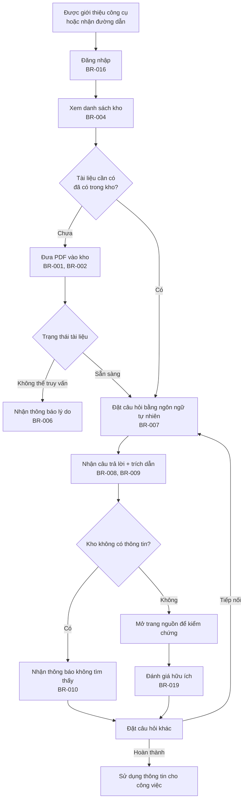

# Tài liệu Yêu cầu Sản phẩm (PRD) — Công cụ "Chat với tài liệu" (MVP)

> **Chuẩn áp dụng:** IEEE 29148-2018 · **Prompt nguồn:** `PRD_Prompt_IEEE_standard.md`
> **Nguồn đầu vào chính:** `BRD.md` (BRD-CWD-001, v0.1) — mọi mã BO / SN / BR / AC / OQ tham chiếu trong tài liệu này trỏ về BRD.
> **Quy ước:** **PHẢI** = *shall* (bắt buộc) · **NÊN** = *should* · **CÓ THỂ** = *may*. `[TBD: OQ-xxx]` = giá trị chưa có, đang chờ câu hỏi mở tương ứng.
> **Quy ước truy vết:** Nội dung được kế thừa trực tiếp từ BRD không ghi chú thêm. Nội dung PRD bổ sung (chi tiết hành vi, trạng thái lỗi, sự kiện analytics) được đánh dấu **[PRD đề xuất]** để review.

---

## 0. Kiểm định trụ cột sản phẩm

Prompt yêu cầu xác nhận các trụ cột UX/sản phẩm trước khi viết PRD. Kết quả đối chiếu với BRD:

| Trụ cột đề xuất | Kết quả | Căn cứ | Ghi chú |
|---|---|---|---|
| **Trả lời có nguồn kiểm chứng được** (citation-first) | **Giữ** — trụ cột cốt lõi | BR-009, BO-002, SN-003 | Mọi câu trả lời có nội dung phải chỉ ra tài liệu và trang. Đây là khác biệt chính so với tìm kiếm từ khóa thông thường. |
| **Không bịa khi kho thiếu thông tin** (grounded, abstain) | **Giữ** — trụ cột cốt lõi | BR-010, BRU-002, RSK-001 | Hệ thống phải nói rõ "không tìm thấy", không lấp đầy bằng kiến thức bên ngoài. |
| **Tối thiểu thao tác** (minimal inputs) | **Giữ** | SN-004, SN-001, CON-001 | Luồng cốt lõi chỉ gồm: đưa PDF vào → đặt câu hỏi. Không yêu cầu cấu hình để bắt đầu. |
| **Bảo mật theo quyền truy cập** | **Bổ sung** (không có trong prompt, lấy từ BRD) | BR-016, BR-017, BR-018, STK-005 | Đây là điều kiện có thể chặn triển khai, nên được coi là trụ cột, không phải tính năng phụ. |
| **Mobile-first** | **Không đưa vào MVP** | CON-002 (kênh là ứng dụng web), Phạm vi "Ngoài phạm vi" (không có ứng dụng di động bản địa) | Không mâu thuẫn trực tiếp nếu giao diện web đáp ứng được màn hình nhỏ, nhưng **không** phải tiêu chí thiết kế chính. **Đề xuất:** thiết kế ưu tiên màn hình máy tính; đáp ứng tối thiểu trên màn hình nhỏ. Cần xác nhận. |
| **Offline-capable** | **Loại bỏ** | CON-004 (câu trả lời do AI tạo ra), BR-007 (cần xử lý truy vấn) | Hỏi đáp cần kết nối tới dịch vụ AI, nên không thể hoạt động offline. Thay thế bằng hành vi xử lý mất kết nối tại §4.2. |

**Kết luận:** Ba trụ cột đầu được giữ. Bổ sung trụ cột bảo mật. Hai trụ cột "Mobile-first" và "Offline-capable" không phù hợp với phạm vi BRD; đề nghị thay bằng "Ưu tiên màn hình máy tính" và "Xử lý rõ ràng khi mất kết nối".

---

## 1. Tổng quan chiến lược

### 1.0 Thông tin sản phẩm

| Thuộc tính | Giá trị |
|---|---|
| Tên sản phẩm / tính năng | Chat với tài liệu (MVP) |
| Mã tài liệu | PRD-CWD-001 |
| Phiên bản | 0.1 (Draft) |
| Đối tượng người dùng chính | Đội phát triển kinh doanh của dự án (STK-002) |
| Vấn đề | Tri thức dự án nằm rải rác trong nhiều tệp PDF độc lập. Người dùng phải mở và tổng hợp thủ công để trả lời một câu hỏi nghiệp vụ. Mức thiệt hại về thời gian **chưa được đo** `[TBD: OQ-002]`. |
| Giải pháp cốt lõi | Đưa PDF vào một kho dùng chung, đặt câu hỏi bằng ngôn ngữ tự nhiên, nhận câu trả lời tổng hợp từ toàn bộ kho, kèm tài liệu và trang nguồn để kiểm chứng. |
| Kênh | Ứng dụng web nội bộ (CON-002) |
| Định dạng đầu vào | PDF (CON-003) |

### 1.1 Tầm nhìn sản phẩm

Trở thành lớp truy vấn tri thức chung cho tài liệu dự án kinh doanh: bất kỳ thành viên nào cũng có thể hỏi một câu và nhận được câu trả lời tổng hợp từ đúng các tài liệu có liên quan, mỗi ý đều có nguồn để kiểm chứng. Tầm nhìn này dài hạn; MVP chỉ chứng minh giá trị trên một kho tài liệu dự án và một nhóm người dùng nội bộ.

### 1.2 Mục tiêu và kết quả chính (OKRs)

Mục tiêu được lấy từ BO-001 đến BO-004. Các giá trị đích BA đề xuất để thảo luận, chờ sponsor xác nhận tại OQ-003 và OQ-011.

**O1 — Đội phát triển kinh doanh có câu trả lời nhanh hơn.** (BO-001)

| KR | Chỉ số | Baseline | Mục tiêu | Thời hạn |
|---|---|---|---|---|
| KR1.1 | MET-001: thời gian từ lúc bắt đầu tìm đến lúc có câu trả lời được chấp nhận, trên bộ câu hỏi chuẩn | `[TBD: OQ-002]` | Giảm ≥ 50% (BA đề xuất, OQ-003) | Khi nghiệm thu MVP |
| KR1.2 | Thời gian phản hồi p90 của một câu hỏi | Không áp dụng | `[TBD: OQ-011]` giây | Khi nghiệm thu MVP |

**O2 — Câu trả lời đủ đáng tin để dùng cho công việc.** (BO-002)

| KR | Chỉ số | Baseline | Mục tiêu | Thời hạn |
|---|---|---|---|---|
| KR2.1 | MET-002: tỷ lệ câu trả lời "đúng và đầy đủ" trên bộ câu hỏi chuẩn | Không áp dụng | ≥ `[TBD: OQ-011]`% | Mỗi đợt nghiệm thu |
| KR2.2 | MET-003: tỷ lệ câu trả lời có nội dung có trích dẫn đúng tài liệu và trang | Không áp dụng | ≥ 95% (BA đề xuất, AC-009) | Mỗi đợt nghiệm thu |
| KR2.3 | Tỷ lệ câu hỏi mà kho không có đáp án được trả lời "không tìm thấy" | Không áp dụng | ≥ 90% (BA đề xuất, AC-010) | Khi nghiệm thu MVP |

**O3 — Sponsor có đủ bằng chứng để quyết định đầu tư giai đoạn sau.** (BO-003)

| KR | Chỉ số | Baseline | Mục tiêu | Thời hạn |
|---|---|---|---|---|
| KR3.1 | MET-004: tỷ lệ người dùng hoạt động hằng tuần trên tổng người dùng mục tiêu | Không áp dụng | ≥ 60% (BA đề xuất, OQ-003). Mẫu số chờ `[TBD: OQ-012]` | 4 tuần sau triển khai |
| KR3.2 | MET-005: tỷ lệ đánh giá "hữu ích" trên tổng số đánh giá | Không áp dụng | ≥ 70% (BA đề xuất, OQ-003) | 4 tuần sau triển khai |

> Theo BRD §4.4, BO-001 và BO-003 **chưa là mục tiêu hợp lệ** cho tới khi baseline và target được điền. O1 và O3 chưa thể đánh giá cho tới khi đóng OQ-002 và OQ-003.

---

## 2. Persona người dùng và hành trình

### 2.1 Persona

**Persona chính — Chuyên viên phát triển kinh doanh (người hỏi đáp)**
- **Vai trò:** Thành viên đội phát triển kinh doanh (STK-002, SN-001 đến SN-008).
- **Bối cảnh:** Cần một thông tin nghiệp vụ trong dự án, nhưng không nhớ tài liệu nào chứa nó. Phải mở lần lượt nhiều PDF.
- **Mục tiêu:** Có câu trả lời đúng trong vài phút và biết chắc nguồn của nó.
- **Nỗi đau:** Mất thời gian tìm kiếm; phải tự ghép thông tin từ nhiều tệp; không tin được thông tin không rõ nguồn.
- **Mức kỹ thuật:** Dùng máy tính văn phòng và trình duyệt. Không cần kiến thức AI.
- **Hành vi cần hỗ trợ:** Đặt câu hỏi tiếp nối, kiểm tra trích dẫn, đánh giá câu trả lời.

**Persona thứ cấp — Người quản lý kho tài liệu (người đưa tài liệu vào)**
- **Vai trò:** Có thể là chính persona chính, hoặc một người được giao phụ trách kho (BRU-004).
- **Mục tiêu:** Đưa đúng tài liệu vào, gỡ tài liệu lỗi thời hoặc đưa nhầm, biết trạng thái của từng tài liệu.
- **Nỗi đau:** Không biết tài liệu nào đã sẵn sàng để hỏi; không chắc tài liệu nào không đọc được (ví dụ PDF ảnh scan).

**Persona phụ trợ — Sponsor / Quản lý (người đọc số liệu)**
- **Vai trò:** Quyết định đầu tư sau MVP (STK-001, SN-009). Không sử dụng hằng ngày.
- **Mục tiêu:** Có số liệu sử dụng và mức hữu ích để quyết định.
- **Tương tác với sản phẩm:** Gián tiếp, qua báo cáo tuần (BR-020).

**Persona ngoài phạm vi:** Người dùng ngoài tổ chức (khách hàng, đối tác) — không thuộc MVP (BRD §4.5).

### 2.2 Hành trình người dùng cấp cao

Hành trình từ lúc người dùng biết đến công cụ đến lúc hoàn thành mục tiêu chính (có câu trả lời được kiểm chứng).

**Điểm thành công của hành trình:** Người dùng mở trích dẫn (hoặc nhận thông báo không tìm thấy) và tiếp tục công việc, không phải mở lại tệp gốc để tìm từ đầu.

**Điểm rơi cần theo dõi (xem §5.2):** Bỏ dở ở bước đưa tài liệu vào (đặc biệt khi tài liệu không truy vấn được); bỏ dở ở bước đầu tiên của hỏi đáp; không mở trích dẫn nào.

---

## 3. Yêu cầu chức năng và câu chuyện người dùng

### 3.1 Ma trận epic

| Epic | Tên | Yêu cầu BRD | Mức ưu tiên tổng thể |
|---|---|---|---|
| E1 | Quản lý kho tài liệu | BR-001 đến BR-006 | P0 (trừ BR-002) |
| E2 | Hỏi đáp trên tài liệu | BR-007 đến BR-015 | P0 (trừ BR-013 đến BR-015) |
| E3 | Truy cập và bảo vệ thông tin | BR-016 đến BR-018 | P0 (trừ BR-018) |
| E4 | Đo lường giá trị MVP | BR-019, BR-020 | P0 (BR-020), P1 (BR-019) |
| E5 | Tính năng bổ sung do BA đề xuất | BR-021, BR-022 (BR-023 là Won't) | P2, **chờ xác nhận OQ-014** |

**Quy ước ưu tiên:** P0 = Must-have cho launch (BRD Must). P1 = nên có (BRD Should). P2 = mong muốn (BRD Could). BR-023 (BRD Won't) **không** có câu chuyện trong tài liệu này.

### 3.2 Epic E1 — Quản lý kho tài liệu

| ID | Câu chuyện | Ưu tiên | Truy vết |
|---|---|---|---|
| US-01 | As a chuyên viên phát triển kinh doanh, I want đưa một tệp PDF vào kho chung, so that nội dung của nó có thể được hỏi đáp. | **P0** | BR-001, AC-001 |
| US-02 | As a người quản lý kho, I want đưa nhiều tệp PDF cùng lúc, so that tôi nạp được bộ tài liệu ban đầu nhanh hơn. | P1 | BR-002, AC-002 |
| US-03 | As a chuyên viên phát triển kinh doanh, I want được báo ngay lý do khi tệp không hợp lệ, so that tôi biết cần sửa gì. | **P0** | BR-003, AC-003 |
| US-04 | As a chuyên viên phát triển kinh doanh, I want xem danh sách tài liệu trong kho kèm trạng thái, so that tôi biết kho đang có gì. | **P0** | BR-004, AC-004 |
| US-05 | As a người quản lý kho, I want gỡ một tài liệu khỏi kho, so that tài liệu lỗi thời hoặc đưa nhầm không còn được dùng để trả lời. | **P0** | BR-005, AC-005 |
| US-06 | As a người đưa tài liệu vào, I want biết khi một tài liệu không đọc được nội dung văn bản, so that tôi không tưởng nó đã được dùng để trả lời. | **P0** | BR-006, AC-006 |

**Acceptance Criteria — P0 (Given-When-Then)**

**US-01 — Đưa một PDF vào kho**
- **Given** người dùng đã đăng nhập và có quyền đưa tài liệu vào (BR-016), và tệp là PDF có lớp văn bản với kích thước trong giới hạn BRU-005,
- **When** người dùng chọn tệp và xác nhận đưa vào,
- **Then** tài liệu xuất hiện trong danh sách kho với trạng thái "Đang xử lý", và chuyển sang "Sẵn sàng" trong vòng `[TBD: OQ-011]` phút.
- **And** với 3 câu hỏi kiểm thử về nội dung ở trang đầu, trang giữa và trang cuối, câu trả lời đều trích dẫn đúng tài liệu đó.

**US-03 — Từ chối tệp không hợp lệ**
- **Given** người dùng đã đăng nhập,
- **When** người dùng đưa vào một tệp không phải PDF (ví dụ `.docx`, `.jpg`, hoặc tệp đổi đuôi thành `.pdf`),
- **Then** hệ thống không thêm tệp vào kho,
- **And** hiển thị thông báo nêu lý do từ chối (ví dụ "Tệp không phải PDF hợp lệ").

**US-04 — Xem danh sách kho**
- **Given** kho có ít nhất một tài liệu,
- **When** người dùng mở trang kho tài liệu,
- **Then** mỗi dòng hiển thị đủ bốn thông tin: tên tệp, người đưa vào, ngày đưa vào, trạng thái (Sẵn sàng / Đang xử lý / Không thể truy vấn).

**US-05 — Gỡ tài liệu**
- **Given** người dùng có quyền gỡ tài liệu theo BRU-004, và tài liệu X đang ở trong kho,
- **When** người dùng gỡ tài liệu X và xác nhận,
- **Then** X không còn trong danh sách kho,
- **And** một câu hỏi mà chỉ X chứa câu trả lời nhận kết quả "không tìm thấy" và không có trích dẫn nào tới X.
- **And** nếu người dùng không đủ quyền theo BRU-004, thao tác gỡ không khả dụng hoặc bị từ chối.

**US-06 — Tài liệu không thể truy vấn**
- **Given** người dùng vừa đưa vào một PDF chỉ chứa ảnh scan,
- **When** hệ thống xử lý xong tài liệu,
- **Then** tài liệu được gắn trạng thái "Không thể truy vấn", và người đưa vào nhận được thông báo nêu rõ tài liệu không thể dùng để trả lời,
- **And** không câu hỏi nào trích dẫn tới tài liệu này.

### 3.3 Epic E2 — Hỏi đáp trên tài liệu

| ID | Câu chuyện | Ưu tiên | Truy vết |
|---|---|---|---|
| US-07 | As a chuyên viên phát triển kinh doanh, I want đặt câu hỏi bằng ngôn ngữ tự nhiên, so that tôi nhận được thông tin mà không phải mở từng tệp PDF. | **P0** | BR-007, AC-007 |
| US-08 | As a chuyên viên phát triển kinh doanh, I want câu trả lời tổng hợp từ tất cả tài liệu liên quan, so that tôi không phải tự ghép thông tin từ nhiều nguồn. | **P0** | BR-008, AC-008 |
| US-09 | As a chuyên viên phát triển kinh doanh, I want biết tài liệu và số trang của từng thông tin trong câu trả lời, so that tôi tự kiểm chứng được. | **P0** | BR-009, AC-009 |
| US-10 | As a chuyên viên phát triển kinh doanh, I want được nói rõ khi kho không có thông tin, so that tôi không dùng nhầm một câu trả lời bịa. | **P0** | BR-010, AC-010 |
| US-11 | As a chuyên viên phát triển kinh doanh, I want nhận câu trả lời trong thời gian chấp nhận được, so that công cụ thực sự tiết kiệm thời gian. | **P0** | BR-011, AC-011 |
| US-12 | As a sponsor, I want câu trả lời đạt độ chính xác đã thống nhất, so that người dùng không quay lại cách làm thủ công. | **P0** | BR-012, AC-012 |
| US-13 | As a chuyên viên phát triển kinh doanh, I want đặt câu hỏi tiếp nối trong cùng cuộc hội thoại, so that tôi không phải nhắc lại ngữ cảnh. | P1 | BR-013, AC-013 |
| US-14 | As a chuyên viên phát triển kinh doanh, I want giới hạn câu hỏi vào một hoặc vài tài liệu tôi chọn, so that kết quả không bị lẫn nội dung không liên quan. | P1 | BR-014, AC-014 |
| US-15 | As a chuyên viên phát triển kinh doanh, I want xem lại các cuộc hội thoại trước của mình, so that tôi không hỏi lại câu đã có đáp án. | P1 | BR-015, AC-015 |

**Acceptance Criteria — P0 (Given-When-Then)**

**US-07 — Đặt câu hỏi**
- **Given** kho có ít nhất một tài liệu ở trạng thái "Sẵn sàng",
- **When** người dùng nhập một câu hỏi bằng ngôn ngữ tự nhiên trong các ngôn ngữ `[TBD: OQ-006]` và gửi,
- **Then** hệ thống trả về một câu trả lời dựa trên nội dung tài liệu trong kho,
- **And** 100% câu hỏi trong bộ chuẩn (DEP-003) nhận được câu trả lời hoặc thông báo "không tìm thấy", không câu nào bị lỗi hoặc không phản hồi.

**US-08 — Tổng hợp nhiều tài liệu**
- **Given** thông tin cần để trả lời nằm ở hai tài liệu trở lên trong kho,
- **When** người dùng đặt câu hỏi cần ghép thông tin từ các tài liệu đó,
- **Then** câu trả lời chứa thông tin từ tất cả tài liệu liên quan,
- **And** có trích dẫn tới từng tài liệu đó.
- **[PRD đề xuất, chờ kiểm chứng]** Tỷ lệ đạt được xác định theo bộ câu hỏi chuẩn có đánh dấu "cần ≥ 2 tài liệu" (AC-008, ngưỡng `[TBD: OQ-011]`).

**US-09 — Trích dẫn tài liệu và trang**
- **Given** một câu trả lời có nội dung,
- **When** người dùng xem câu trả lời,
- **Then** mỗi thông tin được sử dụng đi kèm tên tài liệu và số trang,
- **And** khi người dùng mở trích dẫn, trình xem hiển thị đúng trang chứa thông tin đó.

**US-10 — Không tìm thấy thông tin**
- **Given** kho không chứa thông tin trả lời được câu hỏi,
- **When** người dùng đặt câu hỏi đó,
- **Then** câu trả lời nói rõ là không tìm thấy thông tin trong tài liệu trong kho,
- **And** câu trả lời không chứa nội dung được suy đoán từ kiến thức bên ngoài.

**US-11 — Thời gian phản hồi**
- **Given** kho ở quy mô ASM-003 (vài chục đến vài trăm tài liệu),
- **When** người dùng gửi một câu hỏi trong bộ chuẩn,
- **Then** phân vị 90 của thời gian từ lúc gửi đến lúc hiển thị đầy đủ câu trả lời không vượt quá `[TBD: OQ-011]` giây.

**US-12 — Độ chính xác**
- **Given** bộ câu hỏi chuẩn ít nhất 30 câu (DEP-003),
- **When** chuyên gia nghiệp vụ chấm từng câu trả lời,
- **Then** tỷ lệ câu được chấm "đúng và đầy đủ" (MET-002) đạt ≥ `[TBD: OQ-011]`%.

### 3.4 Epic E3 — Truy cập và bảo vệ thông tin

| ID | Câu chuyện | Ưu tiên | Truy vết |
|---|---|---|---|
| US-16 | As a bộ phận bảo mật thông tin, I want chỉ người được cấp quyền mới truy cập được kho và hỏi đáp, so that tài liệu nội bộ không bị lộ. | **P0** | BR-016, AC-016 |
| US-17 | As a bộ phận bảo mật thông tin, I want nội dung tài liệu chỉ được xử lý bởi các bên đã được phê duyệt, so that tuân thủ chính sách dùng dịch vụ AI. | **P0** | BR-017, AC-017 |
| US-18 | As a bộ phận bảo mật thông tin, I want nhật ký đưa vào và gỡ tài liệu, so that điều tra được khi có sự cố. | P1 | BR-018, AC-018 |

**Acceptance Criteria — P0 (Given-When-Then)**

**US-16 — Kiểm soát truy cập**
- **Given** người dùng chưa được cấp quyền,
- **When** người dùng cố xem danh sách tài liệu, đưa tài liệu vào, hoặc đặt câu hỏi,
- **Then** cả ba thao tác đều bị từ chối, và không có nội dung tài liệu nào được hiển thị.

**US-17 — Bên xử lý được phê duyệt**
- **Given** bộ phận bảo mật thông tin đã ký văn bản chấp thuận danh sách bên xử lý và lưu trữ nội dung tài liệu,
- **When** hệ thống được triển khai,
- **Then** cấu hình triển khai chỉ sử dụng các bên nằm trong danh sách đó.
- **Ghi chú:** Đây là điều kiện nghiệm thu bằng kiểm tra (Inspection), không phải tính năng người dùng nhìn thấy. Phụ thuộc DEP-001 và `[TBD: OQ-008]`.

### 3.5 Epic E4 — Đo lường giá trị MVP

| ID | Câu chuyện | Ưu tiên | Truy vết |
|---|---|---|---|
| US-19 | As a chuyên viên phát triển kinh doanh, I want đánh giá từng câu trả lời là "hữu ích" hoặc "không hữu ích", so that đội đo được mức hữu ích thực tế. | P1 | BR-019, AC-019 |
| US-20 | As a sponsor, I want số câu hỏi và số người dùng hoạt động theo tuần, so that tôi có dữ liệu quyết định đầu tư. | **P0** | BR-020, AC-020 |

**Acceptance Criteria — P0 (Given-When-Then)**

**US-20 — Báo cáo sử dụng hằng tuần**
- **Given** MVP đang vận hành và có một kịch bản kiểm thử với số người và số câu hỏi đã biết trước,
- **When** kết thúc tuần kiểm thử,
- **Then** báo cáo tuần ghi đúng số câu hỏi và số người dùng hoạt động (người đặt ít nhất một câu hỏi trong tuần).

### 3.6 Epic E5 — Tính năng bổ sung do BA đề xuất (chờ OQ-014)

Các mục dưới đây **không thuộc cam kết** cho đến khi sponsor chấp nhận (OQ-014, RSK-007). Không đưa vào kế hoạch sprint nếu chưa có quyết định.

| ID | Câu chuyện | Ưu tiên | Truy vết | Trạng thái |
|---|---|---|---|---|
| US-21 | As a chuyên viên phát triển kinh doanh, I want yêu cầu bản tóm tắt nội dung chính của một tài liệu, so that tôi nắm nhanh tài liệu mới. | P2 | BR-021, AC-021 | Chờ OQ-014 |
| US-22 | As a chuyên viên phát triển kinh doanh, I want nhận gợi ý câu hỏi cho từng tài liệu, so that người mới biết bắt đầu từ đâu. | P2 | BR-022, AC-022 | Chờ OQ-014 |

**Ngoài bản phát hành này:** BR-023 (xuất câu trả lời và trích dẫn ra tệp, BRD Won't). Được xem xét lại khi lập kế hoạch giai đoạn 2.

**Acceptance criteria cho P2 (tham khảo, chưa bắt buộc):**
- US-21: Với 3 tài liệu mẫu, đại diện đội phát triển kinh doanh xác nhận bản tóm tắt nêu đúng ít nhất 80% ý chính trong danh sách họ lập trước.
- US-22: Với 3 tài liệu mẫu, mỗi tài liệu có ít nhất 3 câu hỏi gợi ý, và 100% câu hỏi gợi ý trả lời được từ chính tài liệu đó.

### 3.7 Quy tắc nghiệp vụ áp dụng cho chức năng

Các quy tắc sau áp dụng xuyên suốt các epic (chi tiết tại BRD §4.8):

| ID | Quy tắc | Ảnh hưởng tới chức năng |
|---|---|---|
| BRU-001 | Chỉ PDF được chấp nhận | US-01, US-03 |
| BRU-002 | Câu trả lời chỉ dựa trên nội dung trong kho; không bổ sung kiến thức bên ngoài như thể là nội dung tài liệu | US-07, US-10. Chờ xác nhận OQ-014 |
| BRU-003 | Người đưa tài liệu vào chịu trách nhiệm về quyền chia sẻ tài liệu đó | US-01. Quy trình xác nhận do bộ phận bảo mật thông tin quyết định |
| BRU-004 | Chỉ người đưa vào và/hoặc quản trị viên (`[TBD: OQ-010]`) được gỡ tài liệu | US-05 |
| BRU-005 | Giới hạn kích thước (MB), số trang và tổng số tài liệu `[TBD: OQ-005]` | US-01, US-11 |
| BRU-006 | Hội thoại và tài liệu được lưu giữ trong `[TBD: OQ-013]`, hết hạn thì xóa | US-15 |

---

## 4. Yêu cầu giao diện và trải nghiệm người dùng

### 4.1 Cấu trúc màn hình và logic luồng chính

Phần này mô tả kỳ vọng về bố cục và tương tác quan trọng. **Wireframe chi tiết thuộc phạm vi đội Design** và phải được review với các tiêu chí dưới đây.

**Màn hình A — Kho tài liệu**
- Bảng danh sách với các cột: tên tệp, người đưa vào, ngày đưa vào, trạng thái (US-04).
- Nút "Đưa PDF vào kho" luôn hiển thị ở vị trí dễ thấy. Hỗ trợ chọn nhiều tệp cùng lúc (US-02, P1).
- Trạng thái dùng nhãn chữ, không chỉ dùng màu: "Sẵn sàng", "Đang xử lý", "Không thể truy vấn".
- Thao tác gỡ nằm trong menu của từng dòng, chỉ hiển thị với người có quyền (US-05). Luôn có xác nhận trước khi gỡ.

**Màn hình B — Hỏi đáp**
- Ô nhập câu hỏi cố định ở phía dưới, luôn sẵn sàng sau khi tải xong.
- Bộ chọn phạm vi tài liệu ở phía trên ô nhập: mặc định là "Toàn bộ kho"; người dùng có thể chọn một hoặc nhiều tài liệu (US-14, P1).
- Mỗi câu trả lời hiển thị: nội dung, danh sách trích dẫn (tên tài liệu + số trang) đặt ngay dưới câu trả lời, và nút đánh giá "Hữu ích / Không hữu ích" (US-19, P1).
- Trích dẫn là phần tử bấm được. Bấm mở **Màn hình C** tại đúng trang.
- Khi kho không có thông tin, câu trả lời hiển thị thông báo "không tìm thấy" có cấu trúc riêng, không trình bày như một câu trả lời thông thường (US-10).
- Danh sách cuộc hội thoại trước của chính người dùng nằm ở thanh bên (US-15, P1). Chỉ hiển thị hội thoại của chính người dùng đó.

**Màn hình C — Xem nguồn**
- Mở tài liệu đúng trang được trích dẫn, đánh dấu vùng nội dung được dùng khi có thể.
- Có nút quay lại Màn hình B mà không mất câu hỏi đang nhập.

**Luồng chính cần giữ liền mạch**
1. Người dùng đặt câu hỏi ở Màn hình B.
2. Trong lúc chờ, hiển thị trạng thái đang xử lý, không khóa toàn màn hình.
3. Câu trả lời xuất hiện kèm trích dẫn.
4. Người dùng bấm trích dẫn để kiểm chứng, rồi quay lại và tiếp tục hỏi tiếp trong cùng hội thoại (US-13, P1).

**Nguyên tắc tương tác [PRD đề xuất]:**
- Không hiển thị câu trả lời mà không có trích dẫn, trừ khi đó là thông báo "không tìm thấy".
- Câu hỏi đang nhập không bị mất khi chuyển màn hình hoặc khi gặp lỗi.
- Trạng thái tài liệu được cập nhật mà không cần tải lại trang.

### 4.2 Trường hợp biên và trạng thái lỗi

| # | Tình huống | Hành vi hệ thống yêu cầu | Truy vết / Nguồn |
|---|---|---|---|
| E-01 | Mất kết nối khi đang tải tệp lên | Hủy lần tải, không để lại tài liệu dở dang trong kho. Hiển thị nút thử lại. | **[PRD đề xuất]** |
| E-02 | Mất kết nối khi đang xử lý tài liệu (sau khi tải lên xong) | Tài liệu giữ trạng thái "Đang xử lý" và tự tiếp tục khi có kết nối lại. Không hiển thị "Sẵn sàng" trước khi xử lý xong. | **[PRD đề xuất]** |
| E-03 | Mất kết nối khi đang gửi câu hỏi | Giữ nguyên nội dung câu hỏi trong ô nhập. Khi có kết nối lại, người dùng có thể gửi lại. Không được tạo hai bản ghi câu hỏi cho cùng một lần gửi. | **[PRD đề xuất]** |
| E-04 | Mất kết nối sau khi đã gửi câu hỏi, khi câu trả lời chưa về | Hiển thị "Chưa nhận được câu trả lời". Khi có kết nối lại, nếu câu trả lời đã được lưu thì hiển thị; nếu chưa, cho phép thử lại. | **[PRD đề xuất]** |
| E-05 | Kho trống (chưa có tài liệu nào) | Trang hỏi đáp hiển thị hướng dẫn "Đưa tài liệu vào kho trước khi đặt câu hỏi" kèm liên kết tới Màn hình A. Ô nhập bị vô hiệu hóa. | **[PRD đề xuất]** |
| E-06 | Kho có tài liệu nhưng không có tài liệu nào ở trạng thái "Sẵn sàng" | Tương tự E-05, thông báo rõ có bao nhiêu tài liệu đang xử lý hoặc không thể truy vấn. | **[PRD đề xuất]** |
| E-07 | Tệp không phải PDF hoặc PDF bị hỏng | Từ chối, nêu lý do cụ thể (không phải PDF / PDF không mở được). | BR-003, US-03 |
| E-08 | PDF ảnh scan (không có lớp văn bản) | Gắn trạng thái "Không thể truy vấn", thông báo cho người đưa vào. Không trích dẫn tài liệu này. | BR-006, US-06 |
| E-09 | Tệp vượt giới hạn kích thước hoặc số trang | Từ chối, nêu rõ giới hạn đã vượt. Giá trị giới hạn chờ `[TBD: OQ-005]`. | BRU-005 |
| E-10 | Kho đã đạt giới hạn số tài liệu | Từ chối tài liệu mới, nêu rõ kho đã đầy. Giới hạn chờ `[TBD: OQ-005]`. | BRU-005 |
| E-11 | Hai người cùng đưa một tệp trùng nội dung | Cho phép hoặc cảnh báo trùng. Quyết định cần chốt trước khi phát triển. | **[PRD đề xuất, cần OQ mới]** |
| E-12 | Tài liệu bị gỡ trong lúc một câu hỏi đang được xử lý | Câu trả lời không được trích dẫn tài liệu đã gỡ. Nếu không còn nội dung nào khác, trả về "không tìm thấy". | BR-005, AC-005 |
| E-13 | Câu hỏi rỗng hoặc chỉ có khoảng trắng | Không gửi. Hiển thị gợi ý nhập câu hỏi. | **[PRD đề xuất]** |
| E-14 | Câu hỏi quá dài | Giới hạn độ dài với thông báo rõ ràng, số ký tự tối đa chờ quyết định. | **[PRD đề xuất]** |
| E-15 | Câu hỏi mơ hồ, không đủ ngữ cảnh | Yêu cầu người dùng làm rõ thay vì đoán. Không trả lời bằng nội dung suy đoán. | BRU-002, RSK-001 |
| E-16 | Câu hỏi bằng ngôn ngữ ngoài phạm vi `[TBD: OQ-006]` | Vẫn trả lời nếu có thể, nhưng không cam kết chất lượng. Hoặc từ chối nhẹ nhàng. Quyết định chờ OQ-006. | BR-007 |
| E-17 | Dịch vụ AI không khả dụng hoặc quá thời gian | Hiển thị lỗi rõ ràng, không hiển thị câu trả lời một phần, không tạo câu trả lời thay thế. Ghi nhận sự kiện lỗi (§5.2). | CON-004, RSK-001 |
| E-18 | Câu trả lời có nội dung nhưng không tìm được trích dẫn đáng tin | Không hiển thị câu trả lời như đã được kiểm chứng. Hiển thị thông báo không tìm thấy hoặc chú thích rõ rằng trích dẫn chưa xác minh được. | BR-009, BR-010 |
| E-19 | Người dùng không có quyền mở một trích dẫn cũ | Không hiển thị nội dung; thông báo không đủ quyền. | BR-016 |
| E-20 | Phiên đăng nhập hết hạn giữa chừng | Giữ nội dung câu hỏi đang nhập; yêu cầu đăng nhập lại và không hiển thị dữ liệu trước khi xác thực. | BR-016 |
| E-21 | Người dùng gửi nhiều câu hỏi liên tiếp rất nhanh | Xếp hàng và trả lời theo thứ tự. Không gộp hai câu trả lời vào một khung. | **[PRD đề xuất]** |
| E-22 | Thời gian phản hồi vượt ngưỡng BR-011 | Hiển thị trạng thái đang xử lý kéo dài và cho phép hủy. Ghi nhận sự kiện để đo (§5.2). | BR-011 |

---

## 5. Tiêu chí phát hành và chỉ số sau triển khai

### 5.1 Tiêu chí cổng phát hành (Launch Gate)

MVP chỉ được đưa vào production khi **tất cả** các điều kiện sau đạt.

**A. Tiêu chí chức năng**
- [ ] 100% user story P0 (US-01, US-03 đến US-07, US-08 đến US-12, US-16, US-17, US-20) có kết quả kiểm thử đạt theo Given-When-Then.
- [ ] US-02, US-13 đến US-15, US-18, US-19 (P1): đã kiểm thử; nếu chưa đạt, phải có quyết định chấp nhận bằng văn bản của sponsor để đưa sang bản sau.
- [ ] US-21, US-22 (P2): không nằm trong điều kiện bắt buộc; phụ thuộc OQ-014.

**B. Tiêu chí chất lượng câu trả lời (sau khi đóng OQ-011)**
- [ ] MET-002 đạt ≥ `[TBD: OQ-011]`% trên bộ câu hỏi chuẩn (≥ 30 câu, DEP-003), chấm bởi chuyên gia nghiệp vụ.
- [ ] MET-003 đạt ≥ 95% (ngưỡng BA đề xuất).
- [ ] ≥ 90% câu hỏi có đáp án "không có" được trả lời "không tìm thấy" (AC-010).
- [ ] Không có câu trả lời bịa được phát hiện trong bộ kiểm thử đối kháng. Bộ kiểm thử này do QA lập, cần ghi trong kế hoạch kiểm thử.

**C. Tiêu chí hiệu năng**
- [ ] Phân vị 90 thời gian phản hồi ≤ `[TBD: OQ-011]` giây ở quy mô ASM-003.
- [ ] Thời gian đưa tài liệu sang "Sẵn sàng" ≤ `[TBD: OQ-011]` phút cho bộ PDF mẫu (DEP-004).
- [ ] Trang kho tài liệu và trang hỏi đáp tải xong trong thời gian `[TBD: OQ-011]` giây trên mạng nội bộ. *[PRD đề xuất, chưa có trong BRD]*

**D. Tiêu chí bảo mật**
- [ ] Kiểm thử truy cập (US-16): 3/3 thao tác bị từ chối với người chưa được cấp quyền.
- [ ] Kiểm thử gỡ tài liệu (US-05): người không đủ quyền không gỡ được.
- [ ] Văn bản chấp thuận của bộ phận bảo mật thông tin đã ký cho danh sách bên xử lý (US-17, DEP-001). **Đây là điều kiện chặn phát hành.**
- [ ] Nhật ký đưa vào và gỡ tài liệu đạt đủ bản ghi, đúng người, đúng thao tác, đúng thời điểm (AC-018, nếu US-18 thuộc bản phát hành).
- [ ] Không có lỗi bảo mật mức Cao hoặc Nghiêm trọng còn mở khi phát hành.

**E. Độ phủ QA**
- [ ] Mỗi BR (BR-001 đến BR-020) có ít nhất một ca kiểm thử, truy vết trong ma trận kiểm thử.
- [ ] Mỗi trường hợp biên E-01 đến E-22 có ít nhất một ca kiểm thử, hoặc có lý do miễn trừ được ghi nhận.
- [ ] Phương pháp kiểm chứng được thực hiện đúng theo BRD (Test / Demonstration / Inspection / Analysis).

**F. Điều kiện nghiệp vụ và tài liệu**
- [ ] Các câu hỏi mở chặn triển khai được đóng: OQ-002, OQ-008, OQ-011 (theo điều kiện đề xuất trong BRD §4.14).
- [ ] Phỏng vấn người dùng cuối xác nhận các nhu cầu SN-001 đến SN-008 (OQ-016).
- [ ] Người phê duyệt đã ký (BRD §4.14).
- [ ] Tài liệu được đặt trong `./docs` và có bản PDF cho người phê duyệt (CON-005).
- [ ] Tài liệu đạt ít nhất 3 lớp thấp nhất của tháp chất lượng (CON-006).

### 5.2 Phân tích và theo dõi sự kiện

**Nguyên tắc đo lường:**
- Mỗi sự kiện có định danh cố định, không đổi tên sau khi phát hành.
- **Không ghi nội dung tài liệu hoặc nội dung câu hỏi vào payload analytics.** Nội dung hội thoại chỉ được lưu trong lịch sử hội thoại theo BRU-006 và chỉ người dùng đó xem được (BR-015). Sự kiện analytics chỉ mang định danh, thời gian, mã kết quả.
- Mọi sự kiện đều gắn định danh người dùng (đã băm hoặc nội bộ) để tính MET-004.
- Sự kiện dùng để tính MET-001 đến MET-005 và phục vụ BR-018 (nhật ký).

**A. Sự kiện theo luồng kho tài liệu (E1)**

| Sự kiện | Kích hoạt khi | Thuộc tính | Dùng cho |
|---|---|---|---|
| `doc_upload_started` | Người dùng bắt đầu tải một hoặc nhiều tệp | user_id, số tệp, thời điểm | Funnel, BR-002 |
| `doc_upload_rejected` | Tệp bị từ chối | user_id, lý do (`not_pdf`, `too_large`, `too_many_pages`, `corrupt`, `kho_full`) | BR-003, RSK-003 |
| `doc_added` | Tài liệu được thêm vào kho | user_id, doc_id, số trang, kích thước (MB), thời gian xử lý | BR-001, BR-018, MET-004 |
| `doc_status_changed` | Trạng thái chuyển sang "Sẵn sàng" hoặc "Không thể truy vấn" | doc_id, trạng thái mới, thời gian chuyển | AC-001, AC-006, RSK-003 |
| `doc_removed` | Tài liệu được gỡ | user_id, doc_id, thời điểm | BR-005, BR-018 |

**B. Sự kiện theo luồng hỏi đáp (E2)**

| Sự kiện | Kích hoạt khi | Thuộc tính | Dùng cho |
|---|---|---|---|
| `question_submitted` | Người dùng gửi câu hỏi | user_id, conversation_id, số tài liệu trong phạm vi, có phải câu hỏi tiếp nối hay không | MET-004, BR-013, BR-014 |
| `answer_returned` | Câu trả lời được hiển thị đầy đủ | conversation_id, latency_ms, số trích dẫn, cờ `not_found` (true/false) | MET-001, BR-011, BR-010 |
| `answer_error` | Câu trả lời không hoàn thành | conversation_id, mã lỗi (`ai_unavailable`, `timeout`, `network`) | E-17, E-22 |
| `citation_opened` | Người dùng mở một trích dẫn | conversation_id, doc_id, số trang, thời gian ở trang | MET-003, BR-009 |
| `scope_selected` | Người dùng chọn phạm vi tài liệu cụ thể | số tài liệu được chọn | BR-014 |
| `conversation_viewed` | Người dùng mở lại một hội thoại cũ | user_id, conversation_id, tuổi hội thoại (ngày) | BR-015 |

**C. Sự kiện đánh giá và đo lường giá trị (E4)**

| Sự kiện | Kích hoạt khi | Thuộc tính | Dùng cho |
|---|---|---|---|
| `answer_feedback` | Người dùng bấm "Hữu ích" hoặc "Không hữu ích" | user_id, conversation_id, giá trị (`helpful` / `not_helpful`) | MET-005, BR-019 |
| `session_started` | Người dùng đăng nhập thành công | user_id, thời điểm | MET-004, funnel |
| `auth_denied` | Truy cập bị từ chối do thiếu quyền | user_id hoặc định danh thiết bị, màn hình | BR-016, MET-006 |

**D. Phễu chuyển đổi (funnel) cần theo dõi**

1. `session_started` → 2. `doc_upload_started` (hoặc `conversation_viewed`) → 3. `doc_added` → 4. `doc_status_changed` (Sẵn sàng) → 5. `question_submitted` → 6. `answer_returned` → 7. `citation_opened` hoặc `answer_feedback`.

**Các điểm rơi cần theo dõi:**
- Bước 2 → 3: tỷ lệ tải lên bị từ chối (`doc_upload_rejected`). Nếu cao, kiểm tra RSK-003 và E-08.
- Bước 3 → 4: tỷ lệ tài liệu chuyển sang "Không thể truy vấn". Nếu cao, kiểm tra ASM-001.
- Bước 5 → 6: tỷ lệ câu hỏi không có câu trả lời hoàn chỉnh (`answer_error`). Nếu cao, kiểm tra E-17.
- Bước 6 → 7: tỷ lệ câu trả lời không được mở trích dẫn hoặc đánh giá. Nếu cao, câu trả lời có thể không đáng tin hoặc không được dùng (RSK-006).

**Chỉ số tổng hợp hằng tuần (báo cáo BR-020):**
- Số câu hỏi (`question_submitted`).
- Số người dùng hoạt động (có ít nhất một `question_submitted` trong tuần).
- MET-004 = người dùng hoạt động ÷ người dùng mục tiêu `[TBD: OQ-012]`.
- MET-005 = `answer_feedback` có giá trị `helpful` ÷ tổng `answer_feedback`.
- MET-001 được đo bằng bấm giờ có quan sát trên bộ câu hỏi chuẩn (≥ 3 người dùng), không lấy từ analytics. Analytics chỉ bổ sung cho MET-001 bằng `answer_returned.latency_ms` (đo độ trễ hệ thống, không phải thời gian tìm kiếm của người dùng).

**Chỉ số an toàn (MET-006):** đếm sự cố xác nhận từ nhật ký BR-018 và báo cáo sự cố. Không tính từ analytics.

---

## 6. Câu hỏi mở và quyết định cần có trước khi phát triển

PRD này kế thừa toàn bộ câu hỏi mở từ BRD §4.12. Các mục dưới đây là **những câu hỏi chặn phát triển** theo thứ tự ưu tiên:

| Mã | Câu hỏi | Chặn | Chủ sở hữu (theo BRD) |
|---|---|---|---|
| OQ-008 | Có được gửi nội dung tài liệu tới dịch vụ AI bên ngoài không, và với điều kiện gì? | Toàn bộ kiến trúc; US-17 | STK-005 |
| OQ-011 | Ngưỡng thời gian phản hồi, độ chính xác, thời gian xử lý tài liệu | Tiêu chí nghiệm thu US-01, US-11, US-12 | STK-001 + STK-002 |
| OQ-005 | Giới hạn kích thước, số trang, tổng số tài liệu | E-09, E-10 | STK-002 |
| OQ-006 | Ngôn ngữ tài liệu và câu hỏi | US-07, E-16 | STK-002 |
| OQ-009 | Kho dùng chung hay phân tách theo dự án/người dùng | Mô hình truy cập (US-16) | STK-001 |
| OQ-010 | Ai được gỡ tài liệu | US-05 | STK-001 |
| OQ-015 | Đăng nhập bằng tài khoản công ty sẵn có không? | US-16, E-20 | STK-001 + STK-005 |
| OQ-014 | Sponsor có chấp nhận các tính năng BA đề xuất không? | Phạm vi E5, US-13 đến US-15, US-19, US-21, US-22 | STK-001 |
| OQ-013 | Thời gian lưu giữ tài liệu và hội thoại | US-15, BRU-006 | STK-005 |

**Câu hỏi mới do PRD phát sinh (cần thêm vào BRD khi review):**
- **Q-P01:** Có cho phép tải trùng tài liệu (E-11) không, và xử lý thế nào?
- **Q-P02:** Giới hạn độ dài câu hỏi (E-14) là bao nhiêu ký tự?
- **Q-P03:** Có cần hiển thị trích dẫn theo vùng nội dung trên trang (US-09) trong MVP, hay chỉ cần số trang?
- **Q-P04:** Xác nhận trụ cột "Ưu tiên màn hình máy tính" thay cho "Mobile-first" (§0).

---

## 7. Thuật ngữ

Thuật ngữ đầy đủ tại BRD §4.13. Bổ sung cho PRD:

| Thuật ngữ | Định nghĩa |
|---|---|
| Câu chuyện người dùng (User story) | Mô tả một nhu cầu theo cú pháp "As a / I want / so that" |
| Given-When-Then | Cấu trúc kiểm thử hành vi: điều kiện đầu, hành động, kết quả mong đợi |
| Trích dẫn (citation) | Tên tài liệu và số trang chứa thông tin được dùng trong câu trả lời; là phần tử bấm được |
| Trạng thái tài liệu | Một trong ba giá trị: "Đang xử lý", "Sẵn sàng", "Không thể truy vấn" |
| Hội thoại | Chuỗi câu hỏi và câu trả lời của một người dùng, nhóm theo một `conversation_id` |
| Người dùng hoạt động | Người dùng có ít nhất một câu hỏi trong tuần đo |
| Phễu chuyển đổi (funnel) | Chuỗi sự kiện theo thứ tự để đo tỷ lệ người dùng đi từ bước này sang bước kế tiếp |

---

## 8. Truy vết tổng hợp

| Mục tiêu (PRD) | Nhu cầu (BRD) | Yêu cầu (BRD) | Câu chuyện (PRD) | Sự kiện đo (PRD) |
|---|---|---|---|---|
| O1 / BO-001 | SN-001, SN-002, SN-004, SN-006, SN-007 | BR-001, BR-002, BR-004, BR-007, BR-008, BR-011, BR-013, BR-015 | US-01, US-02, US-04, US-07, US-08, US-11, US-13, US-15 | `doc_added`, `answer_returned`, `question_submitted` |
| O2 / BO-002 | SN-003, SN-005, SN-008, SN-010 | BR-003, BR-006, BR-009, BR-010, BR-012, BR-014 | US-03, US-06, US-09, US-10, US-12, US-14 | `citation_opened`, `answer_returned` (cờ `not_found`), `doc_status_changed` |
| O3 / BO-003 | SN-009 | BR-019, BR-020 | US-19, US-20 | `answer_feedback`, `session_started`, `question_submitted` |
| BO-004 | SN-010 | BR-005, BR-016, BR-017, BR-018 | US-05, US-16, US-17, US-18 | `doc_removed`, `auth_denied` |
| Bổ sung (chờ OQ-014) | SN-006, SN-001 | BR-021, BR-022 | US-21, US-22 | Chưa định nghĩa (chờ quyết định) |

**Lưu ý:** Mọi mục có `[TBD]` vẫn chưa thể nghiệm thu. Trạng thái tài liệu này là **Draft v0.1**, dùng cho vòng review với sponsor, đội phát triển kinh doanh, đội kỹ thuật và bộ phận bảo mật thông tin. Chưa phải baseline để phát triển.
